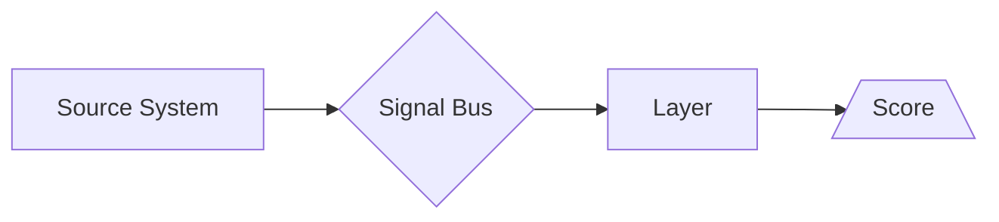

# Development Guide

## Overview

This guide provides comprehensive information for developers working on the Gelatinous MUD project. It covers our development philosophy, coding standards, contribution guidelines, and best practices for maintaining the codebase.

## Development Philosophy

### Core Principles

**1. Roleplay-First Design**
- Every feature should enhance storytelling and character interaction
- Combat serves the narrative, not vice versa
- Player agency and meaningful choices are paramount
- Default to non-violent resolution when possible

**2. Evennia-Native Development**
- Leverage Evennia's built-in tools and patterns
- Follow platform conventions for Scripts, Handlers, and Commands
- Use Evennia's typeclass system effectively
- Maintain compatibility with Evennia's core functionality

**3. Clean Architecture**
- Modular design with clear separation of concerns
- Python best practices throughout the codebase
- Predictable structure for AI-assisted development
- Open source community standards

### Decision-Making Priority Order

When making technical decisions, follow this priority hierarchy:

1. **Python Best Practices** - Clean, readable, maintainable code
2. **Evennia Best Practices** - Platform-native development patterns
3. **AI-Driven Development** - Predictable structure for AI assistance
4. **Open Source Community** - Easy contribution and understanding

## Code Standards

### Python Coding Standards

**PEP 8 Compliance**
- Use 4 spaces for indentation (no tabs)
- Line length maximum of 88 characters (Black formatter standard)
- Use descriptive variable and function names
- Follow Python naming conventions (snake_case, PascalCase, etc.)

**Documentation Requirements**
```python
def example_function(param1: str, param2: int) -> bool:
    """
    Brief description of what the function does.
    
    Args:
        param1: Description of first parameter
        param2: Description of second parameter
        
    Returns:
        Description of return value
        
    Raises:
        ExceptionType: Description of when this exception is raised
    """
    pass
```

**Type Hints**
- Use type hints on new functions: parameters and return values
- Import types from `typing` module when needed
- Use `Optional` for parameters that can be None
- Document complex types clearly

### Diagrams in Specs

Use [Mermaid](https://mermaid.js.org/) (`` ```mermaid `` code fences) for all architectural, flow, sequence, and state diagrams. GitHub renders these natively.

**Use Mermaid for:**
- Architecture overviews, system flowcharts, state machines
- Data flow diagrams, dependency graphs, timelines/Gantt charts
- Sequence diagrams showing component interactions

**Keep plain code fences for:**
- In-game UI mockups (terminal output, ASCII art the player sees)
- Object hierarchy / data structure illustrations with attribute annotations
- Directory tree listings



### Constants and Magic Numbers

**Constants System**
- All magic strings and numbers must be defined in appropriate constants files
- Use descriptive names that indicate purpose and context
- Group related constants together
- Include comments explaining non-obvious values

```python
# world/combat/constants.py
MSG_ATTACK_WHO = "Attack who?"
MSG_GRAPPLE_WHO = "Grapple whom?"
DEFAULT_GRIT = 1
FALL_EDGE_DIFFICULTY_DEFAULT = 8
```

**Avoiding Magic Numbers**
```python
# Bad
if roll_result >= 8:
    success = True

# Good
if roll_result >= constants.FALL_EDGE_DIFFICULTY_DEFAULT:
    success = True
```

### Error Handling

**Error Handling**
- Catch the specific exceptions an operation can raise, and let the unexpected surface
- A broad `except Exception` is only for a boundary where a failure in something optional must not break the thing that matters; mark it `# noqa: BLE001` with the reason on the same line (see `AGENTS.md`, Project Conventions)
- Log what was caught with enough context to find it
- Provide meaningful error messages to users

```python
from world.combat.constants import DEBUG_ERROR, DEBUG_TEMPLATE
from world.combat.debug import log_debug

try:
    result = risky_operation()
except SpecificException as e:
    log_debug(DEBUG_TEMPLATE, DEBUG_ERROR, f"Operation failed: {e}")
    caller.msg("Something went wrong. Please try again.")
    return False
```

**Debug Logging**
- Use consistent debug prefixes for different systems
- Include relevant context in log messages
- Keep `SPLATTERCAST_LIVE` off in production; the combat audit log itself is always on

### Utility Functions

**Reusable Code**
- Extract common operations into utility functions
- Use the existing `world.combat.utils` module
- Create new utility modules for non-combat systems
- Document utility functions thoroughly

```python
# world/combat/utils.py
def get_numeric_stat(character, stat_name: str, default: int = 1) -> int:
    """
    Safely retrieve a numeric stat from a character.
    
    Args:
        character: The character object
        stat_name: Name of the stat to retrieve
        default: Default value if stat is invalid
        
    Returns:
        The stat value as an integer
    """
    stat_value = getattr(character, stat_name, default)
    return stat_value if isinstance(stat_value, (int, float)) else default
```

## Module Organization

### Combat Commands Structure

**File Organization**

`commands/combat/README.md` lists the command modules and what each one holds.

**Command Class Structure**
```python
class CmdExample(Command):
    """
    Brief description of what the command does.
    
    Usage:
        example <target>
        example/option <target>
    
    This command allows players to...
    """
    
    key = "example"
    aliases = ["ex"]
    locks = "cmd:all()"
    help_category = "Combat"
    
    def func(self):
        """Main command logic."""
        # Input validation
        if not self.args:
            self.caller.msg(constants.MSG_EXAMPLE_NO_TARGET)
            return
            
        # Business logic
        target = self.caller.search(self.args.strip())
        if not target:
            return
            
        # Execute action
        result = self.execute_example_action(target)
        
        # Provide feedback
        self.caller.msg(f"You example {target}.")
    
    def execute_example_action(self, target):
        """Separate business logic for testability."""
        # Actual implementation here
        pass
```

### World Systems Structure

**Combat System Organization**

The File → Concept Map in `AGENTS.md` says which module of `world/combat/` holds what.

**Handler Pattern**
```python
class CombatHandler(DefaultScript):
    """
    Main combat handler following Evennia Script pattern.
    
    Manages combat state, turn processing, and cleanup.
    """
    
    def at_script_creation(self):
        """Initialize combat handler."""
        super().at_script_creation()
        # Setup code here
        
    def at_repeat(self):
        """Process combat turns."""
        # Main combat loop
        
    def at_stop(self):
        """Clean up when combat ends."""
        # Cleanup code here
```

## Testing Guidelines

### Unit Testing

**Test Structure**
```python
# world/tests/test_combat_utils.py
import unittest
from unittest.mock import Mock, patch
from world.combat.utils import get_numeric_stat

class TestCombatUtils(unittest.TestCase):
    def setUp(self):
        """Set up test fixtures."""
        self.mock_character = Mock()
        
    def test_get_numeric_stat_valid(self):
        """Test retrieving valid numeric stat."""
        self.mock_character.grit = 5
        result = get_numeric_stat(self.mock_character, "grit")
        self.assertEqual(result, 5)
        
    def test_get_numeric_stat_invalid(self):
        """Test retrieving invalid stat returns default."""
        self.mock_character.grit = "invalid"
        result = get_numeric_stat(self.mock_character, "grit", default=1)
        self.assertEqual(result, 1)
```

**Which Base Class**
- Pure logic with mocks, as above: `unittest.TestCase`
- Anything that creates or saves an object, account or script: `EvenniaTest` (or `django.test.TestCase`), which undoes its writes after each test. A plain `unittest.TestCase` does not: rows it writes stay for the rest of the run

**Test Coverage**
- Aim for >80% test coverage on critical systems
- Test both success and failure paths
- Mock external dependencies appropriately
- Write integration tests for complex workflows

### Manual Testing

**Test Scenarios**
- Create comprehensive test scenarios for combat features
- Test edge cases and error conditions
- Test with multiple players and complex scenarios

## Contribution Guidelines

### Pull Request Process

**Before Submitting**
1. Ensure all tests pass
2. Update documentation for any changes
3. Follow the established code style
4. Add appropriate debug logging
5. When something is moved or renamed, repoint every caller and delete the old name in the same PR: no aliases, wrappers or compatibility shims

**Pull Request Description**
- Clearly describe what the PR does
- Explain why the change is needed
- List any breaking changes
- Include testing instructions
- Reference the issue it closes (`Closes #N`)

### Code Review Standards

**Review Checklist**
- [ ] Code follows established patterns
- [ ] Documentation is updated
- [ ] Tests are included and passing
- [ ] Error handling is appropriate
- [ ] Constants are used instead of magic values
- [ ] Utility functions are leveraged where appropriate

## Debugging and Troubleshooting

### Debug Infrastructure

**Logging System**
```python
from world.combat.constants import DEBUG_PREFIX_ATTACK, DEBUG_SUCCESS
from world.combat.debug import log_combat_action, log_debug

# Both write to server/logs/combat_audit.log. There are no log levels.
log_combat_action(caller, "attack", target=target, success=True, details="hit for 4")
log_debug(DEBUG_PREFIX_ATTACK, DEBUG_SUCCESS, "resolved against cover", character=caller)
```

**Debug Prefixes**
- Use consistent prefixes for different systems
- Include relevant context in debug messages
- Make debug messages searchable and filterable

### Common Issues and Solutions

**Stale NDB State**
- Problem: An `ndb` attribute set by one action is still there when the next one runs
- Solution: Delete it when the action ends (`delattr(obj.ndb, name)`), as most of the code does
- Best Practice: Always validate NDB state before use

**SaverList Corruption**
- Problem: SaverList objects becoming corrupted
- Solution: Use defensive copying and validation

**Handler Cleanup**
- Problem: Combat handlers not cleaning up properly
- Solution: Implement comprehensive cleanup in `at_stop()` method
- Best Practice: Use try-finally blocks for critical cleanup

## Performance Considerations

### Optimization Guidelines

**Efficient Algorithms**
- Avoid O(n²) operations in combat processing
- Use appropriate data structures for the task
- Cache expensive calculations when possible
- Minimize database queries in tight loops

**Memory Management**
- Clean up temporary objects promptly
- Use weak references where appropriate
- Avoid deep copying large data structures
- Monitor memory usage during development

### Monitoring and Profiling

Measure when there is a question to answer, and take the measurement out once it is answered. Diagnostic instrumentation is not left running in the game.

## Future Development

Plans are not kept in this guide. What is built and in what order is in `specs/roadmaps/`; proposals are in `specs/proposals/`. `WORKFLOW.md` says which document may claim what.

## Resources and References

### Evennia Documentation
- [Evennia Official Documentation](https://www.evennia.com/docs/)
- [Evennia Command System](https://www.evennia.com/docs/latest/Components/Commands.html)
- [Evennia Scripts](https://www.evennia.com/docs/latest/Components/Scripts.html)

### Python Resources
- [PEP 8 Style Guide](https://peps.python.org/pep-0008/)
- [Python Type Hints](https://docs.python.org/3/library/typing.html)
- [Python Testing](https://docs.python.org/3/library/unittest.html)

### Project-Specific Documentation
- `README.md` - Project overview, architecture, and feature summary
- `AGENTS.md` - Agent operational reference: conventions, deploy workflow, file map
- `WORKFLOW.md` - Specs, roadmaps and issues: how work is classified, labelled and tracked
- `specs/COMBAT_SYSTEM.md` - Combat system documentation
- Module-specific README files

---

*This development guide is a living document that evolves with the project. When in doubt, follow the established patterns and ask for clarification. The goal is to maintain high code quality while preserving the project's roleplay-first philosophy.*
