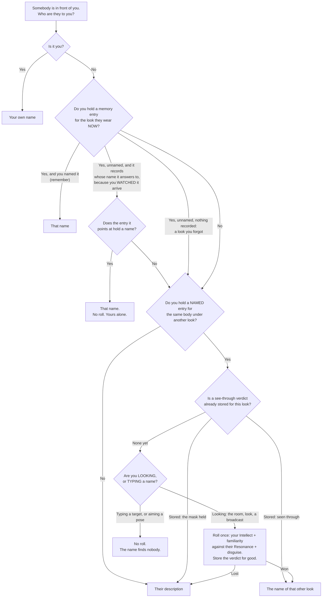

# Identity & Recognition System Specification

## Overview

Characters are seen by strangers through a **sleeve-based recognition system**, not by their `key` (real name). A stranger is seen by a short physical description (sdesc). An observer gives a name to a look with `remember`, and from then on sees that name. The memory is per observer. Cybernetic memory (cyberbrain, digital ID) is meant to plug into the same model later.

Identity and recognition are the base for **memory**, **forensics**, **social deception**, **communication** and **posing**. Every NPC takes full part: all Characters have brains with recognition memory.

### Design Principles

1. **Physical identity** — Recognition is based on the physical sleeve (body), not consciousness. Same body = same recognition across clones.
2. **Unique by default** — The sdesc uses enough physical traits and visible state to make characters distinguishable most of the time without effort.
3. **Obscurable with effort** — Characters can obscure their identity, but only if they are meticulous. Half-measures leave tells.
4. **Per-observer truth** — Every character in a room may know other characters by different names. Messages render per observer.
5. **RAG-ready memory** — Recognition entries are rich documents with temporal, spatial and contextual metadata, designed for future retrieval-augmented generation.
6. **Generic grammar** — The grammar engine serves identity now and posing too. It is built generic. See `EMOTE_POSE_SPEC.md` for the canonical grammar engine specification.

---

## Owner rulings

The decisions this system rests on, in the owner's words, newest last. Each row names the issue that carried the decision and the section of this document that states the rule. A ruling whose behaviour is not built yet is marked 📋 UNBUILT here and again where the rule is stated. Add a row when a ruling is made, in the pull request that records or builds it.

| Date | The owner's words | The rule | Issue | Stated in |
|---|---|---|---|---|
| 2026-11-13 | "Yes, and it's specific to that person. We already have code for this, I believe. It's our 'Scooby doo' system." | Somebody who watches a look change goes on knowing who it is. Per viewer. | #3811 | Recognition System, "A name is read through what you watched" |
| 2026-11-14 | "Your version is correct and was the original intent." | Two names are joined only by a change the observer watched, a see-through they won, or papers. Never because the game knows they are one body. | #3813 | Recognition System, the table of what writes each kind of knowledge |
| 2026-11-14 | "I don't think that's a feature we need at this time." | Staff reaching somebody by real name are shown no notice that the privilege was used. | #3818 | Target Resolution, "Who is staff, and what they are told" |
| 2026-11-14 | "A body without a head is hard to identify. A head on its own is easy to identify but can also still be concealed by a mask." | Identity is in the face. A mask conceals wherever the face is: a living body, a corpse with its head, a severed head. A body without its head is recognised by nobody at a glance. Identity counts what a body is shown wearing. | #3831, #3832, #3834 | Identity Across Surfaces, "What a body wears, for identity" |
| 2026-11-14 | "I mean...is someone really dying if there head is missing? They should be a corpse." | A beheading is a death, not a dying. The body becomes a corpse at once: no death window, no revival. A destroyed brain, the other case #330 listed, keeps its window by an earlier ruling (#3248, 2026-09-26: "Death with a window"). | #3835, #330 | Identity Across Surfaces, "What a body wears, for identity" |
| 2026-11-14 | "If the game still uses it - it doesn't seem like they've been actually forgotten. What if someones memory is blanked out by a machine or a bioroid hacked." | `forget` is a real erase of a look from one observer: the entry, every pointer and link to it, the voice entry that carries its name, and see-throughs won through it. Only what the observer connected, nothing because the game knows two things are one body. The one thing kept is the record of a failed see-through roll, which is not memory but the rule that a lost roll cannot be bought again. A later memory-wipe mechanic calls the same function. | #3825 | Recognition System, the `forget` command |
| 2026-11-15 | "This should be identical to what a player loses. Their behavior is ideally identical to avoid cheating/hacking." | An AI NPC that forgets somebody loses what a player loses. What it wrote down for itself about the forgotten looks and voices goes at the same door: the names it knew them by, what was said between them, and the conversation thread. | #3841 | Recognition System, the `forget` command; `NPC_MEMORY_AND_IDENTITY_SPEC.md` §5b |
| 2026-11-15 | "They should. That's just Scooby-doo but backwards. We already account for that with someone living, don't we?" | Somebody who watches a corpse or a severed head being dressed or stripped goes on knowing whose it is, as a witness to a living change does. So does whoever does it. | #3833 | Identity Across Surfaces, "What a body wears, for identity" |
| 2026-11-16 | "I concur with your recommendation." (The recommendation: "the read goes too. An NPC that is still told why it dislikes somebody has not forgotten them [...] Its general mood stays, because that is not filed under anybody.") | When an AI NPC forgets somebody, its read on them goes with the looks that were erased: the score and the reason behind it. Its general mood stays. | #3851 | `NPC_MEMORY_AND_IDENTITY_SPEC.md` §5b |
| 2026-11-16 | "Yeah, your assessment is solid." (Asked with three cases of an NPC that knows a person, is hit by that person in a mask, and is then made to forget the person: it watched the mask go on; it saw through the mask; it has a name of its own for the masked figure. "Do you agree with changing case 2 and leaving case 3?") | When an AI NPC forgets somebody, a look it has no name of its own for and knows only because it saw through it to that person goes too, with everything recorded under it, as a look it watched arrive already does. A look it has given a name of its own stays, and its read on that look stays with it, whenever it was earned. What it wrote down while it still called that look by the forgotten name goes, as it did before (#3841). | #3859 | Recognition System, the `forget` command; `NPC_MEMORY_AND_IDENTITY_SPEC.md` §5b |
| 2026-11-16 | "You recommendation is fine." (Asked with an NPC that hears an unfamiliar voice on the radio, later learns a person's name and voice, then recognises the unfamiliar voice as theirs, and is then made to forget the person. What it noted after recognising the voice already went. "Do you want the second row changed as I recommended, or parked until memory wipes exist in play?" The second row: what it noted before it recognised the voice goes too.) | When an AI NPC forgets somebody, what it noted from a voice before it recognised that voice as theirs goes too, as what it noted afterwards already did. (As built: a voice the NPC holds no entry for, whose stored recognition goes with the name, is reported to it as forgotten. A voice that has an entry of its own is not reported. That second sentence is what the code does, by analogy with a look, #3859; the owner was not asked it.) | #3861 | Recognition System, the `forget` command; `NPC_MEMORY_AND_IDENTITY_SPEC.md` §5b |

What is not ruled yet is listed under "Not decided" near the end of this document.

Other rulings, beside their rules below:

- 2026-09-16, #3575: severed parts are corpse fragments (Combat-Driven Severance, "Severed parts are corpse fragments").
- 2026-09-16, #3578: a severed part wears its clothes, "just like it does on a character, mixing the worn descs and longdesc where appropriate." (Surgical Sever, "Severed-item rendering").
- 2026-09-17, #3577: garments travel with a severed part on every door, "Why would we ignore a living decapitation?" (Surgical Sever, "Severed-item rendering").
- 2026-09-17, #3602: dressing a part fits the cluster it carries, "goggles being refused seems like a gap since its coverage locations would be on the head" (Surgical Sever, "Severed-item rendering").
- 2026-09-17: a style changed on a part is a non-issue (Surgical Sever, "Severed-item rendering").
- 2026-09-26, #3248: "Death with a window"; "Conscious capacity 0 should not be death" (Memory Architecture).

---

## Core Concepts

### Sleeve

A physical body. Each sleeve has inherent, observable physical traits (height, build, sex) and a unique `sleeve_uid` (UUID). Flash clones are physically identical and inherit the same `sleeve_uid`. A sleeve's identity is what others see, not what consciousness inhabits it.

### Short Description (sdesc)

What strangers see instead of a name. Composed from observable physical traits:

```
"a {physical_descriptor} {keyword} {distinguishing_feature}"
```

- **Physical descriptor** — derived from height × build (immutable without a new sleeve)
- **Keyword** — player-selected via `describe keyword`, gender-gated
- **Distinguishing feature** — derived from visible state: wielded weapon / explosive > clothing > hair > nothing

Skintone is deliberately excluded from the sdesc. It appears only in the longdesc when someone `look`s at the character directly.

### Recognition

A per-character memory mapping, stored as the `recognition_memory` `AttributeProperty` on the Character (see §Memory Architecture): "I know the person with this Apparent UID as [name], and here is everything I remember about them." When you see someone whose current Apparent UID is in your memory with a name, you see that name. Otherwise you see their sdesc (subject to the witness link and see-through, §Who is this to me?). Because the Apparent UID is derived from the target's full identity signature (real sleeve, active overrides, essential items), the same body can produce different recognition entries under different disguises (§Memory Data Model).

### Apparent Identity

What the recognition pipeline resolves against. Three concepts work together:

1. **Identity Signature** — a tuple of all observable identity inputs: real `sleeve_uid` (the body's salt), active presentation overrides (height, build, keyword), and the sorted set of equipped essential disguise item types. It is recomputed on access from current state.
2. **Apparent UID** — a deterministic 16-character hex digest of the identity signature (`blake2b(signature_bytes, digest_size=8).hexdigest()`). This is the **key** recognition memory is stored under. Same signature → same UID → auto-recognition; any signature change → new UID → observers see a stranger, unless they watched the change (§Unmasking Moments).
3. **Persona** — a player-private label for a remembered combination of overrides. Personas do **not** generate UIDs; they are recall aids. Adopting a persona restores its captured overrides, which then flow through the signature → UID pipeline like any other state.

The sdesc is overridable through `appear`, but the distinguishing feature always reflects actual visible state: true disguise requires changing your clothes (or destroying / acquiring essential items).

The same body can carry two named entries in one observer's memory, one per look: a bare face named "Bruce" and a costumed look named "Batman", each found by hashing the signature the body wears at that moment. A stranger with no entries sees the sdesc either way.

### Identity Across Surfaces (Propagation Rule)

When a body is transformed (death, decapitation, limb severance, organ harvest, blood spilled, future cyberware harvested), whether the result carries identity is decided by one rule with one exception.

**Default — forensic chain only.** Every body-derived surface carries `apparent_uid_at_death` and `source_signature` stamped at the moment of transformation. Investigators reach the original character through `autopsy`, `sever`, blood-pool extraction, or any future tracing surface. Look-time recognition ("this is someone I know") does NOT fire for these: there is no face to recognise. Applies to: severed limbs (`Appendage`), harvested organs (`Organ`), blood pools, future cyberware items, and any future scene-attribution surface (graffiti spray, fingerprints, etc.).

**Exception — the head carries the face.** `SeveredHead` is the only surface that propagates face-side identity (`sleeve_uid` + the identity-signature axes a face contributes to) alongside the forensic chain. Look-time recognition fires on a severed head as it does on a live body: an observer who remembers the source character sees the assigned name; a stranger sees the head's sdesc. The body, after decapitation, falls back to forensic-only: `Corpse.recognised_as` names nobody for a corpse whose anatomy shows the head gone (`_is_headless`), because the face left with the head.

**Why this is the only rule needed.** A corpse with an intact head is the live-body case continuing after death: face still visible, recognition still fires until decay obscures it. A corpse with a severed head is the default case (forensic-only), with the head as a separate carrier of face-side identity. No other transformation propagates a face: limbs, organs, blood and a prosthetic arm have none.

**What a body wears, for identity.** A mask conceals a body only while it is over the face. For a living body, a corpse and a severed head alike, the disguise items identity counts are the ones the body is *shown* wearing: the record the description, `undress` and the sever travel rule read (`worn_garments()`). The identity signature asks through `get_worn_items()` and keeps the disguise-essential items. On a living body that method returns everything worn and the signature does the narrowing (`get_essential_item_type_ids`); on a corpse and a severed head it returns the disguise-essential part of `worn_garments()`. Either way the signature counts the disguise items the body is shown wearing, and no others.

- **A mask in a corpse's pocket conceals nothing** (#3831). The death transfer moves the whole inventory into the corpse; only what was worn, or has been put on since with `dress`, is worn. Taking a carried mask out leaves the death-time snapshot alone; taking a worn one off clears it.
- **A mask on a severed head conceals it** (#3832). One worn at the cut goes with the head, and `dress <head> in <item>` fits one on. The head presents the masked look until the mask is taken off.
- **A body without its head is recognised by nobody at a glance**, in its header and in any description text that names the dead. `Corpse.recognised_as` is the one gate for both; the `{name}` token of a preserved description reads "the corpse" (#3834).
- **A beheading is a death, not a dying** (#3835). The body becomes a corpse as soon as the death curtain has told the room the cause: no death window, no revival check, no dying messages (`typeclasses.death_progression.complete_a_beheading`, with the script's next tick as the backstop). For the seconds before that, with the head off, the body names nobody: `world.identity.has_no_face` and `get_recognisable_uid` are what the readers of a living body's name ask: the name the room shows, the name that can be typed, `remember`, `forget`, `recall`, the see-through roll, and the two places that note a sighting (the recency written on walking in, and lost-contact marking). Systems that key something else by a look (trust grants, stealth, cameras, an NPC's conversation thread) read `get_apparent_uid` and are not gated. The line that takes the head off is sent before the head leaves and still names whose it is. The record keeps the look (`get_apparent_uid`), so an autopsy still finds out who a headless body was. "Head off" is read from the anatomy, with `db.head_severed_at_decap` only as the cheap first question: an essential NPC resleeved in the same body has its head back. `reset_body_preserving_augments`, the door that gives a body its flesh back, clears the flag (and `decapitation_pending` with it, so a reset in the middle of a beheading is a revival and not a second head), because the anatomy cannot be trusted there: severing marks chrome in the head as severed too, and a resleeve carries chrome across as it was. `remove_death_state` clears it for any other revival once the anatomy agrees.
- **Somebody who watches remains being dressed or stripped keeps the name** (#3833), as a witness to a living change does (#3811). The name after a corpse or a head is read through `witnessed_from` like any other. Three doors write it, each wrapping what it does in `world.identity.apply_remains_change`: `dress <corpse or head> in <item>`, `undress <corpse or head>`, and `get <item> from <corpse or head>`.
  - *Who watched:* everybody in the room who can see, whoever does it included. Remains in somebody's hand are watched from the room the holder stands in.
  - *What they must have known:* the remains' own answer, asked before the change the way a look asks it (`recognised_as`). A body without its head, a skeleton, or a decayed body the observer cannot work out names nobody, so watching a mask go onto it gives them nothing, whatever their memory holds for the face. On a body a day or more dead the answer is the observer's one roll, made then if they had not made it: watching is looking. `dress` and `undress` make that roll for every bystander, by naming the remains to each of them in their own line before the garment moves, and whoever does the dressing makes it here; asking the same way is what makes `get ... from` agree with them. Nobody is asked when the thing moved is no part of a disguise: lifting a wallet off a body changes no look.
  - *What is written:* the eyewitness rule and nothing else of the living hook (`_keep_knowing`). Whoever held a name for the remains, and holds none for the look that arrived, has that look point at the entry the name is on. No line is sent; the room's line is the command's own, and `get ... from` sends its line once memories are settled.
  - *A decayed body:* the roll that works out whose it is is filed under the body's look, and taking a worn mask off starts a new slot. A watcher who had worked the body out keeps their roll for the look that arrives (`world.forensics.carry_forensic_roll`). A roll that failed is not carried: somebody who could not work the body out examines the look that arrives afresh, as for any changed look.
  - *What it lets somebody do on purpose:* what the living rule already lets them do with a captive. A look learned at remains is the look of that body in that mask, and a person brought back in the same body (a resleeve keeps the `sleeve_uid`) wears the same looks. Somebody who has the corpse of a person they know can put a mask on it and will know that person in that kind of mask afterwards. Overrides (`appear`) and other items still make a different look.

**When the rule will need a second exception.** A future "face-overlay" cyberware item, a synthetic mask that lets the wearer adopt someone else's apparent identity, would carry face-side identity *the wearer presents*, not the wearer's own: a face not tied to a sleeve, just worn. Mechanically it slots into the overlay machinery `apply_severed_head_overlay` uses; design-wise it is a separate conversation about disguise, consent and the identity-signature pipeline. Until it exists, the head stays the only exception.

**Practical consequence for new surfaces.** Adding a body-derived surface means stamping `apparent_uid_at_death` and `source_signature` at the transformation event. No identity-pipeline change, no recognition-system change, no `_resolve_target` change. Whether the new surface should *also* take part in surgical / identity-pipeline target resolution (as `Corpse` does and `Appendage` deliberately does not, §Target Resolution, "Detached-parts filter") is a separate flag question, not an identity question.

---

## Short Description (sdesc) System

### Composition

```
article + physical_descriptor + keyword + distinguishing_feature
```

Examples:
- `"a lanky man in a leather jacket"`
- `"a compact woman with blonde braids"`
- `"a heavyset droog in red power armor"`
- `"a diminutive kid"`
- `"an athletic dame with cropped white hair"`
- `"a towering bloke in a torn lab coat"`

The article (`a` / `an`) is chosen by the grammar engine from the first phoneme of the physical descriptor. A disguise adjective, when one applies, sits between the descriptor and the keyword (§Disguise Adjective).

### Physical Descriptor Table

Derived from the cross-product of height and build. Players select height and build at character creation; the descriptor is derived (`get_physical_descriptor(height, build)`) and cannot be set directly.

**Heights**: short, below-average, average, above-average, tall
**Builds**: slight, lean, athletic, average, stocky, heavyset

| | slight | lean | athletic | average | stocky | heavyset |
|---|---|---|---|---|---|---|
| **short** | diminutive | wiry | compact | short | squat | rotund |
| **below-avg** | slight | lithe | spry | unassuming | stout | portly |
| **average** | slender | lean | athletic | average | stocky | heavyset |
| **above-avg** | willowy | rangy | strapping | tall | brawny | hulking |
| **tall** | lanky | gaunt | towering | tall | burly | massive |

30 unique descriptors. They are setting-neutral and describe observable silhouette.

### Keyword List

Players select their keyword via `describe keyword`. Keywords are gender-gated: feminine-presenting and gender-neutral keywords are available to female characters, masculine-presenting and gender-neutral to male characters, and all three lists to a character of neutral gender. The `appear` command allows **any keyword from the full catalog** regardless of the character's gender: a male character can disguise as a "woman" and vice versa. This is available to all characters, not restricted by access level.

The catalog is read at runtime from `ServerConfig` keys `identity.feminine_keywords` / `identity.masculine_keywords` / `identity.neutral_keywords`, falling back to the `_DEFAULT_FEMININE_KEYWORDS` / `_DEFAULT_MASCULINE_KEYWORDS` / `_DEFAULT_NEUTRAL_KEYWORDS` frozensets in `world/identity.py` when a key is unset. The defaults:

**Feminine-presenting (24):**
female, girl, lass, woman, matron, grandma, hag, granny, madam, tomboy, chick, gal, chica, vixen, diva, dame, sheila, mona, bimbo, bitch, lady, senorita, chola, devotchka

**Masculine-presenting (23):**
male, boy, lad, man, patron, grandpa, geezer, gramps, gentleman, guy, fellow, dude, playa, pimp, bloke, bruce, mano, bro, douche, stiff, hombre, cholo, droog

**Gender-neutral (24):**
person, kid, urchin, human, citizen, elder, fossil, fleshbag, denizen, neut, snack, walker, chum, charmer, star, mate, smoker, meatsicle, punk, clone, wageslave, baka, androog, suit

A character with no keyword set uses a gender default (`DEFAULT_SDESC_KEYWORDS[gender]`: `"man"` / `"woman"` / `"person"`), applied lazily in `Character.get_sdesc()`.

### Distinguishing Feature Derivation

The distinguishing feature is the final clause of the sdesc. It is **always derived** from the character's actual visible state; players cannot set it. The sdesc is therefore always truthful to what observers can see.

**Priority order:** wielded weapon / explosive > clothing > hair > nothing

#### Weapon-based Feature

A held **weapon or explosive** outranks clothing and hair: what someone is brandishing is the most salient thing about them. "Weapon" means an item carrying the `("weapon", "type")` tag (the weapon-base prototypes), **not** `db.weapon_type` (which defaults to `"melee"` on every item, so a cigarette, lighter or tool in hand does NOT dominate; it falls through to the garment). Explosives (`db.is_explosive`) also dominate.

Format: `"wielding {article} {weapon}"`, e.g. `"wielding a kitchen knife"`.

**Deployed cyberweapons dominate too.** An integrated weapon (arm-shotgun) sits in the `hands` dict while deployed, so it is picked here naturally; an active natural weapon (claws) lives off-grid and is checked explicitly via `get_active_natural_weapons`. Either way a deployed cyberweapon carries normal weapon weight in the sdesc while staying out of the "holding" list (it is part of the body; see `AUGMENT_ABILITIES_SPEC`).

#### Clothing-based Feature

The system picks one worn item (`Character.get_distinguishing_feature`):
1. The coverage map gives the outermost item at each body location.
2. Non-disguise items are preferred (below).
3. Of those, the item at the alphabetically first body location is used. Coverage size and the order things were put on are not read.

Format: `"in {article} {item_sdesc}"`, e.g. `"in a leather jacket"`, `"in red power armor"`, `"in a tattered lab coat"`.

Items use a `worn_sdesc_short` attribute for this clause: a brief, recognizable noun phrase. When unset, the selector falls back to the item's `key`. Plural-only nouns take no article (`_PLURALIA_TANTUM_NOUNS`; `mirrorshades` reads `"in mirrorshades"`). Every disguise prototype's `worn_sdesc_short` produces a grammatical `format_clothing_feature` clause.

**Disguise items are deprioritised.** When a wearer has any non-disguise clothing, the selector partitions the worn items and prefers the non-disguise pool. The disguise pool is consulted only when nothing else is worn (the *naked-but-masked* carve-out): a lone balaclava still yields `"a tall lean masked droog in a black balaclava"`. When real clothing is added, the feature shifts to that clothing and the balaclava's contribution falls back to the disguise adjective only (§Disguise Adjective): `"a tall lean masked droog in a black trenchcoat"`. An item flagged `disguise_silent_feature` is never the feature clause; it still counts in the identity signature. Its one user is `COLORED_CONTACTS`: contacts sit on the eye, so observers register eye colour rather than "person in colored contacts". The flag is the extension point for other sub-visible items (dental prosthetics, scent maskers). It is independent of `disguise_adjective` and of `"hair"` in a coverage list.

#### Hair-based Feature

If no clothing provides a feature (nude, very minimal clothing), the system falls back to hair.

Format: `"with {color} {style}"`, e.g. `"with red dreadlocks"`, `"with cropped white hair"`, `"with long black braids"`.

If the character is bald or has no hair attribute set, this is skipped.

Head coverings suppress the hair fallback by listing `"hair"` in their `coverage` list, the same clothing-coverage vocabulary that governs longdesc / wound / scar visibility. When `"hair"` appears in the wearer's coverage map, the chain falls through to "no feature" rather than describing hair the observer cannot see. There is no separate `covers_hair` flag (#176). `"hair"` is a body location in `DEFAULT_LONGDESC_LOCATIONS` and leads the head region of `ANATOMICAL_DISPLAY_ORDER`, which is ordered by organic recognition: hair, then eyes, then the head and face, then ears and neck (#238). Other suppression (a mask over the face) follows from coverage lists the same way; no parallel flags.

#### No Feature

With no visible clothing and no visible hair (bald + nude, or fully concealed), the sdesc has no feature clause:

```
"a lanky man"
"a compact woman"
```

This makes the character harder to distinguish, which is realistic.

### Hair Attributes

Two attributes selected at character creation, stored as `AttributeProperty`s in the `identity` category (read `char.hair_color`; `db.hair_color` reads `None`):

- **`hair_color`** — e.g. "red", "black", "blonde", "white", "brown", "gray", "blue", "green", "pink", "purple", "silver", "auburn" (or None/bald)
- **`hair_style`** — e.g. "cropped", "short", "long", "braided", "dreaded", "mohawk", "ponytail", "shaved sides", "curly", "straight", "matted", "slicked" (or None/bald)

Combined for display: `"{hair_color} {hair_style} hair"` → `"red dreaded hair"`, or shorthand like `"red dreadlocks"`. A small mapping table can give natural-sounding combinations (e.g. "dreaded" + color → `"{color} dreadlocks"`).

### `describe keyword` Command

```
describe keyword <word>
```

Changes the player's keyword only. A word on the list for the character's gender is accepted. A catalog word gated to another gender is refused. Any other word is checked as a custom keyword (`validate_custom_keyword`); if it passes, it is accepted and logged as a `KeywordEvent` (`event_type="custom_set"`). Custom keywords are alpha-only. The physical descriptor and distinguishing feature cannot be set this way; they reflect reality.

The keyword is also editable from the interactive `describe` editor (bare `describe` → item `2 Keyword`), which presents the gender-gated catalog as a selectable list. `describe keyword <word>` is the only path for **custom** (off-catalog) keywords (it replaced the standalone `@shortdesc`, #276).

```
> describe keyword droog
Changed keyword from man to droog.
You now appear as: lanky droog in a leather jacket
```

---

## Recognition System

### Who is this to me? One answer for the eye and the keyboard

Every surface that names a person to an observer asks the same question and gets the same answer (#3811): the room listing and every broadcast (`Character.get_display_name`), the `look` header (`get_look_header`), a typed name (`world.search`), and a name a dot-pose is aimed at (`world.emote`). Two open defects are known exceptions: a corpse or a severed head rolls even when asked with `decided_only` (#3849), and a head cut from a body that died under an `appear` disguise is a stranger to whoever watched it come off (#3848).



`Character.get_display_name` (`typeclasses/characters.py`) runs this order: a name held for the look (`get_assigned_name`, which follows `witnessed_from`), then the see-through (a roll, or only a stored verdict when `decided_only` is set), then the sdesc with its article. For the looker themselves it returns `self.key`. Self-perception ("You") is **not** returned by `get_display_name`; it is handled at the rendering layer (§Grammar Engine, "Self-Perception"). There is no staff overlay (§Unbuilt, "Staff Vision").

What writes each thing the chart reads:

| the chart reads | written by | cleared by |
|---|---|---|
| a name on a look | `remember <them> as <name>` | `forget` |
| whose name a look answers to because you watched it arrive (`witnessed_from`, on the entry for that look; it holds the uid of the NAMED entry, which is the look that went only when that look carried the name itself) | being in the room, conscious, able to see and perceiving them, when their look changes, if you held a name for the look that went (§Unmasking Moments); and being in the room, able to see, when a corpse or a severed head you were shown a name for is dressed or stripped (#3833; Identity Across Surfaces, "What a body wears, for identity") | `forget`: the entry that carried the name is erased, and the pointer is cleared on every entry that pointed at it (#3825) |
| the link (`linked_to`) | the same hook; also `remember` on a look you have SEEN THROUGH (it links to the entry you saw through to, #3813), and matching papers | `forget`, on every entry that pointed at the erased one (#3825). It is not read for a name. `recall` and an NPC's memories use it to hold several names for one person together |
| a see-through verdict (`disguise_pierce_cache`) | the first time you LOOK at a look you hold no name for (no entry, or an entry that leads to none), on a body you have named under another (§Disguise Piercing) | `forget`, for a WON verdict that stands on the name being forgotten; one that stands on another name you hold for the same body stays, and a lost one always stays (#3817, #3825) |

Two rules fall out of it, and both were owner rulings on 2026-11-13:

- **An eyewitness goes on knowing them.** Asked whether somebody who watches a person they know put on a mask goes on knowing them: "Yes, and it's specific to that person." The witness link carries the name, with no roll, and only for the observer who holds the link. Somebody who walks in afterwards has no entry for the look and takes the see-through branch.
- **A name on your screen is a name you can type.** A typed name reads a stored verdict and never makes one. A verdict only ever comes from looking, so a name becomes typeable exactly when it has been shown, and trying names teaches nothing about who is under a mask.

**A name is read through what you watched, not through the link.** `linked_to` is not evidence that anybody watched anything: `remember` links a newly named look to the entry you saw through to (before #3813 it linked any entry for the same body), papers link two faces, and older memories still hold blank entries left by the `forget` of before #3825. So the unmasking hook records a second thing beside it, `witnessed_from`: the entry whose name this look answers to because you watched it arrive. The name walk follows that and nothing else. `linked_to` is never read for a name. Memories written before #3811 have no `witnessed_from` and are not read this way; an eyewitness from before it stands where everybody else does, at the roll, until they watch the change again.

**One rule, applied after the cells, decides who goes on knowing (`_keep_knowing`).** If the observer held a name for the look that has just gone, by any route (its own name, a name read through `witnessed_from`, or a stored see-through), and holds none for the look that has arrived once the cell has done its work, the arriving look's `witnessed_from` is set to the entry that name is stored on. An entry is made for the arriving look if the cell made none, which is the case of somebody who had only seen through the old look; that one entry also takes the same `linked_to`. The cells ask what entries an observer holds. The ruling is about what they know, and the two came apart every time the rule was written as a fact about one cell: an old look held blank but seen through, an arriving look that already led to a name, somebody with no entry at all. `witnessed_from` is always written pointing straight at a named entry, so there is no chain to walk through and no loop to form.

`forget` and `recall` follow the same answer. `recall` reads out the entry of the person the room is naming, which is the entry seen through to when the look itself has none or only a blank one. `forget` takes the name away where it is stored (the look's own entry, or the entry that what you watched or the see-through led to), through either of its doors, **and with it that entry's `witnessed_from` and the `witnessed_from` of every entry that pointed at it**: after `forget`, the look that carried the name names nobody, and neither does any look that was known through it. Naming the face again later is new knowledge about the face; it does not bring the masked look back. The entry itself is erased and the links to it with it: two names joined only through the forgotten look stand alone again (§Remembering Names, `forget`). The other look keeps its own name: forgetting "Batman" leaves "Bruce" alone. From there the observer stands where anybody stands who did not watch, and may still see through on the roll.

A dot-pose is typing, not looking. The pose resolver builds a handle for everybody in the room before it has matched anything, so it asks for what is already decided (`get_display_name(actor, decided_only=True)`) and rolls nothing. A pose therefore cannot roll for somebody the actor has not looked at, or land on a name `look` has just said is not there.

The surfaces that ask the question about a uid and not a person in front of you read the same held name (`world.identity.resolve_assigned_name`): the name after a body on the floor or a severed head (`IdentityBearerMixin.get_display_name`), a forensic match and a post-mortem confirmation, and the name a trust grant is shown under (`world.consent.grant_display_name`). So somebody named while they stood stays named to an eyewitness when they fall.

### Memory Data Model

Each recognition entry is a rich document, designed for future RAG integration. Entries are **keyed on Apparent UID** (the 16-character hex digest of the target's identity signature at the moment of remembering), not on the real `sleeve_uid`. A single real character may therefore appear under several entries, one per distinct disguise signature the observer has tagged.

```python
recognition_memory = {
    "<apparent_uid>": {              # 16-char hex digest of identity signature
        # Core identity
        "assigned_name": str | None,    # What the rememberer calls them
                                        # (None: an entry with no name)

        # Temporal context
        "first_seen": str,              # ISO timestamp of first encounter
        "last_seen": str,               # ISO timestamp of most recent perception.
                                        # Bumped passively on room entry and on
                                        # every explicit `remember`. Throttled to
                                        # one write per
                                        # RECOGNITION_BUMP_THROTTLE_SECONDS
                                        # per UID per observer.
        "times_seen": int,              # Raised by each explicit `remember` of
                                        # this look. Starts at 1 for a new named
                                        # entry and an unmasking stub, 0 for a
                                        # face known only from papers. Does NOT
                                        # track passive perception; see
                                        # `last_seen` for recency.

        # Spatial context
        "location_first_seen": str,     # Room name/key where first encountered
        "location_last_seen": str,      # Room name/key where last perceived
                                        # (passive bump on room entry + explicit `remember`)
        "locations_seen": [str],        # All locations where encountered

        # Appearance snapshot
        "sdesc_at_first_encounter": str,  # What they looked like initially
        "sdesc_at_last_encounter": str,   # What they looked like most recently
                                          # (passive bump on room entry + explicit `remember`)

        # Player-authored
        "notes": str,                   # Free-text notes (player-written)
                                        # 📋 UNBUILT (no issue): written as "" only
        "tags": [str],                  # Player-assigned tags ("dangerous", "merchant", "ally")
                                        # 📋 UNBUILT (no issue): written as [] only

        # System-derived
        "confidence": float,            # 0.0-1.0, Resonance-influenced recognition certainty
                                        # 📋 UNBUILT (no issue): written as 1.0 only
        "relationship_valence": str,    # "hostile", "neutral", "friendly", "unknown"
                                        # 📋 UNBUILT (no issue): written as "neutral" only
        "lost_contact": bool,           # True once the entry's UID has not matched any
                                        # observable character for an extended period,
                                        # OR once the observer witnessed the presentation
                                        # change into a new signature ("unmasking").
                                        # Entry stays visible in `memory` and `recall`,
                                        # annotated as out of contact.
        "real_sleeve_uid": str | None,  # The target's actual `sleeve_uid` at the
                                        # moment of writing. Written once per entry
                                        # (sleeves don't change) and filled in when
                                        # missing by `bump_recognition_recency` and
                                        # the unmasking hook. Used by
                                        # `find_entries_by_real_sleeve_uid` for the
                                        # see-through roll (§Disguise Piercing).
        "linked_to": str | None,        # Apparent UID of another look of the same
                                        # person, joined by what the observer
                                        # earned. Writers: the unmasking hook,
                                        # `_keep_knowing`, `remember` after a
                                        # see-through, and `_link_by_papers`
                                        # (§Unmasking Moments, "Chain semantics").
                                        # Stored one way, new → old; read both
                                        # ways by `linked_family`. Absent on
                                        # entries never linked; read it with `.get`.
        "witnessed_from": str | None,   # Uid of the NAMED entry whose name this
                                        # look answers to because the observer
                                        # watched it arrive (#3811). Set by
                                        # `_keep_knowing`; read for the name by
                                        # `resolve_assigned_name`; cleared by
                                        # `forget` (#3825). Absent on entries
                                        # made by `remember` or papers; read
                                        # it with `.get`.

        # Documentary proof (see NPC_MEMORY_AND_IDENTITY_SPEC.md §2b)
        "attested": [                   # Names a DOCUMENT vouched for. Written
                                        # only by proof, never by speech: a name
                                        # merely claimed is an `assigned_name`.
                                        # Appended by `world/identity.py:attest`,
                                        # capped at the last 8, rendered as the
                                        # `Papers:` lines in `recall`, and read by
                                        # `_link_by_papers` to chain two faces.
                                        # Absent until the first attestation;
                                        # read it with `.get`.
            {
                "name": str,            # The vouched-for name
                "issuer": str,          # Who vouched ("colony registry", ...)
                "authority": str,       # `AUTHORITY_TIERS` key: "colony" |
                                        # "corporate" | "commercial" | "personal".
                                        # Tier is weight, not truth.
                "protocol": str,        # Which security protocol was satisfied;
                                        # `PROTOCOL_UNVERIFIED` when none was.
                "verified": bool,       # Protocol satisfied. A colony document
                                        # with a broken seal is high authority
                                        # and worthless.
            }
        ],

        # Interaction log (capped, rolling window)
        # 📋 UNBUILT (no issue): written as [] only
        "recent_interactions": [
            {
                "timestamp": str,       # ISO timestamp
                "location": str,        # Where it happened
                "type": str,            # "combat", "trade", "conversation", "observation"
                "summary": str,         # Brief auto-generated description
            }
        ],
    }
}
```

This is stored as the `recognition_memory` AttributeProperty on the Character, keyed by **Apparent UID** (§Memory Architecture). The `recent_interactions` list should be capped (e.g. last 20 interactions per entry) to prevent unbounded growth, with older interactions eligible for summarization or archival.

**Orphaned entries (`lost_contact`).** An entry whose Apparent UID has not matched any observable character within a window (`LOST_CONTACT_THRESHOLD_SECONDS` in `world/identity.py`; provisional default 30 in-game days, deferred to the balance pass) is marked `lost_contact = True`. The entry stays visible in `memory` and `recall` (player-authored notes are valuable lore even when the trail goes cold) and is rendered with a `|y(lost contact)|n` annotation, next to the name in both the `memory` table and the `recall` header. The flag has **two writers**:

1. **Lazy staleness scan** — `world/identity.py:mark_lost_contact_entries`, invoked from the `memory` and `recall` commands via `commands/CmdCharacter._refresh_lost_contact` immediately before they read recognition memory. It flips entries whose Apparent UID is not currently visible and whose `last_seen` is older than the threshold. No background scan; the flag only updates when a surface would render it.
2. **Unmasking hook** — `world/identity.py:_broadcast_unmasking` (cells B and D, §Unmasking Moments) flips the *old* entry's `lost_contact` to `True` when an observer witnesses a signature change. This is an eyewitness fact, not an inference: the prior presentation is provably gone from this sleeve.

The flag therefore means either "this presentation has not been observed in a long time" or "this presentation was directly observed to change away". Both render the same annotation; the player-facing string is deliberately agnostic.

The flag is cleared back to `False` on re-meet by `world/identity.py:bump_recognition_recency` (passive perception), by the recognition writer in `_remember_target` (explicit `remember`), and by cells C and D of the unmasking broadcast (refreshing the new entry). Entries are never auto-pruned.

**Passive recency on perception.** The recency fields of existing entries (`last_seen`, `location_last_seen`, `sdesc_at_last_encounter`) are refreshed without an explicit `remember` whenever the observer perceives a target whose Apparent UID is already in their memory. `world/identity.py:bump_recognition_recency` does it, invoked from `Character.at_post_move` via `_refresh_recognition_recency`: on every room entry the observer scans the new room's `Character` contents and bumps each known UID. Writes are throttled to one bump per `RECOGNITION_BUMP_THROTTLE_SECONDS` (provisional 300 s) per UID per observer, so long co-location does not spam attribute writes. The helper **never creates entries**. Entries are created by `remember` (of a person, or of papers) and by the unmasking hook for an eyewitness (cell B and `_keep_knowing`, §Unmasking Moments). `times_seen` is **not** raised by passive perception; only `remember` raises it. A target the observer cannot perceive (hidden) is skipped (`can_perceive`, #3773).

### Remembering Names

**`remember` command:**

```
remember <target> as <name>
```

Stores the name in the rememberer's recognition memory under the target's current **Apparent UID**. Any name is valid: false names are always possible. Re-naming the same look replaces its name. The name must not collide (case-insensitive) with the keyword catalog, the caller's persona names, or a name already given to another look (§Personas, "Cross-namespace uniqueness"); a collision is refused (`"You already remember someone else as '<name>'."`) with the offending namespace named. When the typed word fits more than one person present, `remember` asks which.

```
> remember tall man as Jorge
You will now recognize tall man in a grey coat as Jorge.

> remember 2nd lanky dude as Sketchy Pete
You will now recognize lanky dude in a leather jacket as Sketchy Pete.
```

If the target is already remembered under a different name:

```
> remember Jorge as Johnny Twoshoes
You now know Johnny Twoshoes (previously 'Jorge') as Johnny Twoshoes.
```

The rename line reads the name after the new one is written, so it prints the new name twice; the first-naming line prints the sdesc without its article. Both are filed as a defect (#3867).

A newly named look is linked (`linked_to`) to the entry the caller has seen through to, if the stored verdict says so (`world.identity.seen_through`, which reads the verdict and never rolls). A look the caller has not seen through is linked to nothing, whatever other entries they hold for the same true body (#3813; §Disguise Piercing, "No auto-link").

**`forget` command:**

```
forget <target>
```

Erases a look from the caller's memory (#3825, owner ruling 2026-11-14: "If the game still uses it - it doesn't seem like they've been actually forgotten"). Targets resolve against currently-visible characters first, then against previously-remembered names: you can `forget` someone who is not present. When the typed word fits more than one person present, `forget` asks which, as `remember` does. One function does it, `world.identity.erase_look(observer, uid)`, and a memory-wipe mechanic is to call the same function. (`forget <persona name>` deletes a persona instead, §Personas.)

What goes:

- **the entry itself**: the name, `times_seen`, the first and last seen fields, and `real_sleeve_uid`;
- **every pointer to it**: `witnessed_from` and `linked_to` on other entries. A look the caller watched come from it no longer answers to its name, and two names that were joined only through it stand alone again;
- **the unnamed entries known only through it**: an entry with neither a name nor papers of its own that was joined to this one, once nothing it is still joined to has either. One that another name still reaches stays, and so does one the caller has read papers about;
- **the voice learned with it**. A voice is given a name in one place only, `remember <somebody in front of you>`, and the voice entry records the look it was named with (`named_with`). A voice named with the look being forgotten goes, whatever either is called by now: papers can rename a face and leave its voice as it was, and two people can share a name. A voice entry from before that record existed goes when its name matches the forgotten name and it is not known to belong to a different body; a face that has no body tag was never named in person, so no such voice is its own. At the start of every `remember` and `forget`, each older voice entry that still matches exactly one face by name and body is marked with that look (`world.voice.settle_older_voices`). It is settled beforehand because the match does not last: naming in person does not rename a voice that is garbled or that the caller cannot hear, papers never rename one, and papers can put a second face under a name already in use (`world.voice.erase_voices_named`);
- **the see-throughs won by way of it**: a won `disguise_pierce_cache` verdict whose named candidate is the entry being forgotten. One that stands on another name the caller holds for the same body stays. The voice side mirrors this.

What stays: a LOST see-through (#3817: the verdict is for good, and forgetting a name is not a way to roll again), and everything the caller never connected to this name. Nothing is cleared because the game knows two things are one body.

An observer may keep records of its own about the same looks and voices, outside this memory. An AI NPC does, and they go with the look (#3841): the names it knew the person by, what was said between them, and the turns of the conversation. So does its read on the person (#3851). `erase_look` does not know those records. It tells the observer which looks and which voices have just left its memory (`at_looks_erased`), and the observer drops what it filed under them and what it wrote under their names. The looks are the entries that were erased, and also any look the observer held no entry for and knew only by a see-through that has just gone (#3859): with the name it was seen through to forgotten, that look is a stranger's again. A look that still has an entry after the erase is not one of them: the observer still knows it, by a name or papers of its own or through another name. The exception is an entry blanked by the `forget` of before #3825 that is not joined to the name being forgotten. It tells the observer nothing, and its look is left alone like the entry itself. (One that is joined to this name goes with it, like any unnamed entry known only through it.) Voices are reported the same way (#3861): the voice entries that were erased, and any voice the observer holds no entry for whose won verdict went with them. A voice verdict is the stored result of working out whose voice is being heard when the voice is all there is to go on (on the radio, or when the speaker cannot be seen); it is won when the observer has named a voice of that person and the roll goes their way. So somebody who has named a person's voice and then hears them sounding different (after `@voice`, or through a voice modulator) can hold a won verdict for the changed voice without ever having named it. When the name goes the verdict goes, and the observer can no longer tell that voice by it. A voice that still has an entry is not reported; an entry with a blank name counts as one. `NPC_MEMORY_AND_IDENTITY_SPEC.md` §5b lists what an NPC keeps and what stays.

After `forget`, meeting that person again is a clean start: naming them makes a new entry with `times_seen` 1. It carries no link from before. It can earn one the way any newly named look does: by a see-through the caller still holds through another name (#3813), by a change they watch, or by papers. Entries blanked by the `forget` of before #3825 are still in live memories; they are not migrated, and are not swept up when some other name is forgotten.

*Overturned by ruling (#3825, 2026-11-14):* `forget` used to blank `assigned_name` and keep the entry, so that naming the look again brought back its links and carried on its seen-count, and it cleared every named voice and every won verdict of the same true body whatever the caller had called them. The ruling replaced that with the erase above.

**`recall` command:**

```
recall <target>
```

Inspects a single recognition entry: assigned name (if any), what they looked like at first encounter, where, when, and how many times you have seen them, with the `Papers:` lines, the `Also known as:` line (§Unmasking Moments, "Chain semantics") and the lost-contact annotation where they apply. Resolves somebody present first, then a remembered name. When the typed word fits more than one thing present, `recall` takes the first match and does not ask which (unlike `forget`; filed as a defect, #3868); if that first match is not a person, it falls back to the remembered names.

**`memory` command:**

```
memory
```

Lists every person you have remembered by name, sorted by recency (most recently seen first), with an indented `aka:` row under an entry that has other names in its linked family. Forgotten people are gone from the list and from memory (#3825).

**Digital ID exchange** is 📋 UNBUILT (§Unbuilt, "Cybernetics").

---

## Memory Architecture

### Organic Memory (Character AttributeProperty)

Recognition data lives on the Character as an `AttributeProperty` (`typeclasses/characters.py`: `recognition_memory`, a dict defaulting to `{}`), keyed by **Apparent UID**. It is conceptually "the character's organic memory". The design places it on the brain organ; that move is unbuilt (§Unbuilt, "Memory on the brain organ"). Until then, anything in this spec that reads or writes "the brain's recognition memory" means the Character's `recognition_memory`. The data shape and semantics are the same.

**Properties:**
- Populated by explicit player action (`remember`, of a person or of papers) and by the unmasking hook for an eyewitness (§Unmasking Moments).
- Lost on character deletion.
- A destroyed brain is death (brain death is the structural `brain_integrity` capacity, not `consciousness`, which stays the awake axis: "Conscious capacity 0 should not be death"; #3248, "Death with a window"). Getting the brain back inside the death window (an install, or in-place repair) revives the body. See `specs/roadmaps/MEDICAL_SUBSTRATE_ROADMAP.md` Category A. Because memory lives on the Character, brain loss is not a storage concern today; it becomes one once memory moves to the brain organ and brain transplants exist.
- A flash clone is a new Character record. It wakes with the faces and voices the dead body knew as of its last backup (§Flash Clone Interaction).

### Memory and Resonance

Resonance ("Social Connection & Empathy") is meant to govern organic memory. Today its one use here is the target's side of the see-through roll:

- **Memory persistence** — 📋 UNBUILT (no issue). Higher Resonance → organic memories persist indefinitely. Low Resonance → risk of memory decay over time (entries lose confidence, eventually drop out).
- **Auto-recognition** — 📋 UNBUILT (no issue). At high Resonance, spending extended time in proximity with someone can auto-populate a recognition entry (you develop an intuitive sense of who they are without formal introduction).
- **Disguise perception** — the see-through roll is an opposed Intellect (observer) vs Resonance (target) roll with a familiarity bonus capped at `DISGUISE_PIERCE_FAMILIARITY_CAP` and a per-vector penalty of `DISGUISE_PIERCE_VECTOR_PENALTY` (worn `disguise_essential` items + active overrides). See [Disguise Piercing](#disguise-piercing).
- **Confidence** — 📋 UNBUILT (no issue). The `confidence` field in memory entries is influenced by Resonance. Higher confidence means the name displays with certainty; at low confidence, the display could show uncertainty: `"Jorge(?)"` or `"someone who might be Jorge"`.

Exact thresholds and formulas are a tuning concern; the architecture supports Resonance as an input to all these systems.

---

## Grammar Engine

The grammar engine handles article selection, possessive forms, objective forms and pronoun integration for sdescs and character names. It is a standalone utility module (`world/grammar.py`) that serves the identity system and the posing system. The canonical grammar specification (verb conjugation, the `inflect` integration for articles, pronoun transformation tables) and the posing and communication system (dot-pose, per-observer emote rendering, custom say/whisper) live in `EMOTE_POSE_SPEC.md`. This section covers the identity-specific requirements.

### Article Handling

Sdescs always carry a grammatically correct article:

- **Indefinite** (default for sdescs): `"a tall man"`, `"an athletic dame"`
- **Definite** (for targeting / objective references): `"the tall man"`, `"the athletic dame"`
- `a` vs `an` is decided by the phoneme of the following word, not just the letter (`"an unassuming"`, not `"a unassuming"`)

### Possessive Forms

For sdescs:
- `"a tall man's knife"` → article + descriptor + keyword + `'s`
- `"Jorge's knife"` → recognized name + `'s`

For pronouns (self-perception):
- `"your knife"` (when the looker is the possessor)

### Objective Forms

When a character is the object of an action:
- `"You attack the tall man."` — definite article for the target
- `"A lanky droog attacks you."` — "you" for self

### Pronoun Integration

Template variables like `{they}`, `{them}`, `{their}` resolve from the character's **apparent gender**, `get_apparent_gender(char)` (§Pronouns Under Disguise). For an undisguised character this matches `caller.gender`; for a disguised character it derives from the active `keyword_override`. Recognition (a name tagged on the observed Apparent UID) changes the *name* observers see, not the pronoun set; pronouns follow the *current* apparent presentation.

### Self-Perception

When `looker == self`:
- `get_display_name(self)` → `self.key` (the character's own real name)
- "You" is **not** returned by `get_display_name`; the communication / rendering layer handles it (dot-pose, say, whisper, system messages)
- This avoids breaking third-person sentence construction ("You is standing here")
- See `EMOTE_POSE_SPEC.md` Appendix C for the full rationale

### With the posing system

```
> pose picks up {their} knife and stares at {target}.

Observer who knows both:
→ "Jorge picks up his knife and stares at Maria."

Observer who knows neither:
→ "A lanky man picks up his knife and stares at a compact woman."

Self:
→ "You pick up your knife and stare at a compact woman."
```

The grammar engine handles:
- Arbitrary noun phrase inflection (articles, possessives, objective case)
- Subject-verb agreement (`"a tall man picks"` vs `"you pick"`)
- Pronoun resolution from character gender
- Definite/indefinite article context (first mention = indefinite, subsequent = definite)

---

## Disguise System

Disguise is a **continuous performance**: a character is always perceived as whatever combination of presentation overrides and worn items currently applies. There is no "starting" or "stopping" a disguise; identity flows from observable state. The system is available to **all characters**, with no access-level restriction. Observers carry no disguise metadata: the recognition system stays transparent to disguise mechanics. Nothing is equipped or removed automatically on a persona swap; disguise emerges from observable state.

### Three Architectural Layers

| Layer | Controlled by | What it affects |
|-------|--------------|-----------------|
| **Presentation overrides** | `appear` command | Per-axis: height, build, keyword. Voice is a separate axis (`world/voice.py`), not an `appear` override |
| **Disguise items** | Equipping/removing tagged clothing | Distinguishing feature + identity signature (when essential) |
| **Body modification** (📋 UNBUILT, §Unbuilt, "Future hooks") | Pharmaceuticals / cybernetics | `describe` + identity signature |

The **sdesc** is always composed the same way regardless of disguise state:

```
"{physical_descriptor} {keyword} {distinguishing_feature}"
```

- Presentation overrides change the components going into descriptor and keyword.
- Items contribute to the distinguishing feature through the normal derivation (essential items also contribute to the identity signature).
- The layers combine into the full observable identity.

### Identity Signature & Apparent UID

Observers need a stable identifier for "this disguised person" so they can tag and re-recognize them across encounters. That identifier is the **Apparent UID**, derived from an **identity signature** of:

1. The character's **real `sleeve_uid`** (a per-character salt: the body's bones, gait, mannerisms and bearing are part of how the character is perceived)
2. The character's **active presentation overrides** (height, build, keyword), each `None` when unset
3. The **essential disguise items** currently worn, by item type (`disguise_type_id`), as a sorted tuple

`world/identity.py:get_identity_signature` builds the 5-tuple `(real_sleeve_uid, height_override, build_override, keyword_override, sorted essential item type ids)`. `get_apparent_uid` hashes `repr(signature).encode("utf-8")` with `blake2b(digest_size=8)` to a 16-character lowercase hex string. It is recomputed on access, with no caching.

**Hash choice rationale:** `blake2b` with `digest_size=8` is fast, deterministic across processes (unlike Python's builtin `hash()`, which is salted per process via `PYTHONHASHSEED`), and gives a 64-bit collision space: comfortable for a per-observer dict, where collisions only matter within one character's memory and population is bounded by encounter count.

**Key properties:**

- Same character + same overrides + same essential items → **same Apparent UID, every time.** Observers who tagged this combination auto-recognize it again (*organic recurring identity*).
- Change any signature input → **different Apparent UID.** Observers who tagged the prior signature see a stranger, unless they watched the change, in which case they keep the name (#3811; §Unmasking Moments). This is the *unmasking* property.
- Two different characters wearing the same overrides + items → **different Apparent UIDs** (different salt). Visual collision but no recognition collision. Impersonation is *visual*, not *systemic*.
- Items count by **type**, not instance. Replacing a destroyed balaclava with another of the same type keeps the signature. Items hash by their `disguise_type_id` (a string); an essential item with none is skipped with a warning (`get_essential_item_type_ids`).

Because two looks of one body share the salt, an observer who holds an entry for one look can see through to it from the other (§Disguise Piercing): both entries carry the same `real_sleeve_uid`.

**Tradecraft as gameplay.** Because the signature emerges from observable state, not from a player declaration, disguise discipline is a real player skill. Always wearing the same balaclava, always overriding to the same height, frequenting the same places in the same look: a persistent observer builds a recognition tag on that signature, and a "secret" identity becomes trackable. Mixing up overrides, varying essential items and avoiding repetition keep a character anonymous. **Bad tradecraft is mechanically punished; good tradecraft is mechanically rewarded.**

### `appear` Command — Presentation Overrides

Each override is a **per-axis** change applied independently:

```
appear                       — show current overrides + active persona
appear taller | shorter      — height axis, one step on the HEIGHTS scale
appear thinner | fatter      — build axis, one step on the BUILDS scale
appear <keyword>             — keyword axis (full catalog, gender filter bypassed)
appear <persona name>        — adopt a saved persona (clean swap)
stop appearing               — clear all overrides + the active-persona pointer
```

Axis-step verbs refuse at the extremes (an unreachable axis value is itself a tell). `stop appearing` is the only clear verb; there is no `appear reset` alias.

**Resolution order for `appear <arg>`:** persona name → axis nudge word (`taller` / `shorter` / `thinner` / `fatter`) → keyword catalog. Persona names come first so a player can always reach their own personas; cross-namespace uniqueness (§Personas) prevents real ambiguity.

Every override succeeds unconditionally. Each override is conceptually a **skill-based performance** meant to trigger a Resonance check for its axis; that check is 📋 UNBUILT (§Unbuilt, "Future hooks").

The composed descriptor (`gaunt`, `burly`, etc.) is recomputed from the overridden height + build through the same `get_physical_descriptor(height, build)` table (`Character.get_sdesc`). Players override the **components**; the system composes the descriptor.

**What `appear` overrides change:**
- The signature inputs for the affected axes
- The composed descriptor and/or keyword visible to observers
- The Apparent UID (since signature inputs changed)
- The full keyword catalog is available regardless of the character's real gender

**What `appear` does NOT change:**
- Distinguishing feature (derived from worn items + hair)
- `describe` (looking directly reveals real physical detail)
- Voice. Voice is a separate identity axis with its own UID and memory, not part of the identity signature; a listener who cannot see can place a voice they know (`world/voice.py`; `CAPACITY_CONSUMERS_AND_PERCEPTION_SPEC.md` §4). `@voice` and a cyber-jaw voice modulator change it; `appear` does not.
- The character's real `sleeve_uid`

Overrides live in `db.height_override`, `db.build_override`, `db.keyword_override`; the adopted persona in `db.active_persona`; saved personas in `db.personas`.

### Pronouns Under Disguise

Pronouns follow the disguise. A character presenting as "a woman" is referred to with feminine pronouns by observers who do not know the real identity, whatever the disguiser's underlying `sex`. Getting this wrong is an immediate identity tell and a defect of the rendering layer.

**Derivation rule (`world/identity.py:get_apparent_gender`, returning `"male" | "female" | "neutral"`):**

1. If the character has an active `keyword_override`, look it up in the runtime keyword catalog (§Keyword List).
   - In the feminine list → `she/her/hers`.
   - In the masculine list → `he/him/his`.
   - In the neutral list, **or no match anywhere** (a fallback: `appear` accepts only catalog keywords, so an override normally matches a list) → `they/them/theirs` (singular they).
2. With **no** active `keyword_override`, pronouns derive from the character's real `gender`.

`get_apparent_gender` is the one function pronoun consumers call (`world/emote.py`, `world/grammar.py`'s `transform_pronoun()`, longdesc / sdesc renderers, social templates). It falls through to `caller.gender` only when no override is active.

**No explicit `gender_override` axis.** A player who wants a different pronoun set picks a keyword from the desired gender list (`appear <keyword>`, gender filter bypassed). An explicit axis is 📋 UNBUILT (§Unbuilt, "Future hooks").

**Custom-keyword consequence:** a custom keyword set with `describe keyword` (logged as a `KeywordEvent` row) is the character's own `sdesc_keyword`, not an override, so pronouns stay on the real gender. A custom keyword can become a `keyword_override` only after staff approve it into one of the gendered lists (`@keywords`), because `appear` accepts catalog keywords only.

### Personas — Player-Facing Persona Recall

Because identity is emergent from current state, players need a way to **remember and restore** disguise combinations they want to reuse. A persona is a **player-private snapshot** of presentation overrides, captured when saved and restorable later. Personas are designed in parallel to the identity/contact system: same recall, annotation and (future) web-UI patterns.

**A persona stores:**
- A **player-chosen name** (case-insensitive lookup, case-preserving display, player-private: never visible to other characters)
- The **override values** active at save time (height, build, keyword), `None` for unset axes
- The **types of essential disguise items** worn at save time (`essential_item_types`, captured via `get_essential_item_type_ids()`, sorted, deduplicated; `commands/CmdCharacter.py:_build_persona_entry`)
- A **freeform notes field** for player annotations *(reserved, always empty)*
- A **created-at timestamp** and the **room name** where it was saved

**Pronouns are not stored separately.** Restoring a persona restores its `keyword_override`, and pronouns derive from that (§Pronouns Under Disguise).

**Personas do NOT generate identities.** Adopting a persona applies the captured overrides as a **clean swap**, overwriting all three axes including unset ones, so adoption replays the saved state exactly and never merges. The Apparent UID comes from the restored state, not from the persona. Two personas with identical overrides + item types yield the same Apparent UID and the same recognition tag on every observer; the label is private to its owner. A persona saved with one item type swapped yields a different UID, and observers who knew the other see a stranger until they `remember` again.

**Adoption-time essential-item advisory.** On `appear <persona>`, the system diffs the persona's `essential_item_types` against the essential disguise items currently worn and shows a yellow heads-up listing missing and extra type ids when they differ (`_adopt_persona`). Adoption is **not refused**; the player may proceed and accept the resulting UID. The advisory exists because it is easy in-game to forget which items pair with which persona: it is a recall aid, not a gate. This may be revisited as players grow used to the disguise system.

**Cap:** none. A cap of `min(Resonance × 2, 10)` was floated and is held for a later balance pass.

**Player surface (current grammar — locked):**
- `appear` — show current overrides + active persona
- `appear taller | shorter` — nudge perceived height one step on the `HEIGHTS` scale; refuses at the extremes
- `appear thinner | fatter` — the same on the `BUILDS` scale
- `appear <keyword>` — present as the given keyword; validated against the full keyword catalog (gender filter does not apply to disguise). A custom keyword joins the catalog `appear` accepts only when staff approve it (`@keywords`).
- `appear <persona name>` — restore a saved persona (clean swap)
- `stop appearing` — clear all overrides and any adopted-persona pointer; the only clear verb (no aliases)
- `remember me as <persona name>` — snapshot current overrides as a persona; allowed even with no axes set (deliberately, to save a baseline)
- `forget <persona name>` — delete a persona; if it was the adopted persona, also clear all overrides **and** `db.active_persona` (the pointer is invalidated whenever its referent ceases to exist)
- `personas` — list saved personas, newest first; the active persona, if any, is marked with `*`
- `persona <name>` — inspect a single persona's snapshot

**Manual axis change after adoption** dissociates the active-persona pointer (with an explicit message) but leaves the persona intact; the player can re-adopt it with `appear <name>`. The pointer is also cleared by `stop appearing` and by deleting the active persona with `forget`.

**Cross-namespace uniqueness** is enforced (case-insensitive) when saving a persona name *or* assigning a recognition name with `remember <target> as <name>`. A name is rejected if it collides with:
- the keyword catalog (so `appear <name>` stays unambiguous)
- any of the caller's existing recognition `assigned_name`s (so `forget <name>` stays unambiguous; for `remember`, the name already on the same look does not count)
- any of the caller's existing persona names

The error message names the namespace the name collided with.

### Disguise Items

A disguise item is a clothing / equipment item with these declarative properties:

- **`is_disguise_item`** (`bool`): marks the item as belonging to the disguise taxonomy. It is meant to give the disguiser a perception-roll bonus (📋 UNBUILT, §Unbuilt, "Resonance mechanics"); the flag has no roll effect today. A `disguise_adjective` is honoured only on an item that has it (§Disguise Adjective).
- **`disguise_essential`** (`bool`): marks the item as identity-essential. Essential items contribute to the identity signature (their type is hashed into the Apparent UID); non-essential items contribute only visually, through the distinguishing feature.
- **`disguise_weight`** (`int`, default `1`): per-item see-through penalty weight. When worn (and `disguise_essential = True`), the item counts as this many vectors in `_count_disguise_vectors`. Heavy concealment (full prosthetic mask, hooded robe) can raise the difficulty without adding items; `0` lets an essential item pin the identity signature without making the see-through harder. Negative values are clamped to `0`; non-numeric values fall back to `1`. No effect on non-essential items.
- **`disguise_type_id`** (`str`): the type an essential item is hashed by. Items of the same type count once. An essential item with none is skipped with a warning (`get_essential_item_type_ids`).
- **`disguise_silent_feature`** (`bool`): never the feature clause; still counts in the signature (§Distinguishing Feature Derivation).

Examples:
- **Essential**: balaclava, full mask, cowl, wig, contacts, prosthetic face
- **Non-essential**: gloves, scarf, signature jacket, distinguishing hat

Disguise items are prototypes in `world/prototypes.py` (13 of them, grouped below). Quality tiers are 📋 UNBUILT (no issue); see §Unbuilt, "Future hooks".

#### Disguise Item Taxonomy (`disguise_type_id`)

Items sharing an id are **swap-equivalent** at the Apparent UID layer: an observer who has memorised the wearer in one variant still recognises them in another of the same id. Items with distinct ids shift the UID on swap, even when they share a coverage slot. The rationale comment above each prototype in `world/prototypes.py` is the source of truth; this table is a summary.

| `disguise_type_id` | Prototypes | Rationale (one-liner) |
| --- | --- | --- |
| `balaclava` | `BALACLAVA`, `SKI_MASK` | Both fully obscure head + hair; silhouette and concealment surface are interchangeable. |
| `face_mask` | `SURGICAL_MASK` | Flat paper rectangle over the lower face; deliberately distinct from `respirator` (different visible signature). |
| `respirator` | `RESPIRATOR` | Twin filter cans and moulded shell are unmistakable; deliberately distinct from `face_mask`. |
| `domino_mask` | `DOMINO_MASK` | Sole occupant; a small upper-face mask has no swap-equivalent peer in the current catalog. |
| `face_bandana` | `FACE_BANDANA` | Sole occupant; knotted fabric over the lower face has no swap-equivalent peer. |
| `hood` | `HOODIE_HOOD_UP` | Sole occupant; a drawn hood casts the face in shadow rather than covering it with fabric. |
| `wig` | `BLACK_WIG`, `BLOND_WIG`, `BROWN_WIG` | All read as "wearing a wig" at observer distance; colour is appearance flavour, not an identity-class distinction. The bare↔wigged UID shift is driven by `disguise_essential`, not the per-colour id. |
| `contacts` | `COLORED_CONTACTS` | Sole occupant; contacts sit on the eye and read only as eye colour. Also flagged `disguise_silent_feature`. |
| `mirrorshades` | `MIRRORSHADES` | Reflective chrome finish is the salient identity feature; deliberately distinct from `sunglasses`. |
| `sunglasses` | `AVIATOR_SUNGLASSES` | Conventional tinted lenses obscure eyes without reflecting; deliberately distinct from `mirrorshades`. |

**Guiding principle.** When two prototypes share a body-coverage slot, the question is whether their *visible signature* differs sharply enough that an observer would notice the swap. If yes (surgical mask ↔ respirator, mirrorshades ↔ aviators), they get distinct ids. If no (two balaclava variants, three wig colours), they share an id. Colour alone is not enough to split an id. The bare↔disguised transition is governed by `disguise_essential`; same-slot swap-equivalence by `disguise_type_id`. The two axes are independent.

### Disguise Adjective

Disguise items can flag themselves as a visible **red flag** in the wearer's sdesc through two attributes:

- **`disguise_adjective`** (`str`): a single descriptor (`"masked"`, `"hooded"`, `"helmeted"`, …) placed between the physical descriptor and the keyword, e.g. `"a tall lean masked droog"`. Honoured **only** when the same item also has `is_disguise_item = True`; an adjective on a non-disguise item is skipped with a soft warning (the red-flag style is reserved for the disguise taxonomy).
- **`coverage`** (`list[str]`): the body locations the item hides when worn. The clothing-coverage system is the single source of truth for what an observer cannot see: it gates longdescs, wounds, scars **and** the hair fallback. To suppress hair, include `"hair"` in the item's coverage list.

`world/identity.py:get_disguise_adjective` chooses the adjective and `compose_sdesc` uses it. When more than one is contributed, the sdesc shows the most identity-defining one. Ranks (lowest wins):

| Adjective | Rank |
|---|---|
| `masked` | 1 |
| `helmeted` | 2 |
| `cowled` | 3 |
| `hooded` | 4 |
| `goggled` | 5 |
| `veiled` | 6 |

Adjectives missing from the table are admitted at rank 999 with an alphabetical tiebreak, so authors can add disguise types by item attribute alone.

The adjective is **visual only** and contributes nothing to the identity signature. Whether the wearer is recognised across encounters is governed entirely by the signature inputs (overrides + essential item type ids). Swapping a `masked` item for a `helmeted` one of a different type shifts both adjective and signature; an adjective change alone (an item with the same `disguise_type_id` as a balaclava but a different adjective) would not affect recognition.

### Disguise Completeness

A disguise's effectiveness scales with investment:

| Effort | Result |
|---|---|
| Override one axis (`appear taller`) | Subtle change; observers may notice the same person looking different |
| Override all axes (height, build, keyword) | Strong visual difference; recognition tags from prior signature don't apply |
| Add one essential item (e.g., balaclava) | Signature changes; "unmasking" possible if removed |
| Full ensemble (all axes + multiple essentials) | Distinct identity; harder for observers to connect to real you |
| All of the above + change non-essential clothing | Visual distinguishing feature also changes |
| All of the above + body mod (📋 UNBUILT) | `describe` no longer reveals the truth on close inspection |

How completeness becomes see-through difficulty: each worn essential item adds its `disguise_weight` in vectors and each active override adds 1; the target's side of the roll gains `vectors × DISGUISE_PIERCE_VECTOR_PENALTY` (§Disguise Piercing). Glasses of weight 1 plus one keyword override make 2 vectors; a cowl of weight 3, a cape of weight 1, body armor of weight 2 and all three overrides make 9.

### Disguise Persistence

Override and persona state lives in DB attributes and persists across server restarts, reloads and crashes. There is no "session": a character who logs out mid-disguise logs back in still disguised. Personas persist until explicitly deleted, whether or not the character is using their overrides.

### Breaking and Degrading Disguise

Because disguise is continuous, "breaking" it simply means changing signature inputs.

**Voluntary `stop appearing`:** Clears all overrides and any active-persona pointer. If no essential items are worn, the Apparent UID returns to the bare-signature UID (the real `sleeve_uid` with no overrides and no essential items) and observers who know the real identity auto-recognize. If essential items are still worn, only the override contribution is removed.

**Death:** The corpse stores the full identity-signature 5-tuple as `corpse.db.signature_at_death` beside the hash `apparent_uid_at_death`, so forensic consumers can reconstruct the component axes (the hash alone is one-way), and the real `sleeve_uid`. Then `_clear_all_overrides(character)` wipes `height_override` / `build_override` / `keyword_override` / `active_persona` on the dead Character; snapshot before clear keeps the death-moment disguise (`_create_corpse_from_character`). `world.identity.render_signature_summary(signature)` gives a stable keyed view over the 5-tuple for forensic reconstruction.

**Admin / GM strip:** 📋 UNBUILT (no issue). Staff command clears all overrides on a target. Equipped items are unaffected (use existing strip commands for those).

**Essential item removed (voluntary or forcible):** Signature changes → Apparent UID changes → observers who tagged the prior signature see a stranger, unless they watched the change, in which case they keep the name (#3811). The "unmasking" is mechanical: the signature change *is* the reveal. Wearing the same item type again restores the signature and the recognition.

**Essential item destroyed:** Same as removal (destruction routes through removal). If a unique item is destroyed, the player must acquire another item *of the same type* to recover the signature: items hash by type, not dbref, so a new balaclava restores the "balaclava-wearing" identity.

**Non-disguise clothing changes:** Change the distinguishing feature, NOT the signature. Putting on or taking off a regular jacket changes the description text, not who the character appears to be in the recognition system.

> **Design note:** Direct combat damage (e.g. head wounds) does not break disguise on its own. The disguise system is decoupled from the damage system. Combat affects disguise *indirectly*, by destroying or removing essential items.

**The "unmasking" scenario.** A disguised character (overrides: `tall man` + essential cowl + non-essential cape) is in a room. An observer has tagged this signature as "Batman."

1. Someone rips off the cowl (forcible removal).
2. The signature changes: the cowl is no longer in the essential-items set.
3. The Apparent UID recomputes to a new value.
4. An observer who watched the cowl come off goes on knowing them (#3811). The unmasking hook gives the new look an entry whose `witnessed_from` points at the "Batman" entry, and the name is read through it (§Who is this to me?), so they still see "Batman". Somebody who walks in afterwards has no entry for the new look and sees a stranger, `"a tall man in a black cape"`, unless they hold a name for the same body under another look and see through it on the roll (§Disguise Piercing).
5. If the cowl is worn again, the signature returns to its prior value and the "Batman" tag fires again.
6. If the character then does `stop appearing`, overrides and the active-persona pointer clear: the Apparent UID returns to the bare-signature UID (or wherever the remaining signature inputs lead, if essential items are still worn). Observers who knew the real identity may now auto-recognize them.

### Recognition Interactions

- **Stranger meets disguised character:** Sees the disguised sdesc; no auto-recognition. Can `remember` them by a name, which binds to the current Apparent UID.
- **Observer who knew the real identity meets the disguised character:** Their entry is keyed on the Apparent UID of the *undisguised* signature (real `sleeve_uid` + no overrides + no essential items). The disguise produces a *different* UID; no auto-recognition. They see the disguised sdesc as a stranger, unless they see through it on the roll (§Disguise Piercing).
- **Observer WATCHES a character they know change their look** (the mask goes on in front of them): they go on knowing them. The unmasking hook gives the observer an unnamed entry for the new look that records whose name it now answers to (`witnessed_from`: the named entry that the look which went resolved to), and the name is read through that record (#3811; §Who is this to me?). The entry's `linked_to` is set too and is not what the name is read through. No roll is made. It works the same the other way round: an observer who has named only the masked figure and watches the mask come off keeps that name for the face.
- **Same disguised character met again, same signature:** Auto-recognition (same Apparent UID); the observer sees the name they gave.
- **Same disguised character met again, different signature** (e.g. one essential item swapped): Different Apparent UID; the observer sees a stranger.
- **Two characters wearing identical overrides + items:** Visual collision (sdesc strings match), but Apparent UIDs differ (different salts). An impostor *looks* the same but does not resolve to the original's name. Fooling a name requires either acquiring the original's salt (📋 UNBUILT, §Unbuilt, "Future hooks") or the observer `remember`ing the same name onto the impostor's UID.
- **A tagged disguise that has been abandoned:** The entry is kept but its UID never matches anyone. After the inactivity window it is marked `lost_contact = True` and rendered with "(lost contact)" in `memory` and `recall`. It is never auto-pruned.

### Unmasking Moments

When a character's identity signature changes in a populated room, the observers there are *eyewitnesses*. The **unmasking hook** captures this synchronously: one broadcast pass over the room's conscious observers that updates each observer's recognition memory from what they already knew about the old and new signatures. Without it, a signature change would silently produce a new stranger UID with no tie to the prior presentation. With it, observers who watched get a link (`linked_to`), a `witnessed_from` that carries the name (`_keep_knowing`), and a `lost_contact` flag on the prior presentation, and "Also known as" shows the connection in `recall` and `memory`.

**Where the hook runs:**

- **`apply_signature_change`** (`world/identity.py`) — a context manager wrapping any mutation that may change the actor's identity signature. It captures observers + old signature *before* the mutation, then calls `_broadcast_unmasking` *after*, only if the signature actually changed.
- It wraps: `stop appearing` (`_clear_all_overrides`), the height, build and keyword overrides (`_nudge_height`, `_nudge_build`, `_set_keyword_override`) and persona adoption (`_adopt_persona`) in `commands/CmdCharacter.py`; and `wear_item` / `remove_item` in `typeclasses/clothing_mixin.py`, only for an item with `disguise_essential = True`.
- When the caller of `wear_item` / `remove_item` passes an action line (`action_template`), as the `wear` and `remove` commands do, the hook sends each observer one combined line instead of the cell prose below (`_broadcast_unmask_with_action`: the action, plus "revealing they are none other than ..." where it applies), and the hide of whoever does it breaks before the change (#3769). The cell prose is for changes with no action line: `appear`, `stop appearing`, persona adoption, and wear or remove called with none.
- Remains: `dress` on a corpse or a severed head (`commands/CmdClothing.py`: `_dress_corpse`, `_dress_appendage`), `undress` on remains (`_undress_remains`) and `get ... from` remains (`commands/CmdInventory.py`) wrap the change in `apply_remains_change`, which writes only the eyewitness rule (§Identity Across Surfaces, "What a body wears, for identity").
- **Observer collection** — `_collect_unmasking_observers` walks the actor's room (for remains held in somebody's hand, the room the holder stands in, `_room_holding`) and keeps everyone but the actor who has a recognition memory, can see (`can_see`), perceives the actor (`can_perceive`, #2647), and is not unconscious (`is_unconscious()`; an error there counts as conscious).

**Broadcast matrix.** For each observer, the hook checks whether their memory holds the old UID, the new UID, both or neither:

| Cell | Observer knew old? | Observer knew new? | Action |
|---|---|---|---|
| **A** | No | No | No-op. Observer has no recognition tag for either presentation. |
| **B** | Yes | No | Flip old entry's `lost_contact = True`. Auto-create a new entry under the new UID with `linked_to = old_uid` and a blank `assigned_name` so the observer can later `remember` the new presentation and the link is preserved. |
| **C** | No | Yes | Refresh the new entry's `last_seen` / `location_last_seen` / `sdesc_at_last_encounter`; clear its `lost_contact`. No link formed — the observer never met the old presentation, so there is nothing to chain. |
| **D** | Yes | Yes | Flip old entry's `lost_contact = True`. Refresh the new entry as in cell C. Set `linked_to = old_uid` on the new entry *only if* it is currently `None` (never overwrite an existing chain link). Both `assigned_name` values are preserved. |

**After the cell, an eyewitness's new look is named for them (#3811).** One rule runs (`_keep_knowing`, §Who is this to me?): an observer who held a name for the old look and holds none for the new has the new look's `witnessed_from` set to the entry that name is on. `world.identity.resolve_assigned_name` follows `witnessed_from`, never `linked_to`, and `get_assigned_name` returns the name. So the eyewitness sees the name on screen, can type it, and `recall` on the same figure agrees. A name the observer gives the new look itself always wins. An arriving look that already leads to a name is left alone, so mask on, hood up, hood down in front of one observer keeps the mask leading to the face. Whoever is excluded from the composed line because the command gives them their own (`dress <somebody> in <a mask>` excludes the dresser) has their memory written all the same: they watched.

The reveal suffix ("revealing they are none other than ...") names the arriving look as the room will show it (`resolve_assigned_name`: its own name, or the one it was watched to come from), and is dropped for an observer who was already calling the actor by that name when the action began. An eyewitness to the mask going on would otherwise read "Tamsin removes a wool ski mask, revealing they are none other than Tamsin."

**Chain semantics.**

- The stored `linked_to` pointer is one-directional, new → old.
- `get_linked_aliases(memory, current_uid)` returns the non-empty `assigned_name`s of every *other* entry in `current_uid`'s linked family. The family comes from `world/identity.py:linked_family`, which closes over `linked_to` in BOTH directions (forward via an entry's own pointer, backward by scanning for entries that point at it) and returns a set; `get_linked_aliases` orders the names by the observer's own memory order so the output is deterministic across restarts (#2410, #2651). "Also known as" therefore gives the same answer whichever face you are looking at. The renderer emits `Also known as: |w<name1>|n, |w<name2>|n` in `recall` and an indented `aka: <name1>, <name2>` row per listed entry in the `memory` report panel. The LLM-NPC path (`typeclasses/llm_npc.py`) uses the same `linked_family`.
- `walk_linked_chain` (a forward walk that ends on `None`, on a cycle, logged and broken, or at `_LINKED_CHAIN_MAX_HOPS = 64`) has no production caller; only tests use it.
- **Writers** of `linked_to`: the unmasking hook (cells B and D); `world/identity.py:_keep_knowing`, for the one entry it creates when an observer who had only SEEN THROUGH the old look watches it change (linked to the entry the see-through led to); the pierce-then-`remember` link in `CmdRemember._remember_target` (§Disguise Piercing); and `world/identity.py:_link_by_papers`, which links two faces when both carry a **verified, colony-tier** attestation of the same name: the paper route to the conclusion a witnessed unmasking reaches by eye. `_link_by_papers` is deliberately narrow: it refuses to link when either entry already has a `linked_to`, and weaker tiers or unverified protocols never link. `linked_to` is never read for a name.
- **Forget interaction:** `forget` erases the entry and clears every `linked_to` and `witnessed_from` that pointed at it (#3825), so two names joined only through the forgotten look are no longer one family. The walk tolerates a pointer at a missing UID from memories written earlier (`linked_family` follows a pointer only when the target UID is still in memory, and returns `[uid]` unchanged when the start UID is itself absent). No dangling-reference error.

**Per-cell prose.** `_send_unmasking_message` sends per-observer prose by a direct `.msg()`, not through `msg_room_identity`: the recipients are already narrowed by `_collect_unmasking_observers`, and the prose is tailored to what *this* observer knew going in. The voice is the same noir, recognition-centric voice as the wear/remove emotes:

| Cell | Prose |
|------|-------|
| A | (never reaches the hook) |
| B | `"{new_sdesc} steps into view where {old_name or old_sdesc} stood a moment ago."` (the observer's own name for the old look when that entry has one) |
| C | silent — the observer already knew the new presentation; nothing to learn |
| D | `"You realize that {old_sdesc}, who you call {old_name}, and {new_sdesc}, who you call {new_name}, are the same person."` |

Cell D is silent, like cell C, for an observer who already held the two looks as one person: the same entry named both before the change (#3811). Such an observer watched the mask go on and has called the masked figure by the face's name since; "You realize ..." would tell them again each time it came off by a door with no line of its own (`undress`, `remove all`, an override dropped). Somebody who held the arriving look WITHOUT knowing whose it was still gets the line: for them it is finding out.

Cell D falls back to the shorter `"You realize that {old_sdesc} and {new_sdesc} are the same person."` if either `assigned_name` is blank (defensive: cell D by definition has both). Cell B sends nothing if either sdesc is missing, rather than a malformed line.

### Disguise Piercing

When an observer sees a character whose current look they hold **no name** for (no entry for its Apparent UID, or an entry that leads to no name), the display-name pipeline gives them one more chance: if they have remembered the same underlying sleeve under a *different* presentation (the "bare-face entry"), an opposed Intellect-vs-Resonance roll decides whether they see through the disguise.

This complements the unmasking hook: unmasking handles the observer who *witnesses* a change; piercing handles the observer who meets a familiar sleeve already wearing a disguise they did not see go on.

**Who never reaches the roll.** An observer who watched the look change holds `witnessed_from` on their entry for it and gets the name through that (§Who is this to me?). The roll is for an observer who holds NO NAME for the look in front of them: no entry at all, or an entry that leads to none, such as a look they forgot.

**Trigger.** `Character.get_display_name(looker)` and `get_look_header` first ask for a name held for the look (`get_assigned_name`, which follows `witnessed_from`). When there is none, they call `world.identity.attempt_display_pierce(looker, self, apparent_uid)` before falling back to the articled sdesc. The wrapper:

1. Calls `find_entries_by_real_sleeve_uid(looker, self.sleeve_uid)` to gather every entry the looker has for this sleeve.
2. Drops the current `apparent_uid` (the disguised presentation cannot pierce itself) and any candidate without an `assigned_name`.
3. Returns `None` if no candidates remain.
4. Takes the **first** candidate (insertion order: the earliest presentation the looker remembered for this sleeve) and defers to `attempt_disguise_pierce` for the roll.

**The roll.** `attempt_disguise_pierce(observer, target, apparent_uid, bare_entry)` rolls opposed `Intellect` (observer) vs `Resonance` (target) via `world.combat.dice.opposed_roll`, with:

- **Familiarity bonus** added to the observer's total: `min(bare_entry["times_seen"], DISGUISE_PIERCE_FAMILIARITY_CAP)`. The cap (default 5) keeps a veteran from auto-piercing every disguise.
- **Disguise penalty** added to the target's total: `DISGUISE_PIERCE_VECTOR_PENALTY * count_of_active_vectors`. Vectors are worn `disguise_essential` items (each contributing its `disguise_weight`, default `1`) plus the three string overrides (`height_override`, `build_override`, `keyword_override`), each contributing `1`. Heavier disguises are harder to see through; an item with `disguise_weight = 3` (e.g. a full prosthetic mask) triples its contribution, while `disguise_weight = 0` lets a cosmetic essential pin the signature without affecting the roll.

Success: `(observer_roll + familiarity) > (target_roll + penalty)`. Ties favour the target (the disguise holds).

**Caching.** The outcome is stored permanently per `(observer, target, apparent_uid)` on `observer.db.disguise_pierce_cache = {(target.dbref, apparent_uid): bool}`. This mirrors the corpse forensic-recovery rule (`typeclasses/corpse.py:_attempt_forensic_recognition`): one careful look decides the verdict, with no re-roll on every `look`. The key includes `apparent_uid`, so changing the look (an override, or an essential disguise item put on or taken off) rolls afresh; the previous look's verdict is irrelevant to the new one. Other clothing (a hat, a coat) does not change the Apparent UID, so the stored verdict stands.

Observers or targets without a `dbref` are not cached and roll on every call (keeps the cache bounded; no junk keys for tooling that walks characters without a real observer). The cache is on `db`, not `ndb`, so it survives reloads and persists across sessions by design: a player who has decided "I do not recognise this person" is not reset to undecided by a restart.

**dbref recycling.** Entries for deleted targets are dead weight but cannot misfire: Evennia/Django primary keys are allocated monotonically and never reused. No prune-on-delete hook is wired; entries accumulate at the rate the observer meets distinct presentations. If pruning becomes warranted (very long-lived observers + churn-heavy NPC populations), the place for it is an `at_object_delete` broadcast on the target side mirroring the unmasking pipeline.

**`forget` and stored verdicts (#210, #3817, #3825).** `forget` drops the won verdicts that stand on the name being forgotten: a `True` entry whose named candidate (`_see_through_candidate`) is the entry being erased. A stale `True` would otherwise short-circuit future `look`s and restore the recognition the player just disowned. A won verdict that stands on ANOTHER name the observer holds for the same body is kept: forgetting one name is not forgetting the other. A lost verdict is never dropped (#3817): it is the one stored permanently, and dropping it would let a player roll again at will by naming the masked figure and forgetting that name. The clear was first sleeve-wide: every won verdict for the forgotten entry's true body went, across all its looks. The owner ruled that nothing is cleared because the game knows two things are one body (#3825); the true body is read, in `world.identity._won_verdicts_standing_on`, only to work out which of the observer's own connections a verdict is. The clear is scoped to the caller; other observers' caches are untouched.

**A seen-through name can be typed (#3811; finding 4 of #2451).** `world.identity.seen_through(looker, target)` reads the stored verdict and never rolls; `world.search` and the emote resolver accept the bare-face name when it says the look was seen through. Rolling from the typing side is rejected, because it would let anybody fish for who is under a mask by trying names; reading the stored verdict has no such door.

**Surface.** On success, the looker sees the bare-face entry's `assigned_name` in place of the articled sdesc, the same surface as ordinary recognition. `get_look_header` also attaches the *current* (disguised) sdesc in parentheses, so the looker sees `"Bruce (a tall figure in a black coat)"`.

**No auto-link.** Piercing shows a name but does **not** write `linked_to` on the disguised look's entry: there is none to link. If the looker then runs `remember <pierced name>`, the new entry is linked to the entry they see through to (`world.identity.seen_through`): the bare-face entry the pierce matched. The chain then reads new → bare-face, the shape `recall` / `memory` render for witnessed changes. **A look the looker has not seen through is linked to nothing**, whatever other entries they hold for the same true body (#3813). Two names are joined only by what the observer earned: a watched change (the unmasking broadcast), a won see-through (here), or papers (`attest`).

*Overturned by ruling (#3813, 2026-11-14):* `remember` was first built (2026-05-15) to link every newly named look by `real_sleeve_uid`, which the looker has no way to know. The ruling ("Your version is correct and was the original intent") replaced it with the rule above.

**Tunables** (all in `world/identity.py`, all balance-pass provisional):

| Constant | Default | Effect |
|---|---|---|
| `DISGUISE_PIERCE_VECTOR_PENALTY` | `1` | Per-vector penalty added to the target's total in `attempt_disguise_pierce`. |
| `DISGUISE_PIERCE_FAMILIARITY_CAP` | `5` | Ceiling on the `times_seen` bonus added to the observer's total. |
| `LOST_CONTACT_THRESHOLD_SECONDS` | 30 in-game days | Inactivity window before `mark_lost_contact_entries` flips an entry to `lost_contact = True`. |
| `RECOGNITION_BUMP_THROTTLE_SECONDS` | `300` | Per-`(observer, uid)` write throttle on passive recency bumps via `bump_recognition_recency`. |

The pierce constants tune roll difficulty; the recency constants tune memory hygiene.

**Testing note.** `evennia test` uses the live development database. Tests that touch the keyword catalog must patch `world.identity.ServerConfig.objects.conf` to return a deterministic value (typically `None`, to force the default-frozenset fallback); otherwise they pick up live `KeywordEvent` rows and become non-reproducible. `attempt_disguise_pierce` imports `world.combat.dice.opposed_roll` locally, so patches must target `world.combat.dice.opposed_roll`, not `world.identity.opposed_roll`.

### Impersonation

Impersonation is **emergent**, not mechanical. The system does not detect or prevent it.

Two characters can build overrides + ensembles with identical descriptors, keywords and similar clothing: they look the same in the sdesc but have different Apparent UIDs (different salts). So:

- **Strangers** seeing both at different times have no way to tell them apart visually. A character who met "Natasha" on Monday and meets a different `short woman in a black cape` on Friday would naturally assume it is the same person, until they `remember` them by a name and find the system creates a *new* entry instead of matching the old one.
- **People who tagged the original signature** are not fooled by a look-alike: the UIDs do not match. The impostor appears as a stranger who happens to look similar.
- **Investigation gameplay** emerges: a witness who meets two different UIDs with matching sdescs has a clue that one is an impostor. Which one is "real" needs further investigation.

Building a reputation (many people tagging a recognized signature) is itself identity security: the more people "know" a signature, the harder it is for a visual impostor to work in those circles.

Mechanical disguise piercing exists ([Disguise Piercing](#disguise-piercing)). *Active* impersonation detection (a soft hint like "this person reminds you of someone..." when a fresh signature closely matches a known one *without* a shared `sleeve_uid`) is 📋 UNBUILT: it needs similarity scoring across signatures (§Unbuilt, "Future hooks").

---

## Per-Observer Rendering

### The Core Technical Challenge

Every room message naming a character renders differently for each observer. When "Jorge attacks the bandit":
- Observer A (knows both): `"Jorge attacks Skullface."`
- Observer B (knows neither): `"A lanky man attacks a wiry droog."`
- Observer C (knows Jorge only): `"Jorge attacks a wiry droog."`

This affects every system that sends messages to rooms: combat, movement, communication, emotes, environmental events.

**The rule.** Every message that names a character goes through `get_display_name(looker)` or `msg_room_identity`. A broadcast that names **only** non-character things (item names, constant prose, direction strings) stays a raw `msg_contents`, since per-observer rendering adds nothing there. The death-curtain filter (`Character._is_social_message`) matches verb substrings (`' says, "'`, `' tells you'`, etc.), not `.key`; that is deliberate and outside per-observer rendering. Adjacent-room sightings (`typeclasses/rooms.py`, `get_adjacent_character_sightings`) show characters in neighbouring rooms anonymously (`"You see a lone figure to the north."`, `"You see a group of people standing to the north."`): at distance you cannot make out details, so they need no recognition.

### Phase 2 — Consistency (Impact on Existing Systems)

Exit-traversal announcements are per-observer through `Character.announce_move_from` / `announce_move_to` (`typeclasses/characters.py`); a caller-supplied `msg=` / `mapping=` is honoured by delegating to `super()`. Combat messages render through `observer_template` + `char_refs` in `world/combat/messages/__init__.py`.

### `msg_room_identity` Helper

`world.identity_utils.msg_room_identity(location, template, char_refs, exclude=None, pre_resolved_refs=None, addressed_refs=None, acting=("actor",), **kwargs)` sends an identity-aware message to every observer in a room. Use it instead of `msg_contents()` for any message naming a character.

- `template` is a message string with `{placeholder}` tokens for characters; `char_refs` maps placeholder names to Character objects (`{"actor": attacker, "target": target}`).
- `exclude` lists characters who do not receive it.
- `pre_resolved_refs` is a snapshot of the shape `{placeholder: {observer: display_name}}`; an observer's entry is used verbatim instead of calling `char.get_display_name(observer)` (§Action Broadcast Sdesc Stability).
- `acting` names the placeholders whose referent is acting; each is revealed from hiding before the line is sent (#3769). Pass `acting=()` for an announcement that is not an act.
- `addressed_refs` names the placeholders the line is aimed at; those observers receive `addressed=True` (#3211).
- Observers with no connected session and no `at_msg_receive` override are skipped (`_hears_broadcasts`, #2640).

```python
msg_room_identity(
    location=room,
    template="{actor} attacks {target} with a knife!",
    char_refs={"actor": attacker, "target": target},
    exclude=[attacker, target],
)
```

### Performance Characteristics

For a room with N observers and a message naming M characters: N × M recognition-memory lookups and N × M placeholder replacements. With 20 observers and 2 references, 40 of each: microsecond-scale work per message.

**NPC memory storage**: an NPC that has met 500 unique characters stores a 500-key dict. At ~500 bytes per entry, ~250 KB per well-travelled NPC. Acceptable.

### Action Broadcast Sdesc Stability

When the action being broadcast *changes the actor's own sdesc inputs*, the broadcast must name the actor as they were before. A disguise item is the canonical case: if `wear_item` runs before the broadcast resolves names, the actor is already wearing the balaclava and observers read

> *a lithe masked droog in a black balaclava puts on a black balaclava.*

**Snapshot idiom.** Capture per-observer display names *before* changing state, and pass them as `pre_resolved_refs`. `commands/CmdClothing.py:_snapshot_actor_names` does this, taking the observers from `world.perception.perceivers(location, {caller})`. It snapshots **every** placeholder in `char_refs`, not only the one known to change, which protects multi-actor templates (a forced-equip command with `{actor}` and `{victim}`) without per-call audits, and covers a command that changes a character other than the caller.

**When to apply it.** Any command whose body changes attributes that feed `compose_sdesc` *for a character named in the broadcast template*:

- `wear` / `remove` (clothing changes the feature partition and disguise adjective)
- `rollup` / `unroll`, `zip` / `unzip` (style changes can swap `worn_sdesc_short`)
- Future: `wield` / `unwield` if weapons ever feed the sdesc; `appear` overrides; transformation effects.

**Article grammar.** The same neutral-introduction broadcasts need an indefinite article on the item acted upon: `"puts on a black balaclava"`, not `"puts on black balaclava"`. Use `world.grammar.with_article` (or `_articled` in `commands/CmdClothing.py`) when putting an item key into the template; for lists, `evennia.utils.utils.iter_to_str` over `[_articled(k) for k in keys]`. Error messages and possessive forms (`"the X"`, `"their X"`) are left alone; only neutral introductions take the article.

---

## Target Resolution

Players target characters by assigned names, sdescs and ordinals.

### Targeting Priority

When a player types a targeting string (e.g. `attack jorge` or `attack tall man`):

1. **Magic keywords** — `me` / `self` resolve to the caller; `here` resolves to the caller's location. They short-circuit *before* the identity filter so they work in an ordinary local search regardless of permissions (the identity matcher alone would not match the caller to `me`, breaking `look me` for non-Builders). In a search a command has scoped to a pool with `candidates=` or `location=`, `me` / `self` / `here` resolve only when that pool holds the caller or the room (Evennia's own rule); otherwise they name nothing, so `rig me to north` cannot resolve a person out of the caller's hands (#3783). `Character.search` answers this itself, because on a miss Evennia goes on to search the pool for the caller's key as text and can hand back someone else.
2. **Assigned names** — the name the room shows the player for a character as they stand (`world.identity.get_known_name`): one the player gave the look, one read through a witness link, or one already seen through to (#3811; §Who is this to me?). Matched by case-insensitive **substring** (`world.search._match_assigned_name`).
3. **sdescs** — matched against visible characters' sdescs (partial matching, case-insensitive).
4. **Ordinals** — `"2nd tall man"` uses the existing ordinal system (`get_search_query_replacement`).
5. **Everything else** — standard Evennia search over the pool, which holds things, the searcher, the room and any body seen as its key. For a searcher who is not staff it holds nobody whose real name is hidden (#3816).

`Character.search` runs the identity matcher on an ordinary search, and `Character.get_search_candidates` gates every pool (presence, #3637; identity, #3816). `CmdAttack` resolves its target through `resolve_character_target`.

**NPC sdesc fallback.** When a candidate's `get_sdesc()` returns its bare `key` (an NPC or mob with no sdesc of its own), the matcher `_match_sdesc` tries a prefix match on the key first (`"tom"` → `"Tom Hanks"`), then falls through to the word-boundary check (every query word appears as a whole word), so `"rat"` still finds a mob keyed `"a scrawny ragged rat"`. Without the fall-through, keys beginning with an article could not be reached by identity-based commands like `operate rat`.

### Command Authoring Rule

When a command resolves a **character** target from player input, it MUST go through the identity pipeline. There are exactly two acceptable paths:

1. **Plain caller search** — `caller.search(name)` with no scope-narrowing kwargs. This is the path that MATCHES people: by a name the searcher knows them by, then by description, then ordinals.
2. **Explicit identity helper** — `world.search.identity_match_characters(searcher, query, candidates)` when you must pre-narrow the candidate set (cross-room scans, combat-handler-managed rooms, victim resolution within a grapple). Validate a single candidate with `world.search.is_identity_match(searcher, target, query)`.

A thin wrapper, `commands._identity_targeting.resolve_character_target(caller, query, candidates=None)`, covers the common cases (same-room targeting with Builder-by-key fallback, ambiguity messaging) and SHOULD be preferred by new commands.

Forbidden for character targets: a hand-written loop matching `name` against `char.key`; `caller.search(name, candidates=...)` or `location=...` (it finds no people for a player, #3816); and `caller.search(name, global_search=True)` (it bypasses the filter and exposes real keys).

Item targets (inventory, weapons, room objects) are outside this rule: items do not take part in the identity system, so `caller.search(name, candidates=inventory)` and `caller.search(name, location=caller)` are correct for item lookups.

#### The rule is in the pool, not in the author's care (#3816)

A convention ("do not pass a scope kwarg when you mean a person") cannot catch a command that passes a pool while looking for a THING. Ten such commands (`get`, `get ... from`, `get ... from here`, `inspect`, `sever`, `buy ... from`, `jump on`, the two edge jumps, `throw ... to`) handed over the room, the room holds people, and Evennia matched those people by real key; each command's refusal to act on a person differed from "nothing matched" and named the figure the guessed name belonged to. So the rule is enforced where no caller can step around it, in `Character.get_search_candidates`, the hook Evennia calls to build the pool of every local search:

**For a searcher who is not staff, a person whose real name is not what they are seen as (`world.search.name_is_hidden`) is not in the pool.** Evennia's match by key and alias never sees them. People are reached only through the identity matcher, which matches a name the searcher knows them by or their description and never reads a key.

| The call | What happens |
|---|---|
| `caller.search(name)` | The identity matcher over the people present; then Evennia over the pool, which holds things, the searcher, the room, and any body that is SEEN as its key (a mob, an NPC with no description of its own). |
| `caller.search(name, candidates=...)` or `location=...` | Evennia over the pool it was handed, less the same people. Such a search finds things. It does not find people, by name or by description: a command that means a person uses one of the two paths above. |
| `global_search=True`, a `#dbref` | No pool: plain Evennia, staff tooling. `world/tests/test_a_real_name_opens_no_door.py` fails if a `global_search=True` appears in a command whose lock names no permission, and Evennia refuses a `#dbref` to anybody below Builder. |
| Staff | The pool keeps everybody, so a real name reaches them. |

**It has to be the pool and not the results.** Letting Evennia match and then dropping the people it found still lets the real name steer the answer, three ways: an NPC's surname alias (`brown`) is an exact match that hides the partial match on the `brown wig` beside them, so `get brown` fails only while they are in the room; `get man` finds only the man whose real name begins with "man", which says which man that is; and `remember gaunt man as <guess>` followed by `get <guess>` answers differently when the guess is his real name. The presence gate (#3637) sits in the same hook for the same reason: exact-before-partial and ordinals are decided inside the match, so anything that must not influence the answer has to be gone before it.

**The invariant, in one sentence:** for a searcher who is not staff, no local search answers differently because of what somebody's real name or alias is. The test for it asks every question at every door, renames everybody, and asks again.

**Who is staff, and what they are told.** One question decides it at every door, `world.search.may_use_real_names`: the account's permission, Builder or above, and while quelled the lower of the account's and the character's. Nothing on screen says that a match came from that privilege (owner ruling 2026-11-14, #3818).

#### Admin commands

Staff commands that need cross-room reach (`describe`, `@heal`, `@resetmedical`, etc.) follow a **dual path**: try `identity_match_characters` against the caller's room first (so disguised neighbours resolve via identity, not real key), then fall back to `evennia.search_object(query)` filtered to characters for global key matching. `commands._identity_targeting.resolve_admin_target(caller, query)` provides this.

#### Room-scoped item fallbacks

Commands that resolve *either* a character *or* an item (surgical verbs act on living patients, corpses or severed appendages; dress/undress acts on conscious cooperators, corpses or severed limbs) layer the identity pipeline for the character path, then a plain `caller.search(...)` for the item path. The room fallback MUST exclude Characters from its candidate set (pass `candidates=` the room's contents that are not `Character`). Otherwise, when identity correctly returns `None` for a query that is not an sdesc match (a player typing a real character key), the item stage finds the character by `.key` and bypasses the identity layer. The inventory fallback does not need the filter (characters cannot be in inventory); the room fallback always does. Canonical implementations: `commands/CmdSurgical.py:_resolve_target` and `commands/CmdClothing.py:_resolve_clothing_target` (identity pipeline → inventory → room, Characters filtered).

#### Detached-parts filter

`Appendage` / `SeveredHead` items carry identity for forensics and recognition by sight (`signature_at_death` / `apparent_uid_at_death`, so investigators can trace a severed limb back to its source), but they have no `get_sdesc`, so the identity matcher (`world.search._has_identity`) never picks them. **Surgical commands target whole-body patients only**; detached parts route through `autopsy` / `sever` / `harvest`. `CmdSurgical._resolve_target` also filters `Appendage` instances (the base of `SeveredHead`) out of the stage-1 candidates before calling `resolve_character_target(..., allow_self=False)`. The filter is defensive: it keeps the rule true if a detached part ever gains a `get_sdesc`, when `operate 1st rat` after a decapitation could otherwise land on the head, which spawns after the body. Detached parts then route through the inventory and room stages, where `autopsy` and item-targeting commands find them by key. Commands that *do* want detached parts as identity candidates (none today) would not apply it.

#### Canonical examples

- **Same-room combat**: `commands/combat/core_actions.py` (`CmdAttack`)
- **Same-room inventory exchange**: `commands/CmdInventory.py` (`CmdGive`)
- **Same-room medical**: `commands/CmdConsumption.py` (`CmdInject`)
- **Cross-room combat target**: `commands/combat/movement.py` (`CmdAdvance`, `CmdCharge`)
- **Admin dual-path**: `commands/CmdCharacter.py` (`describe`)

### Ambiguity Resolution

If several characters match the same target string:
- Ordinals resolve: `"2nd tall man"` → the second matching character.
- With no ordinal, an ordinary search lists them (`"Multiple matches for '<query>':"` with a numbered list); `resolve_character_target` answers `"Multiple targets match '<query>'. Please be more specific."`
- A name already given to another look, a persona name or a keyword is refused by `remember` (`"You already remember someone else as '<name>'."`). Re-naming the same look replaces its name.

### Emote / Dot-Pose Targeting Parity

The emote/dot-pose engine (`world/emote.py`) does **not** route character references through `Character.search`; it builds its own candidate list in `build_char_candidates()` and matches with whole-string, word-boundary regexes. To agree with the `look` / `attack` path (which matches assigned names by case-insensitive substring), `build_char_candidates()` also emits each whitespace-delimited **word** of an occupant's assigned name as its own candidate. An actor who remembers someone as `"Whimsical Wendy"` can target them with `.flick a nod at Wendy` (or `Whimsical`, or the full name). Only player-**assigned** names are split into words; sdescs are not, so generic descriptors (`"lanky"`, `"man"`) never over-match free-form emote prose. Longest match first keeps the full name winning when it is typed in full.

`world.identity.get_assigned_name(observer, target)` is the single source of truth for "what name does the observer HOLD for this target's current Apparent UID": the look's own, or the one read through a witness link (#3811). `Character.get_display_name` and `get_look_header` use it and then roll for a see-through. `world.search._match_assigned_name` and `world.emote.build_char_candidates` use `get_known_name`, which is the same name plus a see-through ALREADY decided, so a typed or posed name agrees with the one on screen and nothing is rolled by typing.

### The `look` header

`Character.get_look_header`, used by `return_appearance` for the first line of `look <character>`, renders `"{name} ({article} {sdesc})"` whenever the looker has a name to attach: their own real name when looking at themselves, a name they hold for the target's look (`get_assigned_name`), or a seen-through name. Strangers get the bare articled sdesc, with no parenthetical. The parenthetical is omitted when `get_sdesc()` falls back to `self.key` (no height or build set) to avoid `Name (Name)`. Other surfaces (room contents, combat / wielding / aiming messages) use `get_display_name`.

---

## Flash Clone Interaction

Flash clones inherit physical attributes from the original body, including `sleeve_uid` (`commands/charcreate.py:create_flash_clone`):

| Attribute | Inherited? | Notes |
|---|---|---|
| `sleeve_uid` | Yes | Same physical body template → same recognition |
| `height` | Yes | Physically identical |
| `build` | Yes | Physically identical |
| `hair_color` | Yes | Physically identical |
| `hair_style` | Yes | Physically identical |
| `sex` | Yes | Physically identical |
| `sdesc_keyword` | Yes | Same player preference |
| Recognition memory | Restored from the imprint | Faces and voices known as of the last backup (`world/imprint.py`) |
| `key` | Modified | Incremented numeral (Jorge → Jorge II) |
| `stack_id` | Yes | Same consciousness |

### Consequences

- **Others recognize the clone**: anyone whose entry was tagged against Jorge's undisguised Apparent UID (Jorge's `sleeve_uid` + no overrides + no essential items) auto-recognizes Jorge II undisguised: the inherited `sleeve_uid` makes the undisguised UID match. Entries tagged against Jorge in disguise transfer the same way: same body + same overrides + same items = same UID.
- **The clone wakes knowing who the dead body knew, as of its last backup**: `create_flash_clone` restores the faces and voices the dead body knew from the imprint taken at death (`world/imprint.py`). The backup is dated `GAP` (90 minutes) before the death, so anyone first met in that gap is a stranger to the clone. NPC resleeves use the same capture and restore. `create_flash_clone`, which restores recognition from the imprint, needs a sleeve policy (#3667).
- **Personas stay on the dead Character**: the clone is a new Character and does not have them. Because the salt is the real `sleeve_uid`, personas do not carry across bodies; keeping persona records on the player across a sleeve swap is 📋 UNBUILT (§Unbuilt, "Resleeving").
- **The clone's system `key` (Jorge Jackson II)** is not what others see: they see whatever name they gave that look, or the sdesc if they never met the original.

---

## Forensic Integration

Recognition ties into the forensic system.

### Blood Pools (`typeclasses/objects.py`, `BloodPool`)

Each bleeding incident stores the bleeder's name (kept for staff, never shown to players), `sleeve_uid`, `signature` and `apparent_uid`, plus severity, timestamp, age progression and forensic descriptions; no `sdesc_at_time`. `look` at a pool counts sources and never names them. `inspect <pool>` names a bleeder ("Bleeder's signature, matching <name>") only to an investigator who already holds a name for that look (§Forensic Recognition Engine).

### Corpses (`typeclasses/corpse.py`)

Corpses preserve forensic data: original character name / dbref, account dbref, death time, cause of death, medical conditions, wounds at death, physical description, longdesc data, skintone, gender, `sleeve_uid`, `signature_at_death` and `apparent_uid_at_death`.

- **Looking at a corpse**: the investigator sees a recognized name or the sdesc from their own memory. The corpse's `get_display_name` reads the observer's recognition memory keyed on the corpse's apparent UID (its `sleeve_uid` plus what it is still wearing).
- **Worn-item changes** on the corpse re-derive its presentation through `at_object_leave` invalidation, so stripping a body changes its signature exactly as stripping a live character does. Worn, not carried: a mask in a pocket is not part of the presentation (#3831). As with a live character, a change somebody watches does not cost them the name (#3833; Identity Across Surfaces, "What a body wears, for identity").
- **Decay** interacts with recognition through the decay-aware policy below.
- **`look` is a pure read** (#230). `Corpse.return_appearance` does not write `db.desc`, `key` or aliases. All decay-stage aliases (`corpse`, `remains`, `body`, `human corpse`, `rotting corpse`, `skeletal remains`) are seeded at creation by `_seed_decay_aliases_and_key`, so search works from t=0 whichever stage is current. The corpse's `key` is refreshed on stage transitions by `_refresh_decay_key_if_changed`, called from `Room._check_corpse_decay` on character entry (a lifecycle event). The staged decay paragraph is computed on the fly by `_build_decay_desc_paragraph` and inlined into the look output without persisting. The death-time `db.desc` snapshot set in `death_progression.py` is untouched.
- **Species-aware decay prose** (#232). `_build_decay_desc_paragraph` calls `world.anatomy.species.get_species_corpse_description(species, decay_stage, base_desc)` rather than hardcoding "human", so a non-human corpse reads correctly at every stage ("Decomposing synth remains."). The death-time physical description is embedded in the fresh / early tiers; from moderate on, the decay state is described generically as the original features deteriorate. An unregistered / `None` species drops the species word entirely ("A recently deceased body.") rather than claiming to be human (#215). The helper is pure, keeping `look` a pure read.

#### Decay-Aware Recognition

`Corpse.get_display_name` runs a two-pass lookup against the observer's recognition memory, gated by the current decay stage:

| Stage | Threshold | Body axis (`sleeve_uid`) | Natural recognition | Forensic recovery |
|---|---|---|---|---|
| `fresh` | < 1 h | preserved | Works | n/a |
| `early` | < 1 d | preserved | Works | n/a |
| `moderate` | < 3 d | blanked | Fails | Intellect ≥ 3 |
| `advanced` | < 1 w | blanked | Fails | Intellect ≥ 5 |
| `skeletal` | ≥ 1 w | n/a | Blocked | Blocked |

**Pass 1 — natural recognition.** `world.identity.get_apparent_uid_for_decay(corpse, stage)` mirrors `get_apparent_uid` but blanks the `sleeve_uid` axis at `moderate` and `advanced`. Disguise items the body wears and override axes are kept, so a mask still anchors the signature through light decay; a memory keyed to `(sleeve_uid + mask)` no longer matches once the body axis is blanked. At `fresh` and `early` the degraded UID equals the fresh UID, so ordinary recognition works.

**Pass 2 — forensic recovery.** If the degraded lookup misses but `get_apparent_uid(corpse)` (the fresh-equivalent UID) is in memory, the looker rolls Intellect (`world.combat.dice.roll_stat(looker, "intellect", default=1)`) against the stage DC. On success the name is shown as `<decay name> (<name>)`; on failure, the decay name alone. The roll is stored permanently in `corpse.db.forensic_recognition_cache[(looker.dbref, uid)]` and compared against each door's own DC, so a look at DC 5 and an `inspect` at DC 3 share one roll and each keeps its own difficulty (#2622). This prevents re-roll abuse on every `look`. Anonymous lookers (no dbref) are not cached and roll each call.

**Skeletal hard cutoff.** The skeletal stage short-circuits both passes and returns the decay name, even with a roll that would pass. Programmatic `sleeve_uid` queries (admin commands, future forensic tooling) still work; only the display-name path is blocked.

**Disguise persistence.** Worn-item axes count at all non-skeletal stages, so looting a disguise-essential item (e.g. a balaclava) silently breaks both recognition paths for whoever did not watch it done, as it does for a living character. Somebody in the room who knew whose body it was goes on knowing (#3833).

#### Identity-Bearer Mixin

The two-pass algorithm lives in `typeclasses.identity_bearer.IdentityBearerMixin`, shared by `Corpse` and `SeveredHead`, so a head is recognised on sight as a corpse is.

**Contract** (duck-typed; a subclass must supply):

| Member | Contract |
|---|---|
| `self.db.signature_at_death` | 5-tuple identity signature at bodily-separation moment. `None` on legacy objects. |
| `self.db.apparent_uid_at_death` | Hashed apparent UID matching the signature. |
| `get_decay_stage() -> str` | One of `fresh` / `early` / `moderate` / `advanced` / `skeletal`. |
| `_decay_display_name() -> str` | Fallback name when no recognition match (`"fresh corpse"`, `"fresh head"`, …). |

Subclasses may override `_FORENSIC_RECOGNITION_DC` to tune per-stage DCs. The default `{"moderate": 3, "advanced": 5}` is the corpse's; `fresh` and `early` are deliberately absent, so recovery rolls never fire there (natural recognition covers them through the unchanged degraded UID).

**Recognition parenthetical** (`IdentityBearerMixin.get_display_name`). When the observer's memory matches the bearer's UID (natural recognition on the degraded UID, or forensic recovery on the fresh UID), the name is:

```
<decay name> (<assigned name>)
```

e.g. `"human corpse (Jorge)"`, `"rotting corpse (Jorge)"`, `"rotting head (Mira)"`. The decay name leads so the recognising observer keeps glance-level awareness of decay; the parenthetical gives the remembered identity. The name is read through `world.identity.resolve_assigned_name`, so an eyewitness name holds here too. Living characters do not pass through the mixin. Skeletal keeps its hard cutoff (no reveal under any circumstance).

---

## Forensic Recognition Engine

**Module**: `world/forensics.py` (#184).

The canonical access layer for identity recovery from *static evidence*: corpses, severed heads and blood pools, with photos to come. It complements `world.identity.attempt_disguise_pierce` (which handles *live* targets) by keeping the recognition contract the same across evidence types: *live UID is the only key that returns an assigned name*.

### Surface

**Subject envelope**: `ForensicSubject(signature, apparent_uid_at_death, essential_item_type_ids, source_kind, source_ref)`, a frozen dataclass; consumers extract one per evidence object.

**Extractors** (one per evidence surface):

- `extract_subject_from_corpse(corpse)` — reads `db.signature_at_death` + `db.apparent_uid_at_death`.
- `extract_subject_from_blood_pool_incident(pool, incident)` — reads `incident.get("signature")` / `incident.get("apparent_uid")`, so legacy incidents land as `signature=None`.
- `extract_subject_from_photo(photo)` — a stub that raises `NotImplementedError` (📋 UNBUILT, §Unbuilt, "Forensics").

**Recognition (Surface A)**:

- `attempt_forensic_recognition(looker, subject, dc, *, cache_owner, cache_attr="forensic_recognition_cache")` returns `RecognitionResult(success, revealed_uid, from_cache)`.
- It rolls `world.combat.dice.roll_stat(looker, "intellect", default=1)` vs `dc`. The cache key is `(looker.dbref, revealed_uid)`, so a signature change (a looted disguise essential) starts a fresh cache slot on the next examination.
- Anonymous lookers (no dbref) roll every call; subjects without a recoverable UID return `RecognitionResult(False, None, False)` without rolling.
- `evidence_uid(subject)` — the look a roll is filed under: the death-time look while the snapshot stands, else the look the corpse presents now.
- `carry_forensic_roll(looker, cache_owner, old_uid, new_uid)` — when remains are dressed or stripped, somebody they were naming who watched the change has their roll filed under the new look as well (#3833; called from `world.identity.apply_remains_change`). A failed roll is not carried, and nothing is written over a roll already filed under the new look.

**Report rendering (Surface B)**: `render_forensic_report(subject, *, observer)` renders one six-section report:

1. Disguise axes — the height, build and keyword overrides in force at death; each reads "indeterminate" when there was none.
2. Apparent time of death — a fuzzy bucket from `AUTOPSY_TIME_BUCKETS` (aligned with `CORPSE_DECAY_*`).
3. Apparent cause of death — `corpse.db.death_cause`.
4. Wounds — by body location from `corpse.db.wounds_at_death`.
5. Organ inventory — from `corpse.get_medical_snapshot()`; harvested / severed organs render as `absent` (no surgeon is attributed). A corpse with no snapshot gives a single "no internal examination possible" line.
6. Worn essentials — disguise-essential item type ids.

A subject with `signature is None` collapses to a single "no further forensic detail" line, so identity axes never leak as blank fields. The report **never assigns a name**; naming stays with the recognition-memory lookup the consumer command performs.

**Linking primitive**: `link_subjects(a, b)` returns `LinkResult(shared_sleeve_uid, shared_apparent_uid, shared_axes)`, comparing two subjects axis by axis. It is diagnostic only; no command exposes it.

### Consumer: `inspect` command (alias `autopsy`)

`commands/forensics.py:CmdInspect` (key `inspect`, alias `autopsy`, no switches, help category `Forensics`):

- `inspect <corpse|severed_head|blood_pool>` — Intellect vs `AUTOPSY_DC_BASIC` → forensic report. The type gate accepts `Corpse`, `SeveredHead` and `BloodPool`.
- **Corpses / severed heads** render the six-section report. A head renders it against its trimmed head-container snapshot (brain / eyes / ears / etc.).
- **Blood pools** dedupe `bleeding_incidents` by `apparent_uid` and render distinguishable bleeders (recognized, OR carrying at least one non-None signature axis) one by one; bare-sleeve passers-by aggregate into a single count line, failed rolls into another (#441, #442).
- Skeletal corpses short-circuit with a "too far decomposed" message before rolling.
- A pre-roll room broadcast via `msg_room_identity` lets observers see the investigation whatever the outcome.
- The recognized-name header is added only when the looker already holds the revealed UID in `recognition_memory` with an `assigned_name` set.

📋 UNBUILT (not decided): `inspect` is slated to become a procedure type under the `operate` charting menu, only performable on a deceased body the surgeon is operating on. When that lands, this standalone command retires; the `autopsy` alias keeps the old command name working through the change.

### DC tuning (provisional)

Constants in `world/combat/constants.py`:

```python
AUTOPSY_DC_BASIC = 3
AUTOPSY_TIME_BUCKETS = (
    (CORPSE_DECAY_FRESH,    "recently deceased"),
    (CORPSE_DECAY_EARLY,    "dead for hours"),
    (CORPSE_DECAY_MODERATE, "dead for a day or more"),
    (CORPSE_DECAY_ADVANCED, "dead for several days"),
    (float("inf"),          "long dead"),
)
```

Flagged for balance tuning, as the disguise-pierce constants are. `AUTOPSY_DC_BASIC` is deliberately low for a basic-Intellect target; raise it alongside any future Investigation skill gating.

### Cache strategy

The per-`(observer, evidence)` cache is stored on the evidence object (`cache_owner.db.<cache_attr>`, default `"forensic_recognition_cache"`, the corpse's own attribute). Permanent across server restarts. A second examination by the same character compares the stored roll against that examination's DC rather than rolling again: one careful examination is rewarded and Intellect re-rolls are prevented. Older entries that are bare booleans replay the verdict they recorded.

### Recognition contract guarantees

1. The engine never assigns a name on its own.
2. Consumers may add an `assigned_name` from the looker's recognition memory **only after** confirming the revealed UID is present in that memory.
3. Subjects without a UID (corpses and blood incidents from before signatures were stored) render "no further forensic detail" instead of leaking a `sleeve_uid` or other internal hash.

---

## Surgical Harvest

`harvest <organ> from <target>` (alias `extract`, help category Medical) is a surgical procedure on a corpse, a severed part or a living patient (`commands/CmdSurgical.py:CmdHarvest`, resolved by `world/medical/procedures.py:_resolve_harvest`). It needs an open incision at the organ's container (surface organs excepted) and a surgical kit, and it rolls through the procedure's own `roll_procedure`. A successful harvest spawns a `typeclasses.items.Organ` into the harvester's inventory. The procedure detail is in `HEALTH_AND_SUBSTANCE_SYSTEM_SPEC.md`.

The death-time medical snapshot is the single source of truth for a corpse's organ state; a harvest changes it in place, so later autopsies render the removed organ as `absent`. Organs whose container is in `corpse.db.severed_locations` cannot be harvested: severing an arm makes a later harvest of a contained organ (e.g. `left_humerus`) refuse with "went with the severed left_arm". A severed limb does not spawn separate organ items for the anatomy bundled inside it.

**Organ freshness** follows the source's decay stage via `ORGAN_CONDITION_BY_DECAY` (read by `_resolve_harvest`): fresh / early → `pristine`; moderate → `damaged`; advanced → `putrid`; skeletal → `refuse`. At the skeletal stage, soft tissue is refused; a bone can still be harvested and takes the `desiccated` tier (#227).

```python
ORGAN_CONDITION_BY_DECAY = {
    "fresh": "pristine", "early": "pristine",
    "moderate": "damaged", "advanced": "putrid",
    "skeletal": "refuse",
}
```

`HARVEST_DC_BASIC = 3` and `HARVEST_CRIT_FAIL = 1` are still defined in `world/combat/constants.py`, but nothing outside that file reads them. `HARVEST_DC_BASIC` matches `AUTOPSY_DC_BASIC` deliberately: both are "basic forensic competency" gates.

### Organ typeclass

`typeclasses.items.Organ` extends `Item` and carries:

| Attribute | Source |
|---|---|
| `db.organ_name` | Canonical key from `ORGANS` |
| `db.condition` | `ORGAN_CONDITION_BY_DECAY[stage]` at extraction |
| `db.source_signature` | Copy of `corpse.db.signature_at_death` |
| `db.source_apparent_uid` | Copy of `corpse.db.apparent_uid_at_death` |
| `db.source_corpse_dbref` | Audit pointer; not resolution-guaranteed |
| `db.source_species` | Inherited from `corpse.db.species` |

The display key is rendered by `get_species_organ_name(species, organ_name, decay_stage)` at spawn time in `configure_from_harvest` (#212). Fresh / early decay gives `"{species} {organ}"` (e.g. `human heart`); moderate / advanced, `"rotting {organ}"`; the skeletal tier, `"desiccated {organ}"`. This mirrors the appendage decay-tier names but uses `desiccated` for `skeletal`, because soft tissue dries out rather than skeletonizing. The freshness `condition` (`pristine` / `damaged` / `putrid`) is carried in `db.desc` and shows at `look` time, not in the key.

**Unknown-species fallback (#215):** an unregistered species drops the species word at fresh / early stages: an organ from an alien species reads as bare `"heart"`, not `"human heart"`. This is deliberate: builders who create something truly alien get inscrutable organ names for free, and the system never misclaims provenance. Late-decay tiers already drop the species.

When a corpse decays out, its snapshot goes with it; an organ's `source_corpse_dbref` becomes stale but the forensic-chain copy of the signature on the organ survives.

### Harvested-Organ Wounds

A harvest on a corpse or a severed part (anything carrying `wounds_at_death`) synthesizes a `harvested`-type wound at the organ's **container** location (`_mark_organ_removed`). Targeting the container, not the organ name, lets the wound + longdesc carry-forward (`apply_wound_and_longdesc_overlay`) move the wound onto a severed limb or head automatically when that container is later severed; no harvest-specific code is needed in the overlay.

**Synthesized wound**: `{injury_type: "harvested", location: <container>, severity: "Critical", stage: "old", organ: <organ_name>, organ_damage: {current_hp: 0, max_hp: 0, container: <container>}}`, appended to `corpse.db.wounds_at_death` after `removed_organs` is updated. Templates in `world/medical/wounds/messages/harvested.py` (fresh / old / treated / healing / scarred / destroyed stages) render through the standard `get_wound_description` pipeline using `{location}` and `{organ}` tokens. `world/medical/wounds/wound_descriptions.py` adds an `organ_display` key to `format_vars` (`left_eye` → `left eye`): a cheap string transform with no `ORGANS` registry lookup, so the renderer stays independent of registry growth.

**Carry-forward:**
- **Severable container** (head, hands, arms, thighs, shins, feet): the harvested wound rides with the severed item when that location is later severed. A harvested-eye wound at `head` goes through the head-cluster fan-out; a harvested-metacarpal wound at `right_hand` moves to the severed right hand.
- **Unseverable container** (chest, abdomen, back): the wound stays on the corpse permanently. A harvested-heart wound at `chest` cannot travel because no sever targets the chest; the autopsy always records the excision.

A failed harvest yields no item, but the organ is still marked removed (`_mark_organ_removed`), so it writes the same wound.

---

## Surgical Sever

`sever <location> from <corpse>` (aliases `amputate`, `shear`) detaches a limb (or the head) from a corpse into a `typeclasses.items.Appendage` (or `SeveredHead` for `head`) in the severer's hands. It shares the forensic-chain provenance pattern of harvest and treats the death-time medical snapshot as the single source of truth for what anatomy the corpse had. The typed command goes through `spawn_severed_part_from_corpse`, the same helper as any corpse-side severance.

### Command contract

- **Wielded-blade gate**: the actor must wield an edged weapon flagged `db.can_sever` (stamped on the `SWORD`, `KATANA`, `DAGGER`, `FIGHTING_FAN`/tessen, `CHAINSAW` prototypes). A missing weapon ("you need a bladed weapon in hand") or a non-`can_sever` weapon ("too dull") is refused before any cut begins. The check is `weapon.db.can_sever is not True`, so an unset flag reads as ineligible; no base-class default is needed.
- **Cast-time**: the cut takes `SEVER_TIME_SECONDS` real seconds, scheduled via `utils.delay`. Only one cut may be in flight per actor (`caller.ndb.sever_task`); a second `sever` is refused with "you are already mid-cut".
- **Roll**: combined `intellect + motorics` (two independent `roll_stat` calls summed, as `CmdExplosives` does) vs `SEVER_DC_INT_MOT`. A sum at or below `SEVER_CRIT_FAIL_SUM` mangles the cut but leaves state intact: no item, no bookkeeping change. A critical failure is **non-destructive** (unlike harvest): limbs are coarser anatomy, and the realistic failure is hacking a mess, not destroying the limb beyond recovery.
- **Ambiguous form** (`sever <corpse>`) lists severable locations.
- **Pre-cast refusals** (no roll spent, no cut scheduled):
  - Skeletal corpse, or a corpse with no medical snapshot.
  - Location not in the severable set (below).
  - The snapshot has no organs in that container (the corpse never had that limb).
  - Location already in `corpse.db.severed_locations`.
  - No `can_sever` weapon wielded; a cut already pending.
- **Pre-cast broadcast** via `msg_room_identity`.
- **Completion-time re-validation** (the codebase has no channeled-action infrastructure; timed actions validate at completion rather than interrupting). When the timer fires, the cut aborts with **no change** if, during the cut:
  - the corpse was moved away (`target.location != caller.location`) or destroyed (`target.pk is None`), or has gone skeletal;
  - the actor stopped wielding a `can_sever` blade;
  - the actor entered combat (`caller.ndb.combat_handler is not None`);
  - the location was severed by someone else.
- **On success**: the location is appended to `severed_locations`, an `Appendage` (or `SeveredHead`) is spawned with `configure_from_sever`, and `apply_sever_to_corpse` carries wounds and longdesc forward.
- **A `SeveredHead` cannot be severed**: heads are terminal; `CmdSever`'s type gate is `Corpse` only.

### DC tuning (provisional)

```python
SEVER_DC_INT_MOT = 14      # vs intellect_roll + motorics_roll
SEVER_CRIT_FAIL_SUM = 3    # combined sum at/under this botches
SEVER_TIME_SECONDS = 3     # cast-time, re-validated on completion
```

All three are coarse placeholders tuned for the range of the combined `intellect + motorics` sum, flagged for balance review alongside the harvest economy.

### Severable partition

The severable set is per species (`SPECIES_DEFINITIONS[species]["severable_containers"]` in `world/anatomy/species.py`; a rat has its own), plus any grafted augment that declares itself severable (`world.medical.removable.severable_containers`, #3380). `SEVERABLE_CONTAINERS` (`world/combat/constants.py`) is the human set:

```python
SEVERABLE_CONTAINERS = frozenset({
    "head",
    "left_arm", "right_arm",
    "left_hand", "right_hand",
    "left_thigh", "right_thigh",
    "left_shin", "right_shin",
    "left_foot", "right_foot",
})
```

`head` is internal anatomy in the medical model but severs as a discrete item. A severed head is a `typeclasses.items.SeveredHead` that carries the full identity signature and can be recognized and autopsied independently of the source corpse.

### Sever-Head Identity Surface (#208)

When `apply_severed_head_overlay` runs (head-sever success), the identity surface is **duplicated**, not transferred:

1. **The head carries face-side identity.** The overlay copies `corpse.db.sleeve_uid → head.db.sleeve_uid`, beside the forensic-chain fields (`source_signature`, `source_apparent_uid`, `source_corpse_dbref`) inherited from `Appendage`. `SeveredHead.sleeve_uid` is a property reading `db.sleeve_uid`, satisfying `world.identity.get_identity_signature`'s 5-tuple `(sleeve_uid, height_override, build_override, keyword_override, essential_item_type_ids)`. The head's `get_worn_items()` returns the disguise items the head is wearing, from its own worn record: a bare head reduces to the face-side signature, and a head in a mask presents the masked look until the mask comes off (#3832).
2. **The corpse keeps its snapshot.** `signature_at_death`, `apparent_uid_at_death`, `sleeve_uid` and `medical_state_at_death` are untouched. Autopsy / harvest / forensic-recovery still resolve the source identity.
3. **Corpse look-time recognition is gated.** A corpse that has lost its head (read from its severance record, `Corpse._is_headless`, not from a stored flag) is recognised by nobody: `Corpse.recognised_as` answers `None`, so `get_display_name` gives the decay-tier name (e.g. `"a rotting corpse"`) and the `{name}` token of a preserved description gives "the corpse" (#3834). Unaided recognition is suppressed while the forensic surface stays intact. Autopsy does not use live derivation (it reads `medical_state_at_death`), so forensic identification works on headless corpses.

So a witness who knew the deceased recognizes the **head** by sight, while the **headless corpse** appears as a generic decaying body until autopsied, matching real-world forensic intuition.

Recognition DCs for severed heads mirror the corpse tiers (moderate DC 3, advanced DC 5, skeletal hard cutoff with no roll). Decay names: fresh/early → `"human head"`, moderate/advanced → `"rotting head"`, skeletal → `"skeletal head"`.

### Severed-Head Super-Item

`SeveredHead` inherits `IdentityBearerMixin` (beside its `Appendage` base), so the head is a forensic peer of the source corpse:

- **Identity carry-forward**: `db.signature_at_death` and `db.apparent_uid_at_death` are copied verbatim from the corpse, so the two-pass recognition (live UID → snapshot UID via a recovery roll) works on a head as on a corpse.
- **Shared decay clock**: `db.creation_time`, `db.death_time`, `db.death_cause` are copied, so the head ages on the corpse's timeline. `get_decay_stage()` maps elapsed time onto `fresh` / `early` / `moderate` / `advanced` / `skeletal` with the standard `CORPSE_DECAY_*` thresholds.
- **Trimmed medical snapshot**: `db.medical_state_at_death` keeps only the organs whose `container == "head"` (brain, eyes, ears, etc.); body-wide fields (`conditions`, `blood_level`, `pain_level`, `consciousness`) are blanked because reporting them off a disembodied head would lie. Head-container entries from the corpse's `removed_organs` are carried over so earlier harvests stay visible.
- **Worn items**: `get_worn_items()` returns the disguise items the head wears, from its own worn record (#3832).

`inspect` accepts a head and renders the six-section report against the trimmed snapshot; `harvest` accepts anything with an organ snapshot (a corpse, a severed part or a living patient) and honours the carried-over `removed_organs`.

### Appendage typeclass

`typeclasses.items.Appendage` extends `Item`; it carries the same forensic-chain fields as `Organ` (`source_signature`, `source_apparent_uid`, `source_corpse_dbref`) plus:

| Attribute | Source |
|---|---|
| `db.location_name` | Canonical container key (e.g. `left_arm`) |
| `db.condition` | `ORGAN_CONDITION_BY_DECAY[stage]` at severance |
| `db.source_species` | Inherited from `corpse.db.species` |

The display key is rendered by `get_species_part_name(species, location, decay_stage)` (or the compound `get_species_severed_chain_name`) at spawn time in `configure_from_sever`, and **then advances with decay** (below). Fresh / early decay gives `"{species} {location}"` (e.g. `human left arm`); moderate / advanced, `"rotting {location}"`; the skeletal tier, `"skeletal {location}"`. Limbs *can* skeletonize, so appendages keep the `skeletal` prefix (organs use `desiccated`, #212). The freshness `condition` (`pristine` / `damaged` / `putrid`) is carried in `db.desc` and shows at `look` time, not in the key.

### Severed-Part Decay & Preservation

A severed part keeps decaying after it leaves the body. There are three categories.

#### Flesh limbs — free-running decay

`Appendage` carries the same decay clock as `Corpse` / `SeveredHead` (the clock lives on the `Appendage` base, so every severed part shares it):

| Field / method | Behavior |
|---|---|
| `db.creation_time` | Corpse-sever copies `corpse.db.creation_time` (the limb ages with its source corpse); living-sever stamps `time.time()` (cut fresh, decays from now). |
| `_DECAY_STAGES` | `fresh(<1h) → early(<1d) → moderate(<3d) → advanced(<1wk) → skeletal`. Identical ladder to the corpse. |
| `get_decay_stage()` | Live tier from `creation_time`. |
| `_refresh_decay_key_if_changed()` | Advances `self.key` to the current tier's species-aware name (`get_species_part_name` / compound `get_species_severed_chain_name`). |

The key advances on the **same lifecycle hook the corpse uses**, `Room._check_corpse_decay`, fired on character entry, keeping `look` a pure read. Targeting survives the rename without alias churn because the **location words are the same at every tier** (`human left arm` → `rotting left arm` → `skeletal left arm` all contain `left arm`), so substring matching still resolves.

**Skeletal is terminal.** Bones persist on a scale the game does not simulate, so there is no tier past skeletal. Severed parts are not cleaned up: the room hook refreshes their keys but, unlike corpses, does not `check_complete_decay()` them, so a fully decayed flesh limb becomes a persistent bone. (Limb cleanup is deliberately deferred.)

Flesh-limb decay is cosmetic: it does not block reattachment.

#### Cyberware limbs — frozen

A severed *cybernetic* limb does **not** free-run decay: `_refresh_decay_key_if_changed()` skips any part for which `is_cybernetic_limb(self)` is true. Chrome does not rot. Its degradation is meant to ride the preservation model below (📋 UNBUILT, §Unbuilt, "Preservation and viability").

#### Organs + cyberware — viability via preservation

Harvested **organs and cyberware** are meant to degrade only while **unprotected**, not on a free-running clock. This is 📋 UNBUILT, blocked on a refrigeration / cold-storage mechanic (§Unbuilt, "Preservation and viability").

### Severed-item rendering

`Appendage.return_appearance` (and the `SeveredHead` override) renders the engine base (the name, on its own header line (#236), and the seeded `db.desc`), then a **blank line** (`f"{base}\n\n{body}"`), then the part's body prose as a **single flowing paragraph**. A severed part is described like a body, not like a container (owner ruling 2026-09-16, #3578): garments display *"just like it does on a character, mixing the worn descs and longdesc where appropriate."*

* **Per location, in anatomical order.** The renderer walks the species display order. Each uncovered location's longdesc is followed at once by that location's wound description(s), so a wound stays with the body part it belongs to (as on the corpse). Wounds at an uncovered location that has no carried longdesc still render, appended last, so no forensic detail is silently dropped. A severed left hand reads like "a severed left hand. <tattoo prose> <old slash wound>" wherever it ends up. Longdescs carry no decay modulation of their own: once written into death prose they age with the host item's decay clock.
* **Coverage, from the part's own ledger.** The renderer heals the self-healing `worn_items` ledger with `worn_garments()` and builds the coverage map from the ledger itself, outermost garment first at each location, through the module-level builder the living body uses, **`coverage_from_worn_stack`** (`typeclasses/clothing_mixin.py`; a corpse, which keeps no stack, orders its flat list by layer instead). The garment's prose comes through `Item.get_current_worn_desc()`, so an active style's sentence wins and the terminating period is added, as on the body. A **covered** location renders that garment's `worn_desc` (colour codes through `Item._process_color_codes`, brace tokens through `substitute_pronoun_tokens` against the snapshotted `original_gender` / `original_character_name` / `source_species`) **once per garment**, in place of that location's longdesc.
* **Paired locations** carrying the same prose collapse into one plural line when neither side is covered or destroyed ("His eyes are", not "His eye is" twice); a lone side reads with its side ("His left eye is"); and a collapsed pair renders BOTH sides' wounds after the plural line. Forensic detail is never dropped, which is one place the part is stricter than the living body.
* **Extras.** A garment that covers only locations outside the display order still renders: the extras pass walks the longdesc keys **and** the coverage-map keys. This is the corpse's rule (`Corpse._get_preserved_longdesc_descriptions`) and the living character's (`AppearanceMixin._get_visible_body_descriptions`), not a third one.
* **What is under a garment stays under it.** A preserved wound at a covered location is marked handled and **not** rendered. Take the glove off and the wound is there.
* **No inventory sentence.** There is no bolted-on "It still wears ..." sentence (`Appendage._build_worn_items_line` does not exist). `Appendage.filter_visible` drops WORN garments from Evennia's contents line, so `You see: a mining helmet` never repeats a garment the prose described. What a part merely carries (retracted hardware moved with it, #3487; a thing put in a severed hand) is still listed there, since that line is its only way of being seen. A part answers "what is this body wearing" the only way a body does: by describing itself.
* **The ledger is outermost first, and both writers keep it so.** `detach_items_to_appendage` copies each of the character's per-location lists in their own order, and `dress <part>` inserts by layer the way `wear_item` does. (Innermost-first would make a helmet over a balaclava vanish: not described, and filtered from contents.)
* **Garments travel on every door (#3577, 2026-09-17; owner: "Why would we ignore a living decapitation?").** `detach_items_to_appendage` is called by all three severance paths: `apply_sever_to_character` (limbs), `spawn_severed_head_for_living` (the instant head, #343) and `spawn_severed_part_from_corpse` (`sever … from corpse`, head or limb, including the typed `sever` command). The death transfer always writes `worn_at_death`, even empty, so a naked corpse's pocketed garments do not read as worn and travel. A corpse keeps no worn stack, so `Corpse.worn_stack()` derives one from its flat list (layer orders each location, styled coverage decides where a garment sits), and the travel function reads it without writing back: a garment that has left the corpse's contents is no longer worn by it. The travel rule is the limb door's: a garment goes when every location it is worn at lies inside the severed cluster (`severed_cluster`, one computation shared with the corpse change); spanning garments stay. The head arrives with its ledger outermost first and renders it at once.
* **Dressing fits the cluster the part carries (#3602, 2026-09-17; owner: "goggles being refused seems like a gap since its coverage locations would be on the head").** `dress <part> in <garment>` fits the garment's coverage against `severed_cluster(species, location_name)`, the same set the travel rule chose the part's garments by and the renderer walks: for a limb, the limb's downstream chain; for a head, the whole head cluster, so goggles land at both eyes and a balaclava at hair and head. `db.chain` (the limb downstream table, which has no head entry) is not used for fitting and is left untouched: the part's display name reads it, and a multi-location chain on a head would rename it.
* **Style on a part: a non-issue (owner ruling 2026-09-17).** A part has no `refresh_worn_coverage`, so a style changed while the garment is on the part would not re-derive the ledger, but no verb can do that: `rollup` / `zip` search only the caller's own worn items, and dressing re-derives placement from the garment's current coverage. Unreachable today; revisit only if a verb that restyles a garment on another body or a part ever exists.

Two properties shared with corpses:

1. **The prototype's `coverage` list decides what is hidden.** `MINING_HELMET` declares `coverage: ["head"]`, so a severed head wearing one renders the helmet for `head` and still renders `hair`, `face`, the eyes and the ears. That reads right for a helmet; it is the binary, location-shaped coverage limit recorded in `CLOTHING_SYSTEM_SPEC.md` §"Coverage is binary, and two real garments need it not to be".
2. **Carried longdesc prose prints verbatim.** Prose written for a living body ("He holds his head slightly forward") reads the same way on a detached one. The renderer substitutes pronoun / name / number tokens; it never rewrites an author's verb.

**Pronoun-token substitution (#234).** Carried longdesc prose may contain author-written `{their}` / `{they}` / `{name}` brace tokens. Because the living-character renderer is not in play for a corpse or part, the corpse and severed-part paths resolve them against *preserved* character data through the shared pure helper `world.anatomy.longdesc_tokens.substitute_pronoun_tokens(text, *, gender, name)`, always in the third person. `Corpse` keeps its own `{color}` / skintone handling and calls the helper for pronouns and name; `Appendage.configure_from_sever` snapshots `original_gender` / `original_character_name` off the corpse so `return_appearance` can run each longdesc through the same helper. Parts without the snapshot degrade to plural pronouns ("their" / "they"), never leaking braces. `%`-style tokens such as `%p` are **not** supported anywhere; the only token vocabulary is the brace form.

### Wound + Longdesc Carry-Forward

When a sever succeeds, the severed appendage (or head) takes the corpse's per-location wounds and free-form longdesc prose, and the corpse's matching prose is cleared and replaced with a synthesized stump wound: one source of truth for "what happened to that body part", so autopsy and the severed item tell the same story.

**Move semantics** (not copy): wounds at the severed location(s) are removed from the corpse and given to the severed item. The corpse keeps only the stump wound at the sever location. This prevents double-reporting in autopsy.

**Head cluster**: severing the head moves wounds and longdesc for the whole head cluster, `{hair, head, face, neck, left_eye, right_eye, left_ear, right_ear}` (`SEVERED_HEAD_LOCATIONS` in `world/combat/constants.py`). Hair (#236) frames the head and visibly leaves with it. Limbs move a single location.

**Stump wound**: `{injury_type: "severed", location: <sever_loc>, severity: "Critical", stage: "old", organ: None, organ_damage: {current_hp: 0, max_hp: 0, container: <sever_loc>}}`, appended to `corpse.db.wounds_at_death`. It renders through the standard `world.medical.wounds.get_wound_description()` pipeline with templates in `world/medical/wounds/messages/severed.py` (fresh / old / treated / healing / scarred / destroyed, `old` being the autopsy form).

**Helpers** (`typeclasses/items.py`): `apply_wound_and_longdesc_overlay(item, corpse, locations)` copies the listed locations' wounds and longdesc from corpse to item; `apply_sever_to_corpse(corpse, location)` wraps it for the limb / head-cluster case, clears the corpse side and stamps the stump wound.

**Failure**: on a failed sever roll neither helper is called; the corpse keeps its wounds and longdesc.

### Species Anatomy Overlay

A thin **species registry** at `world/anatomy/species.py` owns the player-facing vocabulary for body locations, severed parts and whole-corpse names, keyed by species and decay stage. Every species-aware rendering path (`Corpse`, `Appendage`, `SeveredHead`, `Organ`, wound-display `get_location_display_name`) consults it, so naming stays consistent and a new species is added by registering one dict.

**Registry shape** (`SPECIES_DEFINITIONS[species]`):

| Key                    | Purpose                                              |
|------------------------|------------------------------------------------------|
| `display_name`         | Glance-level species tag (e.g. `"human"`).           |
| `location_display`     | Canonical body-location → readable string mapping.   |
| `decay_part_prefixes`  | Decay-stage → severed-part template (`{species} {part}`). |
| `decay_corpse_names`   | Decay-stage → whole-corpse name string.              |
| `decay_corpse_descriptions` | Decay-stage → whole-corpse body-prose template (`{species}` / `{base_desc}`). |
| `severable_containers` | The species' severable set (§Severable partition). |

**Pure helpers** (state-free): `get_species_location_display(species, location)`, `get_species_part_name(species, location, decay_stage)`, `get_species_corpse_name(species, decay_stage)`, `get_species_corpse_description(species, decay_stage, base_desc)`, `get_species_organ_name(species, organ_name, decay_stage)`.

Unknown species fall back to the `"human"` definition (or, for the description / organ helpers, drop the species word, #215); unknown locations fall back to an underscore-stripped passthrough; unknown decay stages fall back to the `"fresh"` template.

**Provenance**: `Character.at_object_creation` sets `db.species = "human"` (default). `_create_corpse_from_character` copies `character.db.species` → `corpse.db.species` and seeds the corpse's key with `get_species_corpse_name(species, "fresh")`. `Appendage.configure_from_sever` and `Organ.configure_from_harvest` copy `corpse.db.species` → `db.source_species`; `SeveredHead` inherits this through its super-call.

**Decay-tier vocabulary**, the same for corpses and severed parts:

| Stage     | Part display           | Corpse display       |
|-----------|------------------------|----------------------|
| fresh     | `human <part>`         | `human corpse`       |
| early     | `human <part>`         | `human corpse`       |
| moderate  | `rotting <part>`       | `rotting corpse`     |
| advanced  | `rotting <part>`       | `rotting corpse`     |
| skeletal  | `skeletal <part>`      | `skeletal remains`   |

Fresh / early identify the species; moderate / advanced obscure it ("rotting"); skeletal drops it entirely and the corpse switches from "corpse" to "remains", a deliberate shift that signals decay is irreversible. The recognition parenthetical is in §Identity-Bearer Mixin.

### Organ Default Descriptions

`world/anatomy/organs.py` has an `ORGAN_DISPLAY` table with display names and condition-keyed prose for every harvestable organ (27 entries × 3 conditions: pristine / damaged / putrid). The prose is short, clinical and physically anchored, enough to ground the player in the organ's state without staff setting a custom `db.desc`.

`Organ.configure_from_harvest` fills `self.db.desc` from that prose at harvest time, and Evennia's default `return_appearance` shows it; there is no custom override. The description opens with a condition sentence (`"It is a {pristine | damaged | putrid | desiccated} specimen."`, #221, #223), joined to the prose by a single space so it reads as one paragraph (#225), followed by prose such as:

```
A dense, dark-red heart, its muscle firm
and the great vessels stumped cleanly above.
```

The `format_condition_tagline` / `prepend_condition_to_desc` helpers in `world/anatomy/conditions.py` are shared by `configure_from_harvest` (organs) and `configure_from_sever` (appendages, including heads), so both render the same way. The `refuse` condition renders empty, so the word never reaches players.

The lookup helpers `get_organ_display_name` and `get_organ_default_description` fall back defensively: an unknown organ returns the underscore-stripped key; an unknown condition (including `refuse`) returns empty, so `configure_from_harvest` leaves `db.desc` untouched (the engine default applies) rather than writing an empty string.

#### Bone vs. Soft-Tissue Prose Tiers (#213)

Bones (jaw, thoracolumbar spine, pelvis, both humeri, both metacarpal clusters, both femora, both tibiae, both metatarsal rows) decay differently from soft tissue: they dry, stain and crack rather than weep, slough or dissolve.

1. **Bone identity**: `world/anatomy/organs.py` exports a `BONE_ORGANS` frozenset (13 entries), the authoritative bone list for display and for the skeletal-stage harvest gate.
2. **Four-tier prose**: bone entries in `ORGAN_DISPLAY` carry a fourth `desiccated` tier besides `pristine` / `damaged` / `putrid`. It is what a bone harvested from skeletal remains gets: the skeletal-stage gate refuses soft tissue only (`_resolve_harvest`, #227).
3. **Vocabulary split**: bone prose avoids the soft-tissue register (`weeping`, `slurry`, `pulp`, `slough`, `serum`, `frothy`, `slime`, `fetid`, `pus`, `swollen`, `dissolving`, `blackening`, `ruptured`, ...) and uses mineralized-tissue language (`ivory`, `periosteum`, `hairline`, `marrow`, `chalk`, `bleached`, `cracked`, `crumbling`). A contract test (`world/tests/test_organ_display.py::TestBoneOrganContract`) enforces the split both ways: no soft-tissue word in any bone prose, and no soft-tissue organ with a `desiccated` tier.

### Severed Part Default Descriptions

`world/anatomy/severed_parts.py` has `SEVERED_PART_DESCRIPTIONS`, a species-keyed prose table for every severable location (11 for humans: `head`, both arms / hands / thighs / shins / feet, × 3 conditions = 33 strings), in the same register as the organ table.

`Appendage.configure_from_sever` fills `self.db.desc` from the condition-keyed prose at sever time; `SeveredHead` inherits this through `super().configure_from_sever(...)`. `Appendage.return_appearance` composes the wound + longdesc + garment prose on top of the engine-rendered base, which includes the seeded `db.desc`: the default prose anchors the look and the dynamic prose follows.

`get_severed_part_description` has the same fallbacks as the organ helper: unknown species fall back to human; unknown locations / conditions return empty, so `db.desc` is left untouched.

---

## Combat-Driven Severance

> **Anatomy source of truth**: the spinal / decapitation / death model (the `cervical_spine` / `thoracolumbar_spine` organs, the `neck_integrity` capacity, `is_dead()` wiring, hit routing, and `_get_vital_locations`) is in `HEALTH_AND_SUBSTANCE_SYSTEM_SPEC.md` § "Spinal Anatomy, Decapitation & Combat Severance". This section covers the **identity / forensic** consequences of severance.

Surgical Sever is a deliberate post-mortem act against a **corpse**. Combat-driven severance makes body parts come off **during the fight**, as a consequence of damage. It reuses the corpse-side machinery (`Appendage` / `SeveredHead` / `apply_sever_to_corpse`) and adds a living-character path and the damage-pipeline trigger.

**Design rulings:**

- **Decapitation has a real anatomical locus**: a `cervical_spine` organ in the `neck` container, not a special-cased flag.
- **Trigger is representative-bone-at-0**: a severable part comes off when the bone organ in its container reaches 0 HP.
- **Weapon gate is edged-only**: `cut` / `stab` / `laceration` shear a part clean off; `blunt` / `bullet` / `burn` destroy the bone *in place* with no detachment (a hammer pulps, fire chars, a bullet shatters; none cleanly amputate).
- **Limb loss is survivable**: capacity loss only, never a death trigger, and no special bleeding model. Only the neck kills (via `neck_integrity`).
- **Worn / wielded items stay with the part** (item-retention rule, below).

*Overturned by ruling (#3835, 2026-11-14):* the neck death was to route through the normal death → corpse pipeline. The owner ruled that a beheading is a death, not a dying: the body becomes a corpse as soon as the death curtain has told the room, with no death window and no revival check (§Decapitation, below).

### Neck organ and decapitation death

- **`cervical_spine` organ** in `world/medical/constants.py` `ORGANS`: `container: "neck"`, `vital: True`, `capacity: "neck_integrity"`, `contribution: "total"`, and explicitly `can_be_destroyed` (unlike the `thoracolumbar_spine` in `back`, which cannot; the cervical spine *is* the decapitation locus).
- **`neck_integrity` body capacity** in `BODY_CAPACITIES`: `organs: ["cervical_spine"]`, `directly_fatal: True`.
- **Death wiring**: `MedicalState.is_dead()` reads `neck_integrity` alongside the other fatal capacities (blood pumping, breathing, digestion, brain integrity) and the blood-loss floor; a destroyed cervical spine drives the capacity to 0.0 and is immediately fatal. `HEALTH_AND_SUBSTANCE_SYSTEM_SPEC.md` holds the full list.
- **Hit routing**: `neck` resolves to `cervical_spine` (a single-organ container, so `select_target_organ` is deterministic).
- **Older medical states**: a persisted medical state without the organ reads a *healthy* neck through `get_organ` lazy creation, so such characters are never spuriously decapitated.

### Living-character limb severance

- **Orchestrator**: `apply_sever_to_character(character, container, *, injury_type="cut")` (`typeclasses/items.py`) snapshots the still-intact prose / wounds onto a new `Appendage` via `Appendage.configure_from_living_sever`, strips the limb from the body (`sever_character_body`), recomputes vital signs, saves the medical state, moves the limb's items onto the appendage (`detach_items_to_appendage`), and broadcasts the severance per observer through `msg_room_identity`.
- **Living-stump model**: *no* synthesized wound dict is written onto the character. `sever_character_body` drops the container's longdesc prose and marks every organ in that container `current_hp = 0` with `wound_stage = "severed"` (a clean amputation, distinct from in-place `"destroyed"` mangling). `world.medical.wounds.get_character_wounds` then shows a `severed` stump wound, and the capacity recompute drops the limb's contribution.
- **Item-retention rule**:
  - A **worn** item travels onto the appendage only if **all** the body locations it occupies are within the severed cluster (`{container}` for a limb). A glove worn only at `left_hand` follows a severed left hand; a jacket over chest + both arms stays on the character when one arm comes off. The sleeve oddity is accepted rather than modelled as garment damage.
  - A **wielded** weapon in the hand matching the severed limb (via `SEVER_HAND_BY_CONTAINER`) always follows: you cannot keep gripping with a hand that just left your body. Leg containers (thigh / shin / foot) carry no hand and never pull a weapon.
- **`SEVER_HAND_BY_CONTAINER`** (`world/combat/constants.py`) maps `left_arm` / `left_hand` → `"left"`, `right_arm` / `right_hand` → `"right"`; legs are deliberately absent.
- **Severed parts are corpse fragments** (owner ruling 2026-09-16, #3575): a limb or head with things on it answers to the corpse's verbs. `frisk` treats `Appendage` / `SeveredHead` as remains (always searchable, no consent gate), and `get … from` takes from them as from a corpse. `dress` / `undress` stay (dress only where the garment's coverage fits the part; an accepted outlier). One question, "what is this body wearing", is answered by `worn_garments()` on `ClothingMixin`, `Corpse` (contents with coverage, filtered by `worn_at_death` where the record exists) and `Appendage` (its ledger, self-healing); `frisk`, `undress` and both renderers read it, so no verb keeps a private copy. `Corpse.get_worn_items` stays the disguise-essential subset the identity signature uses.
- **A severed part is described like a body** (#3578): §Surgical Sever, "Severed-item rendering".
- **Decapitation is not handled here.** A lethal neck hit takes its own path (below). This path is survivable limb loss only.

### Combat trigger and weapon gate

- **`SEVERING_INJURY_TYPES`** (`world/combat/constants.py`): `frozenset({"cut", "stab", "laceration"})`, the edged set that can shear a part off.
- **Detection**: `ArmorMixin._bone_freshly_destroyed(location)` reports a severable container whose representative bone (each limb container holds exactly one) is at or below 0 HP **and** not already `wound_stage == "severed"`. The `"severed"` guard makes the trigger idempotent: a second edged hit on a detached stump does not sever again.
- **Trigger**: `ArmorMixin._maybe_sever_from_damage(location, injury_type)` is called from `take_damage` right after `save_medical_state` and **before** the death handler (so the decapitation flag is set before `at_death` starts the asynchronous corpse pipeline). Gated on `injury_type in SEVERING_INJURY_TYPES`:
  - **Neck**: a destroyed cervical spine is lethal via `neck_integrity`. The character is flagged `db.decapitation_pending = True` and the head comes off at once: `spawn_severed_head_for_living` puts a `SeveredHead` in the room, strips the head cluster from the body, and moves garments worn only there onto the head (#343, #3577).
  - **Any other severable limb** (arm / hand / thigh / shin / foot; `head` is excluded, since living decapitation routes through the neck): survivable. `apply_sever_to_character` runs synchronously; `died` stays `False`.

### Decapitation

A beheading is a death, not a dying (owner ruling 2026-11-14, #3835). Once the death curtain has told the room, it calls `complete_a_beheading`, which builds the corpse at once: no death window, no revival check, no dying messages. At the end of `DeathProgressionScript._create_corpse_from_character`, a body whose head already came off (`db.head_severed_at_decap`) gets only the corpse-side bookkeeping: `head` is added to `corpse.db.severed_locations` and `apply_sever_to_corpse(corpse, "head")` clears the head-cluster prose / wounds and stamps the stump. Only if the living-side spawn failed does `spawn_severed_head_for_corpse(corpse)` build the head off the corpse instead. The corpse is therefore headless, read from its severance record (`Corpse._is_headless`), and recognised by nobody at a glance, exactly as after a manual decapitation (§Sever-Head Identity Surface). For the moments before the corpse exists, see Identity Across Surfaces, "A beheading is a death, not a dying".

**Identity consequence**: combat decapitation produces the same forensic surface as surgical decapitation: a `SeveredHead` carrying the face-side identity (recognisable by witnesses who knew the deceased) and a headless corpse whose look-time recognition falls back to the decay-tier name until autopsied.

**Surgery is the second door.** Amputating a living patient's head with the `amputate` procedure (`world/medical/procedures.py:_resolve_amputate`) calls the same `spawn_severed_head_for_living`, which sets the same `decapitation_pending` flag, so the death is the same death with no window.

---

## Character Attributes

### On Character (sleeve-level)

| Attribute | Type | Default | Set By | Persists Across Clones |
|---|---|---|---|---|
| `sleeve_uid` | UUID (str) | Generated at creation | System | Yes (flash clones inherit) |
| `height` | str | Selected at chargen | Chargen | Yes |
| `build` | str | Selected at chargen | Chargen | Yes |
| `hair_color` | str or None | Selected at chargen | Chargen | Yes |
| `hair_style` | str or None | Selected at chargen | Chargen | Yes |
| `sdesc_keyword` | str or None | None (a gender default is used when unset) | `describe keyword` | Yes |

All six are `AttributeProperty(..., category="identity")` on `Character`: read them as `char.sleeve_uid`, not `char.db.sleeve_uid`, which reads `None`.

The physical descriptor is not stored: it is computed on access from `height` and `build` through the descriptor table. The distinguishing feature is not stored: it is computed on access from worn items and hair attributes.

### On Character (recognition and disguise)

| Attribute | Type | Default |
|---|---|---|
| `recognition_memory` (`AttributeProperty`) | dict | `{}` |
| `db.disguise_pierce_cache` | dict `{(target dbref, apparent_uid): bool}` | unset |
| `db.height_override`, `db.build_override`, `db.keyword_override` | str or None | None |
| `db.active_persona`, `db.personas` | persona pointer / persona records | unset |

### On Items (for sdesc feature derivation)

| Attribute | Type | Purpose |
|---|---|---|
| `worn_sdesc_short` (AttributeProperty) | str (default `""`) | Brief recognizable description for sdesc feature clause (e.g., "leather jacket", "red power armor") |

The disguise attributes on items are in §Disguise Items and §Disguise Adjective.

---

## Character Creation

Character creation (in-game `create` and the web form) includes a short identity block between sex selection and G.R.I.M. distribution:

1. **Height selection** — short, below-average, average, above-average, tall
2. **Build selection** — slight, lean, athletic, average, stocky, heavyset
3. **Hair color selection** — from the approved list, or bald/none
4. **Hair style selection** — from the full approved list, whatever the colour; choosing bald at step 3 skips this step
5. **Confirm** — after G.R.I.M. distribution, a summary of name, sex, height, build, hair and G.R.I.M. (not the composed sdesc)

The web form asks height and build only; it does not ask hair.

**The sdesc keyword is not chosen at chargen.** New characters get a gender-appropriate default (`DEFAULT_SDESC_KEYWORDS[gender]`: `"man"` / `"woman"` / `"person"`) through the lazy fallback in `Character.get_sdesc()` (`typeclasses/characters.py`). Players set their keyword at any time afterwards with `describe keyword` (or the interactive `describe` editor), which presents the gender-gated list and accepts custom alpha-only keywords (logged as `KeywordEvent(event_type="custom_set")`). This keeps chargen short and defers a writing decision until the player knows what a keyword is.

**Sleeve UID assignment.** A new character gets a fresh `uuid.uuid4()` when it is created (`Character.at_object_creation`). A flash clone inherits `sleeve_uid` from the original (`commands/charcreate.py:create_flash_clone`). A character with no height or build is seen by its key until those are set (`Character.get_sdesc`).

---

## Unbuilt

Everything in this section is wanted and not built. Items marked inline elsewhere (the `notes`, `tags`, `confidence`, `relationship_valence` and `recent_interactions` fields; memory persistence, auto-recognition and confidence display under Resonance; disguise quality tiers; the admin / GM strip; `inspect` under `operate`) stay where they are stated.

### Staff Vision

📋 UNBUILT (not decided). Nothing in this section is built. Today staff (`world.search.may_use_real_names`) may reach a person by their real name in a search, and nothing on screen shows a real name or says that the privilege was used (#3818).

Staff see real names via a cyberware effect auto-granted to all staff characters. This is not a special-case code path: it is the same cyberware system available to players (future).

```
A lanky man [Jorge Jackson] is standing here.
A compact woman [Maria Santos] attacks a heavyset droog [Viktor Kozlov].
```

The real name appears in brackets after the sdesc or recognized name. It would be a condition/effect on the character (similar to medical conditions) setting a flag checked by `get_display_name` (`has_identity_overlay`). A permission check (Builder) could stand in until the cyberware system exists, and then become a real implant check. There is no such permission-check overlay to migrate today.

### Migration of existing characters

📋 UNBUILT (not decided). No backfill command exists, and nothing prompts a player at login. Every character gets a `sleeve_uid` when it is created (`Character.at_object_creation`). A character with no height or build is seen by its key until those are set (`Character.get_sdesc`). There is no `@hair` command; hair is set at chargen.

The described backfill is a one-off staff command in the `@fixchar` pattern (that command itself was removed 2026-10-09, #3728):

1. Generate `sleeve_uid` for all existing characters (unique per character)
2. Set default `height` = `"average"`, `build` = `"average"` (or derive from existing descriptive data if possible)
3. Set default `hair_color` and `hair_style` = `None` (forces players to set via `describe keyword` or `@hair`)
4. Set default `sdesc_keyword` based on existing `sex` attribute (`"man"` for male, `"woman"` for female, `"person"` for ambiguous)
5. Initialize empty `recognition_memory` (Character AttributeProperty; defaults to `{}` automatically)
6. Staff can run the backfill command with an `all` form to batch-process

Players should be prompted to customize their sdesc on next login if defaults were applied.

### Memory on the brain organ

📋 UNBUILT. Recognition memory is designed to live on the brain organ; the move is tracked under the medical-system rework. Once it lands, recognition is lost on brain destruction, which matters for brain-transplant scenarios. Brain damage (non-fatal) is to carry a risk of partial memory loss: individual entries degraded or lost, once the memory pool is rich enough to make partial loss meaningful.

### Cybernetics

📋 UNBUILT. Gated on the cyberware system.

- **Cyberbrain organ / implant.**
- **Digital memory**: the same data model as organic memory, different storage and capabilities. Stored on the cyberbrain implant; backed up and transferable between sleeves; hackable, forgeable, wipeable; a contact-book UI (traditional list); survives resleeving if the cyberbrain is preserved or backed up. **Lookup priority:** cyberbrain first, then organic memory; first match wins, so a character with both has redundant recognition and is harder to fool. If the original backed up their cyberbrain, a flash clone could restore contacts; without a backup, digital memory is lost too.
- **Digital ID exchange**: a character with a cyberbrain broadcasts their digital identity over the air, and the receiver's cyberbrain stores the transmitted name and `sleeve_uid`: a certificate exchange, fast, impersonal, verifiable within the digital trust framework. Socially, demanding someone flash their digital ID is a faux pas in most contexts (it implies distrust); that is a norm enforced by player culture, not game mechanics.
- **Memory backup / restore.** A fixed imprint at death exists for organic memory (`world/imprint.py`, #2188). Backups a character takes at a terminal are proposed in `specs/proposals/BACKUPS_AND_MEMORY_FORGERY_SPEC.md`.
- **Hackable / forgeable contact entries.**
- **Staff identity overlay as cyberware**: 📋 UNBUILT (not decided); see Staff Vision above.

### Resonance mechanics

📋 UNBUILT: none of the items below is built. `world.identity.erase_look` (#3825), today called only by `forget`, is the function a memory-loss item would call. (The see-through roll already uses Intellect vs Resonance, not opposed Resonance.)

- Memory decay curves (low Resonance → memory loss over time)
- Auto-recognition from proximity + time + high Resonance
- Confidence display (uncertain recognition at low confidence)
- Active impersonation detection (similar-but-different signatures surface a soft hint)
- Social reads (emotional state, lie detection during introductions)
- Brain damage → partial memory loss (risk scaled to damage severity)
- A perception bonus for the disguiser from `is_disguise_item`

### Future hooks

📋 UNBUILT. Designed into the architecture, not built:

- **Per-axis Resonance checks on `appear`**: every override succeeds today. Future: per-axis difficulty, opposed or threshold rolls, with failure meaning the override does not take effect or looks unconvincing. It is wired together with the Resonance perception mechanics, once a real consumer (per-axis difficulty, opposed-roll tuning) justifies it.
- **Clothing coverage gating**: no coverage requirement today. Future: certain overrides need minimum body coverage to be plausible (no `appear fatter` while shirtless, with no padding to sell it). Boots / shoes can sell height changes; bulky clothing can sell build changes.
- **Disguise item quality tiers**: all disguise items are equal today. Future: a cheap rubber mask vs a high-tech prosthetic affects perception bonuses.
- **Active impersonation detection**: Resonance-based hints when a *fresh* signature (different `sleeve_uid`) closely matches a known identity (*"this person reminds you of someone..."*); needs similarity scoring across signatures.
- **Forcible item removal via grapple**: needs grapple-system integration for stripping equipment from a grappled character.
- **Pharmaceutical / biomod items**: consumable or implanted modifications that override `describe` and contribute to the identity signature (body-mod inputs to the signature function). With body mods, even direct `look` reveals a different person. Pharmaceuticals would be temporary (wearing off), possibly expensive / rare, with side effects (stat penalties, addiction).
- **Photos / identity artifacts**: a photo captures the identity signature at a moment, including the subject's real `sleeve_uid`. A character finding a photo of *their own* past disguise gets a recipe to rebuild it (overrides + essential item types) and, with their salt, can become that past signature again. A photo of *someone else's* disguise gives the recipe but not the salt: visual impersonation, not auto-recognition as the original. An investigator can compare a photo's signature to a person they meet ("is this the person in the photo"), including across disguise changes if essential elements match. Ties into cybernetics, where digital identity data becomes hackable and forgeable.
- **Salt acquisition for true impersonation**: stolen contact cards, hacked digital identities and other means by which an impostor acquires the original's salt and is auto-recognized as them.
- **Web UI**: personas mirror the identity/contact archive; a web surface for managing personas, photos and contact memory in one place, including fuller persona capture.
- **Explicit `gender_override` axis**: would let a player pair a custom (`describe keyword`) keyword with a chosen pronoun set without going through a catalog keyword. Deferred until a real player need surfaces.
- **Forensic linking of several Apparent UIDs to one real identity**: a well-resourced investigator correlates several entries (different Apparent UIDs) and infers the same `sleeve_uid`. Needs evidence-system integration.
- **Player-initiated lost-contact pruning**: a `forget --lost` (or similar) command to drop entries marked `lost_contact`. Auto-pruning is deliberately not done; this gives the player the choice.
- **`appear edit <persona>`**: players delete and re-save today.
- **Apparent UID caching**: measure first; add only if needed.
- **Face-overlay cyberware**: the second exception to the propagation rule (§Identity Across Surfaces).

### Resleeving

📋 UNBUILT. Personas are meant not to carry across bodies (the salt is the real `sleeve_uid`), with persona records remaining on the player; deferred until the resleeving system lands. Today personas stay on the dead Character. Sleeve-swap awareness in forensics (a head's or corpse's snapshot is the *body's* identity at the moment of separation, not consciousness) also waits on resleeving.

### Forensics

📋 UNBUILT:

- Photo capture / display gameplay (`extract_subject_from_photo` is a stub; wire it when a photo typeclass exists).
- Multi-UID linking gameplay (`link_subjects` is a primitive no command exposes).
- Skeletal-bone harvest (cracked-bone marrow extraction). A bone itself can already be harvested from skeletal remains and takes the `desiccated` tier (`_resolve_harvest`, #227).
- Blood trail tracking: the same apparent UID appearing in several rooms over time, shown as "the wounded individual went this way". Parked; the data model (`BloodPool` per room with `bleeding_incidents`) already supports aggregation across pools; only a query / render layer is missing.
- DNA hash / cross-sleeve identifier: a new identity axis stamped at character creation that persists across resleeving, separate from `sleeve_uid`. Parked; it would slot in as a sixth element of the identity signature and propagate through the forensic chain by the existing copy mechanics.
- Black-market organ economy / NPC fences (`HARVEST_*` and `ORGAN_CONDITION_BY_DECAY` are flagged for balance review once it exists).
- Snapshot persistence across corpse deletion (today the snapshot is lost when the corpse decays out; the organ's signature copy survives).

### Severance and severed parts

📋 UNBUILT:

- Per-organ unbundling from severed limbs (a future butchery pass).
- Reattachment / cybernetic limb prosthetics, for severed corpse parts and living limbs.
- Decay-tier modulation of inherited longdesc prose on the severed item.
- Severance from non-edged damage (no "blunt amputation" / explosive dismemberment).
- A special arterial-bleeding model for living stumps (limb loss is capacity-only).
- Multi-limb / cascading severance from a single blow.

### Preservation and viability

📋 UNBUILT. Blocked on a **refrigeration / cold-storage mechanic** that does not exist: without it there is no signal to tell protected from unprotected, and a naive rot timer would make every harvested organ useless in minutes. The model when built:

- A cold-storage container (or location) **pauses** the viability clock.
- **Timestamp cold-storage entry and exit**, then accrue the *unprotected* duration against the item; the decay tier derives from accumulated unprotected time, not wall-clock age.
- **Utilization viability** is the gate that uses this: transplant (organs), reinstall (cyberware) and limb **reattachment** all check freshness. Reattaching a severed limb is *uncommon but sometimes viable*: a fresh / early limb may graft; beyond that it has necrosed and is refused. Severed cybernetic limbs, which do not free-run decay, degrade through this model.

This belongs to the medical substrate; see `HEALTH_AND_SUBSTANCE_SYSTEM_SPEC.md` for the organ / harvest detail.

### RAG Integration

📋 UNBUILT: no vector store is in the repository. An LLM layer for NPCs exists, behind configurable endpoints and tied to no one model or backend (`AGENTS.md`, Design Laws; `specs/proposals/LLM_GAMEMASTER_SPEC.md`). RAG infrastructure is not needed until the Resonance mechanics at the earliest; recognition works on exact dict lookups until then. The data model is ready; the vector infrastructure plugs in later without schema changes.

**Why RAG.** Future uses need semantic retrieval, not exact key lookups:

- **Player recall**: `remember the docks` → all memories with spatial context matching "docks"
- **NPC behavior**: "have I met this person before, and should I be hostile?" from past interaction history
- **Contextual reactions**: NPCs referencing past encounters in dialogue ("Last time you were here, you started a fight.")
- **Investigation**: "Who have I seen carrying a knife?" → semantic search over appearance snapshots and interaction logs

**Data model compatibility.**

| Field | RAG Role |
|---|---|
| `assigned_name` | Metadata filter (exact match) |
| `first_seen`, `last_seen` | Metadata filter (temporal range queries) |
| `location_first_seen`, `location_last_seen`, `locations_seen` | Metadata filter (spatial queries) |
| `tags` | Metadata filter (categorical queries) |
| `relationship_valence` | Metadata filter (sentiment queries) |
| `confidence` | Metadata filter (certainty threshold) |
| `notes` | **Embedded content** (free-text, semantic search) |
| `sdesc_at_first_encounter`, `sdesc_at_last_encounter` | **Embedded content** (appearance-based search) |
| `recent_interactions[].summary` | **Embedded content** (event-based search) |

Structured fields pre-filter; text fields are embedded for similarity search (filter → rank, the standard RAG pattern).

**Recommended stack** (evaluated for: runs alongside the MUD server in Docker, no GPU, tens of thousands of small documents, Python-native):

| | ChromaDB | LanceDB |
|---|---|---|
| **Backend** | SQLite | Lance columnar format |
| **Deployment** | Embedded (in-process) or client/server | Embedded (in-process) |
| **Python-native** | Yes | Yes |
| **Metadata filtering** | Yes | Yes |
| **Scale ceiling** | ~1M documents | ~10M documents |
| **Docker-friendly** | Yes (pip install) | Yes (pip install) |

Either works. ChromaDB has a larger community and more documentation; LanceDB performs better at scale and versions datasets natively (useful if entries update often). **ChromaDB is the simpler starting point.**

#### Embedding model

| Embedding model | Size | Dimensions | Speed (CPU) | Quality |
|---|---|---|---|---|
| `all-MiniLM-L6-v2` | 80MB | 384 | Fast | Good |
| `all-mpnet-base-v2` | 420MB | 768 | Moderate | Better |
| `nomic-embed-text-v1.5` | 550MB | 768 | Moderate | Best (local) |

**`all-MiniLM-L6-v2` is recommended to start**: small, fast on CPU, sufficient for short memory documents (100–500 tokens each); upgrade to `nomic-embed-text` if retrieval quality needs it.

**LLM synthesis** (interpreting retrieved memories into natural language) is a separate decision: local (Ollama + Mistral/Llama; more resources, full autonomy), API (OpenAI / Anthropic; simpler, ongoing cost, latency dependency), or hybrid (local embeddings + API synthesis). It depends on the server's resource budget and acceptable dialogue latency, and does not affect the storage or embedding layer.

#### Indexing Strategy

`Character.recognition_memory` is the source of truth; the vector index is a **read-through cache** built from it. Writes: when an entry is created or updated, its document is upserted. Reads: exact lookups (by Apparent UID) hit the dict; semantic queries hit the index. The dict is authoritative; the index can be rebuilt from the dicts at any time (cold start, migration, corruption recovery).

**Collections.** Option A, one collection per character: simple isolation, easy cleanup on deletion, but many small collections with hundreds of NPCs. Option B, one collection with an `owner_sleeve_uid` metadata field: simpler management, better for cross-character queries ("who remembers Jorge?"). **Option B is recommended.**

**Document schema (ChromaDB):**

```python
{
    "id": "{owner_uid}_{target_uid}",  # Unique document ID
    "document": "{notes} {interaction_summaries} {sdesc_snapshots}",  # Embedded text
    "metadata": {
        "owner_uid": str,              # Whose memory this is
        "target_uid": str,             # Who is remembered (sleeve_uid)
        "assigned_name": str,          # Name assigned by owner
        "first_seen": str,             # ISO timestamp
        "last_seen": str,              # ISO timestamp
        "times_seen": int,             # Encounter count
        "locations": str,              # Comma-separated location list
        "tags": str,                   # Comma-separated tags
        "relationship_valence": str,   # hostile/neutral/friendly/unknown
        "confidence": float,           # 0.0-1.0
    }
}
```

**Performance budget**: embedding model in memory ~80MB (MiniLM) to ~550MB (nomic); vector index on disk ~50 bytes per dimension per document (384 dimensions × 50,000 documents: ~7MB); embedding latency ~5ms per document on CPU (MiniLM), batched; query latency <10ms for top-K from 50,000 documents; ~100–600MB additional RAM depending on model. This fits alongside the MUD server in Docker.

**What RAG enables**: a semantic `remember` command, NPC behavioral memory queries, investigation memory searches, and memory decay with semantic importance weighting.

---

## Not decided

**Not ruled yet:** whether naming somebody in person may overwrite a name already given to that voice (recorded on closed #3825; no open issue); whether a forced memory wipe earns a fresh see-through roll (recorded on closed #3825; no open issue); whether what an AI NPC filed under a look or a voice goes with a forgotten name in two leftover cases, where it stays today: the look or voice has only a blank entry, or the see-through or voice recognition was stored for a body object that no longer exists (#3863); whether a voice the AI NPC holds an entry of its own for is reported to it as forgotten when the name goes (#3861: not reported, as built by analogy with a look; the owner was not asked).

---

## Related documents

- `EMOTE_POSE_SPEC.md` — grammar engine, dot-pose, per-observer emotes, self-perception (Appendix C)
- `NPC_MEMORY_AND_IDENTITY_SPEC.md` — §2b documentary proof; §5b what an AI NPC loses on `forget`
- `CAPACITY_CONSUMERS_AND_PERCEPTION_SPEC.md` §4 — voice as an identity axis
- `HEALTH_AND_SUBSTANCE_SYSTEM_SPEC.md` — harvest procedure, spinal anatomy, decapitation and combat severance
- `CLOTHING_SYSTEM_SPEC.md` — coverage
- `AUGMENT_ABILITIES_SPEC` — deployed cyberweapons
- `specs/roadmaps/MEDICAL_SUBSTRATE_ROADMAP.md` — brain death (Category A)
- `specs/proposals/BACKUPS_AND_MEMORY_FORGERY_SPEC.md` — terminal memory backups
- `specs/proposals/LLM_GAMEMASTER_SPEC.md` — the NPC LLM layer
