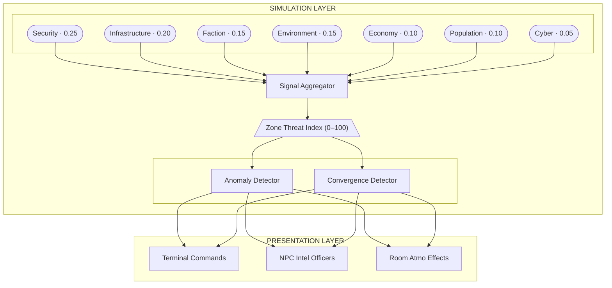
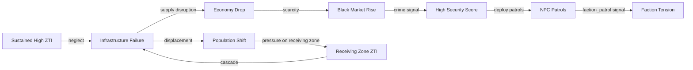

# World State Intelligence System (WSIS) Specification

**WSIS is the colony's capacity to notice itself.** The game records what
happens to the colony as signals on a bus (`world/wsis.py`, called P0 in the code). The design
above the bus turns those signals into claims about places, and carries the
claims to people through mouths that already exist in the colony. Tracking
issue: #303.

Intelligence is a sourced, fallible, tradeable commodity, not an objective
readout (the vision, rewritten 2026-08-24 on the owner's call).

## The thesis

The framing comes from the bus's own docstring:

> *Collapse is legitimate content. The colony is not propped up, and
> players and NPCs are meant to decide what state it ends up in. That
> only works if its state is LEGIBLE. The medical collapse of
> 2026-08-20 ran for hours in plain sight — both doctors soulless,
> casualties bleeding out — and nothing anywhere said so.*

A world allowed to fail needs a way to say that it is failing. Otherwise
failure is indistinguishable from nothing happening, and the consequence
lands on nobody.

### What this is NOT

**Not a dashboard.** An earlier draft of this spec was built around a
real-time intelligence dashboard: seven signal layers, toggleable views, a
terminal showing `Sector 7 · 78 ▲`. That design is withdrawn, for two
reasons.

First, **nothing else in this colony works that way.** Information here has
a mouth. It comes through the radio, through dispatch, through Sable,
through the Rook, through a board somebody keeps. A screen that objectively
reports the truth to anyone who walks up would be the only thing in the game
speaking with the voice of God.

Second, **the layers were inherited rather than derived.** They came from an
external tool's categories, not from this colony's systems. That is why the
bus declares seven layers and only four of them have a signal wired to them.
`environment`, `faction` and `cyber` are empty boxes waiting for games that
do not exist yet.

**WSIS never blocks on a system that hasn't been built.** It consumes what
is real and grows layers as the world grows them. The earlier draft said
WSIS "depends on faction / infrastructure / economy systems that are
themselves unbuilt"; the bus disproved that by emitting from souls, posts
and deaths, systems that exist.

---

## The three movements

Three, in dependency order.

### 1. Legibility — the colony records what happens to it

Signals are emitted nearly free, decay on a per-layer half-life so the
picture is always "lately" and never "ever", and are **never read back into
behaviour**. WSIS observes. An observer needs no balance, because it reports
whatever the numbers currently are.

The only reader in the game is for staff. Bare `@soul` (Builder only,
`_colony_dashboard` in `commands/CmdSoul.py`) shows deaths in the last hour
from the bus, the three loudest zones, and decayed pressure per layer. Its
other health alarms (untreated casualties, posts held by nobody home, dry
shelves, machines wanting service) are read from souls and posts directly,
not from the bus. No player can read the bus.

### 2. Interpretation — turning signal into a claim

Zones, temporal baselines, anomaly detection, convergence (the engine
sections below). The engine design is still good. This is the part that decides that the Snailery being loud
for six hours is *a fact about the colony* rather than forty rows in a ring
buffer.

### 3. Circulation — how a claim reaches a person

The departure from the dashboard design, and the cheap part, because
**every surface already exists.** The radio DJ on
88.8 already cuts an unprompted segment about every half hour. Dispatch
reads a board. Bartenders have opinions. A decker will eventually read
files.

---

## Provenance: the rule that makes this the colony's system

**The same discipline as BOLO provenance** (#2247), which the owner already
ruled on: the system knows the truth, the player gets a possibly-false
narrator, and *how you learned something is part of what you know.*

One fact — *the Snailery is the loudest zone in the colony* — should arrive
very differently depending on the door it came through:

| source | fidelity | cost |
|---|---|---|
| Constabulary terminal | measured, precise, current | requires access |
| The Rook, 88.8 | true-ish, editorialised, hours late | free; everyone hears it |
| A bartender | one incident, extrapolated wildly | a drink |
| A decker's stolen dump | raw signal, no interpretation | a run |
| An NPC who was there | narrow, vivid, and possibly lying | a favour |

**Nobody gets the objective number for free.** That single rule turns a
readout into content: intelligence becomes something you buy, trade, steal,
or are lied to about, which is exactly the favour / reputation / gig economy
that the growth direction names as the spine.

It also lands the net layer naturally. "Everything is a file" and "the
colony's own state is a file" are the same sentence — WSIS is what a decker
reads, and interpretation is what they steal.

---

## The signal bus (`world/wsis.py`)

The bus is a flat module. Its functions are `emit`, `recent`, `pressure`,
`by_layer`, `hot_zones`, `counts`, `flush` and `zone_of`; its constants are
`LAYERS`, `SIGNALS`, `RING`, `CHECKPOINT_EVERY` and `SIGNATURE_SHARE`.

- **`emit(kind, where=None, weight=None, note="", layer=None)`** records a
  signal. It never raises. A kind not in `SIGNALS` records at weight 0.35 in
  the population layer.
- **Where a signal lands: `zone_of(where)`.** The bus keys on the room's
  name, cut at the first " - ", so every unit of a building counts as the
  building. A signal with no place counts as "the colony". That is why it
  reports "Escallier Snailery" rather than a corridor (see Zones).
- **The ring** is capped at `RING = 400`, with a per-signature share
  (`SIGNATURE_SHARE`, #2671).
- **Saving.** Signals of weight 0.7 or more are saved at once, the rest
  every 25th emit (`CHECKPOINT_EVERY`). `flush()` saves the rest when the
  server stops, reloads or resets (`at_server_stop` in
  `server/conf/at_server_startstop.py`, #3227).
- **Where it is kept.** The ring is stored in `ServerConfig` under the key
  `wsis_ring` (`_STORE_KEY`), not on a Script. **Do not put the signal
  history on a global Script.** Evennia recreates a settings-managed script
  when its settings entry changes, so an interval tweak would silently take
  the colony's entire signal history with it (#2672). The same hazard
  applies to `ZoneRegistryScript.db.zones` and
  `AnomalyBaselineScript.db.baselines` in the storage design below.
- The ring lives in each server process, so an external `evennia shell`
  sees only what has been saved.

---

## Signal layers — what is real, and what is aspirational

The bus declares seven layers. **Four carry signals.** The rest are kept
only as named intentions, and each states what would have to exist first. A
layer earns its place by having a system that emits to it — never by
analogy to somebody else's categories.

The "declared kinds" column mirrors `wsis.SIGNALS`, the bus's vocabulary. A
declared kind is not necessarily emitted; see the emitter list below.

| layer | state | declared kinds |
|---|---|---|
| **security** | live | death, killing, assault, robbery, casualty, casualty_untreated |
| **population** | live | arrival, resleeve, went_hungry, homeless, undressed |
| **infrastructure** | live | post_vacant, post_unsouled, machine_defect, travel_stalled, plan_faulted |
| **economy** | live (thin) | sale, wage_paid, till_empty, supply_dry |
| **faction** | aspirational | needs the NPC-only faction layer |
| **cyber** | aspirational | needs the net layer |
| **environment** | aspirational | needs weather/hazard systems to emit; the terraform failure and the Boot breach are the obvious first sources |

**Kinds with an emitter** (seven of the twenty; each live layer has at
least one):

| kind | emitted from |
|---|---|
| `death` | `DeathProgressionScript._handle_corpse_creation_and_transition` (`typeclasses/death_progression.py`) |
| `robbery`, `travel_stalled`, `plan_faulted` | `_signal` in `world/souls/jobs.py`, called from `fault` and `step_job` |
| `went_hungry` | `plan_for` in `world/souls/actions.py` |
| `post_vacant` | `sweep` in `world/souls/posts.py` |
| `till_empty` | `hand_over` in `world/director/courier.py` |

`killing`, `assault`, `casualty`, `casualty_untreated`, `arrival`,
`resleeve`, `homeless`, `undressed`, `sale`, `wage_paid`, `supply_dry`,
`post_unsouled` and `machine_defect` are declared and not emitted. Note in
particular that `casualty_untreated` — the founding incident of this
document — is one of them.

What the live four describe: **a colony that starves, loses its staff, and
bleeds.** That is not a small picture. With the current emitters the medical
collapse would reach the bus only as deaths. The signals that would name it
(`casualty_untreated`, `post_unsouled`) are declared and not emitted,
📋 UNBUILT (#303). Bare `@soul` shows untreated casualties and unsouled
posts, but reads them from souls and posts directly, not from the bus.

---

## Held for WSIS: ground truth the world already computes (#2260)

**Not a gap. A metric waiting for its reader** (owner ruling 2026-08-25).

`world.director.security.is_the_right_person(event, candidate)` (from
#2247) compares a person a unit has detained against `event.source` — the
truth the system quietly keeps while the robot acts on a claim that may be
wrong. Vague reports getting the wrong person grabbed is deliberate: #2246
made the description fallible on purpose.

**Nothing calls it, and nothing should yet.** The value of that function is
not a punishment hook; it is that the colony can COUNT how often its
security force is wrong. That is a WSIS reading, not a gameplay rule:

* **wrongful detention rate** — per corridor, per unit, per shift. A
  security layer that only counts incidents describes a busy district; one
  that counts wrong arrests describes a *badly policed* one, and those are
  different facts about a place.
* **report quality per caller** — a false-report strike record. Calls are
  already closed `unfounded` and said so on the air (#2256), and each call
  keeps the caller's VOICE UID, which a modulator already defeats — the
  counter-tradecraft is built in. 📋 UNBUILT (no issue): the per-caller
  count; only the last 50 calls are kept.

Both fit the provenance model without modification. "The constabulary
detains the wrong person on Volta about a third of the time" is exactly the
sort of claim that should be **expensive and sourced**: a precinct terminal
knows it precisely, the Rook says it with a sneer and no number, and a
decker takes the raw log.

**Do not wire it to consequences first.** A strike record that docks
reputation before anybody can SEE the count is a rule the colony enforces in
secret. Legibility comes before consequence — which is the thesis of this
whole document.

---

## The engine above the bus — 📋 UNBUILT (#303)

Everything from here through "Constants" is unbuilt design: zones, ZTI,
escalation tiers, anomaly and convergence detection, terminals, the news
network, room atmosphere, intelligence officers, the feedback loops and the
scripts. It is a target shape for the unbuilt layers, not a description of
the bus. Where it names a `world/intel/` package, a `SignalBus` class, a
singleton or `world/intel/constants.py`, none of those exist; the
`SignalBus.emit(signal_type, zone_id, severity, metadata)` signature and the
`SIGNAL_COMBAT_START` vocabulary below share nothing with the live bus's
`emit` and `SIGNALS`.

### Scale

Starting scope: a single offworld colony on a planetary body. The zone
abstraction is scale-agnostic -- zones can represent rooms, districts,
stations, or entire planetary regions. As the game expands to a full solar
system, the same system scales by adding zone hierarchies (zone -> sector ->
region -> body).

### Architecture



### Module structure

The design follows the crowd/weather pattern: a package `world/intel/` whose
`__init__.py` exposes a global `intel_system` singleton, with:

- `zone_system.py` — zone registry, ZTI computation
- `signal_bus.py` — event aggregation, signal fusion
- `anomaly.py` — Welford's algorithm, baseline tracking
- `convergence.py` — multi-signal convergence detection
- `layers/` — one module per layer: `security.py` (combat events, crime,
  faction hostility), `infrastructure.py` (power, life support, comms,
  docking), `economy.py` (trade, resource flow, market state), `faction.py`
  (faction tensions, territorial control), `environment.py` (atmo quality,
  radiation, weather severity), `population.py` (crowd displacement,
  casualties, migration), `cyber.py` (network intrusions, system breaches)
- `reports/` — `brief_generator.py` (zone/colony-level intelligence briefs),
  `report_messages.py` (message pools for terminal readouts)
- `constants.py` — all WSIS constants

---

## Zone System

### Corridors, not districts — corrected 2026-08-24

**The aggregation unit is the corridor** — the street work travels along —
with **Northside / Southside** as the coarse gradient above it. Not invented
districts. BUILDING_PLAYBOOK §1.5, a section marked owner-set which builds
"do not argue with", already says so:

> **The plan: corridors, not zones.** The city organizes the way
> cities organically form — along the routes work travels.
> **Industrial corridors**: the freight run from the Landing Pad
> toward the Processor's skirt; power down Volta; fab-labor along
> Riveter's Way. **Cultural corridors**: each quarter's life
> concentrates on a main street.

The playbook already names them: Maxwell, Pessoa, the Spillane, Riveter's
Way, Volta.

An earlier draft of this section said "named districts, hand-authored";
that was corrected to corridors on 2026-08-24, citing §1.5. #303's "Next
brick: zones" still records "named districts, hand-authored (owner ruling)",
so this spec and its tracking issue disagree on the unit.

**This is better for circulation, not just more consistent.** A street is
more sayable than a district, and it is how people actually give directions.
"Stay off Volta tonight" and "Pessoa's gone quiet since the shrine went up"
are things the Rook can say on air and a bartender can repeat. "Sector 7 is
at 78" is not.

It also matches how convergence already works in this city: the playbook
engineers venues to cluster on a spine, so a loud corridor is a real thing
that a loud rectangle is not.

### It is cheaper than expected

Measured against the live world, 2026-08-24: **1070 rooms, of which 424
already carry a corridor name in the room key** — Brackett 242, Kaspar 31,
Marlowe 29, Maxwell 29, Pessoa 25, Hammett 25, Bhavani 17, Volta 17, the
Spillane 17, Riveter's 5.

The remaining 646 are interiors, which inherit from the building they sit in
rather than needing their own authoring. So the zone map is mostly derivable
from names that already exist, with hand-authoring reserved for the cases
that need judgement.

The change: aggregate at the corridor and keep the room as the note (today
the bus keys on the room name; see `zone_of`).

### Analysis only — not being built

Not being built (owner, 2026-08-24). WSIS is a large undertaking and
**rounding out NPC management stays the priority**. This section is recorded
so the next person starts from the corrected unit rather than re-deriving
districts.

### Zone fields on rooms

Two new `AttributeProperty` fields on the Room typeclass, category
`"intel"`:

```python
zone = AttributeProperty("unzoned", category="intel")
zone_type = AttributeProperty("residential", category="intel")
# Types: residential, commercial, industrial, military,
#        infrastructure, docking, medical, administrative
```

### Zone Registry

A persistent global Script that maintains the zone map and computes the Zone
Threat Index per zone on each tick. Its data shape:

```python
# db.zones = {
#   "sector_7": {
#       "name": "Sector 7 - Habitation",
#       "type": "residential",
#       "rooms": [dbref_list],
#       "zti_score": 42,          # 0-100 composite
#       "layer_scores": {
#           "security": 65,
#           "infrastructure": 30,
#           "economy": 25,
#           "faction": 50,
#           "environment": 40,
#           "population": 35,
#           "cyber": 20,
#       },
#       "trend": "rising",        # rising/stable/falling
#       "convergence_level": 0,   # 0-3 (none/low/medium/high)
#   }
# }
```

### ZTI Computation

A composite index is a weighted blend across layers rather than a sum, so
one loud layer cannot masquerade as a failing district:

| Layer | Weight | Signals |
|---|---|---|
| Security | 0.25 | Combat events, murders, armed NPCs, faction hostility in zone |
| Infrastructure | 0.20 | Power grid %, life support %, comms uptime, structural damage |
| Faction | 0.15 | Faction tension scores, territorial disputes, contested zones |
| Environment | 0.15 | Atmospheric quality, radiation, weather severity, hazards |
| Economy | 0.10 | Trade volume, resource scarcity, black market activity |
| Population | 0.10 | Crowd displacement, casualties, migration pressure |
| Cyber | 0.05 | Network breaches, system intrusions, data theft |

```
ZTI = sum(layer_score * weight) * convergence_multiplier
```

Where `convergence_multiplier` increases when multiple layers spike
simultaneously (1.0 normal, up to 1.5 for 4+ layers elevated). The result is
a ZTI score of 0–100.

### Escalation Tiers

| ZTI Range | Status | Effects |
|---|---|---|
| 0-20 | STABLE | Normal operations |
| 21-40 | ELEVATED | Minor atmospheric changes, increased NPC patrols |
| 41-60 | UNSTABLE | Visible security presence, crowd nervousness |
| 61-80 | CRITICAL | Lockdowns, infrastructure strain, NPC displacement |
| 81-100 | EMERGENCY | Full crisis -- martial law, system failures cascade |

---

## Signal Layers (design)

### Security Layer

**Signals consumed:**
- 📋 UNBUILT (#303): combat events from `CombatHandler` (`start()` when a
  fight begins, `stop_combat_logic()` when it ends). No combat signal is
  emitted.
- Deaths/corpse creation (from `DeathProgressionScript`)
- Weapon discharges (gunfire heard in adjacent rooms)
- NPC faction patrol encounters
- Arrests/detentions

**Score computation:** Rolling window (e.g., last 6 game-hours) of weighted
security events normalized by zone room count.

### Infrastructure Layer

Colony infrastructure systems, each independently trackable:

| System | | Game Mechanic |
|---|---|---|
| Power Grid | Undersea cables / pipelines | % capacity per zone, sector blackouts |
| Life Support | Climate anomaly panel | Atmospheric quality, O2 levels, scrubber status |
| Communications | Internet outages | Comms relay status, jamming, signal degradation |
| Docking | Strategic ports | Landing pad availability, traffic volume |
| Water/Recycling | Infrastructure health | Contamination levels, rationing triggers |
| Transit System | Trade routes | Rail/tram operational status, corridor throughput |

Each system has: `capacity` (0-100%), `status`
(operational/degraded/offline/critical), `last_incident` timestamp, `trend`
(improving/stable/degrading).

### Economy Layer

- **Token economy:** Track velocity (tokens traded per period),
  inflation/deflation signals
- **Shop inventory levels:** Scarcity indices for weapon/medical/general
  goods per zone
- **Black market activity:** Illicit trades, contraband detection events
- **Resource extraction:** Mining/salvage output per zone
- **Supply routes:** Convoy status between zones, and the chokepoints they
  must pass

### Faction Layer

- **Faction tension matrix:** Pairwise tension scores between factions
  (0-100)
- **Territorial control:** Which faction controls which zones, contested
  zones flagged
- **Force disposition:** Faction NPC patrol strength per zone
- **Diplomatic state:** Allied/neutral/hostile per faction pair
- **Player faction actions:** Player kills, trade, espionage contribute to
  faction scores

### Environment Layer

- **Weather severity:** Already tracked by `weather_system` -- integrate its
  intensity level directly
- **Atmospheric hazards:** Radiation zones, toxic leaks, pressure breaches
- **Seismic events:** Tremors, structural instability (planetary body
  geology)
- **Fire/thermal:** Fires in sectors, heat exchanger failures
- **External threats:** Meteor impacts, solar flare effects (long-term
  escalation arc for solar system expansion)

### Population Layer

- **Crowd system integration:** Already exists (`world/crowd/`) -- crowd
  levels per room aggregated to zone level
- **Displacement events:** NPCs fleeing high-ZTI zones (crowd_base_level
  shifts dynamically)
- **Casualty tracking:** Deaths per zone per period
- **Medical load:** Injured characters per zone, medical facility saturation
- **Migration pressure:** Population flow between zones, read from both ends
  — who is leaving and who is arriving

### Cyber/Network Layer

- **System intrusions:** Hacking events against colony infrastructure
- **Data breaches:** Intelligence leaks, faction secrets exposed
- **Comms interception:** Eavesdropping events
- **AI/automation disruptions:** Rogue automation, drone hijacking
- **Network integrity:** Colony mesh network health, node failures

---

## Signal Bus and Event Aggregation (design)

### Design

An event-driven bus where game systems emit signals, and the aggregator
routes them to the appropriate layer and zone. The design's call is
`SignalBus.emit(signal_type, zone_id, severity, metadata=None)`:
`signal_type` names the event ("combat_start", "death", "power_failure",
"faction_patrol", "trade_completed", etc.), `zone_id` is the zone it
affects, `severity` is 0.0-1.0, and `metadata` is a dict of additional
context.

### Signal Sources

Hooks into existing Gelatinous systems with minimal changes -- add
`signal_bus.emit()` calls at natural hook points:

| Existing System | Hook Point | Signal Emitted | Layer |
|---|---|---|---|
| `CombatHandler` (`world/combat/handler.py`) | `start()` | `combat_start` | security |
| `CombatHandler` | `stop_combat_logic()` | `combat_end` | security |
| `Character` (`typeclasses/characters.py`) | `at_death()` | `death` | security |
| `DeathProgressionScript` (`typeclasses/death_progression.py`) | corpse creation | `corpse_created` | security |
| `CmdThrow` (`commands/CmdThrow.py`) | grenade explosion | `explosion` | security |
| `crowd_system` | crowd level recalculation | `crowd_shift` | population |
| `weather_system` (`world/weather/weather_system.py`) | `set_weather()` | `weather_change` | environment |
| `CmdBuy` (`commands/shop.py`) | successful purchase | `trade` | economy |
| New: infrastructure system | damage/repair events | `infra_damage`, `infra_repair` | infrastructure |
| New: faction patrol scripts | patrol movement | `faction_patrol` | faction |
| New: hacking commands | intrusion attempts | `cyber_intrusion` | cyber |

`CombatHandler` has no `start_combat()`; its entry points are
`get_or_create_combat(location)` and `CombatHandler.start()`. The live bus
already emits `death`, from `DeathProgressionScript` rather than from
`Character.at_death()`.

**Integration example.** In `CombatHandler`, when a fight starts: take the
zone from the first of the handler's `db.managed_rooms` (`room.db.zone`),
and if there is one, emit `combat_start` for that zone at severity 0.5 with
metadata `{"combatants": len(self.db.combatants)}`.

---

## Update Model

Hybrid: event-driven ingestion (emitting is nearly free) plus periodic
recomputation (scoring is not).

- **Event-driven:** Signals update layer scores immediately when emitted. A
  combat starting in Sector 7 immediately nudges that zone's security score.
- **Periodic tick:** A `ZoneTickScript` (Evennia Script, `interval=300` / 5
  minutes) runs, in order:
  1. Decay old signals (sliding window -- events age out over configurable
     periods)
  2. Recompute ZTI composite scores per zone
  3. Run anomaly detection against baselines
  4. Run convergence detection across layers
  5. Update trends (rising/stable/falling based on score delta)
  6. Trigger NPC reactions to ZTI changes (patrol reinforcements, civilian
     flight, lockdowns)
  7. Generate news items for significant state changes

Layer score updates feed the tick, and generated news feeds back into the
event-driven path.

---

## Anomaly Detection

An `AnomalyDetector` tracks rolling baselines per (zone, signal_type) pair,
using Welford's online algorithm for streaming mean and variance, and flags
deviations that exceed z-score thresholds:

| level | z-score | meaning |
|---|---|---|
| elevated | 1.5 | Unusual activity |
| high | 2.0 | Significant deviation |
| critical | 3.0 | Extreme anomaly |

A baseline entry, keyed by (zone, signal_type):

```python
# db.baselines = {
#   ("sector_7", "combat_start"): {
#       "count": 450,      # total observations
#       "mean": 2.3,       # events per tick window
#       "m2": 156.7,       # Welford's M2 accumulator
#       "variance": 0.35,  # computed from m2/count
#   }
# }
```

When an anomaly is detected, it generates an **intelligence finding** -- a
structured alert with context:

```python
{
    "zone": "sector_7",
    "signal_type": "combat_start",
    "observed": 8,
    "baseline_mean": 2.3,
    "z_score": 3.2,
    "severity": "critical",
    "message": "Combat frequency 3.2 sigma above baseline for Sector 7"
}
```

### Welford's Algorithm

Chosen because it computes running mean and variance in a single pass with
O(1) memory per tracked pair. No need to store historical event lists. Each
observation of a pair's count increments `count`, moves `mean` by the delta
over `count`, adds the product of the deltas before and after to `m2`, and,
once `count` is above 1, sets `variance = m2 / (count - 1)`.

---

## Convergence Detection

If 3+ layers are simultaneously elevated (z-score > 1.5) in the same zone,
that zone is flagged as a **convergence zone**. The convergence level (0-3)
multiplies the ZTI score.

| Elevated Layers | Convergence Level | ZTI Multiplier | Meaning |
|---|---|---|---|
| 0-2 | 0 (none) | 1.0x | Isolated incidents |
| 3 | 1 (low) | 1.15x | Correlated activity |
| 4 | 2 (medium) | 1.3x | Coordinated threat likely |
| 5+ | 3 (high) | 1.5x | Multi-domain crisis |

**Example:** Sector 7 has elevated security (gang violence) + degraded
infrastructure (power outage) + faction tension spike = convergence level 1.
If economy also drops (shops looted) = convergence level 2. This likely
means a coordinated faction move is underway.

---

## Player-Facing Intelligence Interface

**The terminal is ONE DOOR, not the door.** The terminal design below is
still good and still wanted — it is the source that tells the truth plainly,
gated by access rather than by fidelity. But it is one row in the provenance
table above, not the product. The Rook, a bartender, a rumour and a stolen
file are the others, and most players should meet the colony's state
through one of those long before they ever stand in front of a screen.

### Intelligence Terminals

Interactable objects placed in key rooms (command centers, security offices,
public information kiosks). Different terminal types may have different
access levels.

```
> use terminal

+==========================================+
|  COLONY INTELLIGENCE TERMINAL v2.1       |
|  Classification: UNRESTRICTED            |
+==========================================+
|                                          |
|  ZONE THREAT INDEX -- Colony Overview    |
|                                          |
|  Sector 7 (Hab)    ||||||||..  78  ^     |
|  Sector 3 (Ind)    ||||||....  55  -     |
|  Sector 1 (Admin)  |||.......  28  v     |
|  Docking Ring       ||||......  42  ^     |
|  Medical Wing       ||........  15  -     |
|                                          |
|  [1] Zone Detail   [2] Alerts            |
|  [3] Factions      [4] Infrastructure    |
|  [5] Economy       [6] Intel Brief       |
+==========================================+
```

Commands: `terminal status`, `terminal zone <name>`, `terminal alerts`,
`terminal factions`, `terminal brief <zone>`.

### Zone Brief

```
> terminal brief sector_7

+==========================================+
|  ZONE BRIEF: SECTOR 7 -- HABITATION      |
+==========================================+
|                                          |
|  THREAT INDEX: 78/100 [CRITICAL] ^       |
|                                          |
|  Security    ||||||||..  82              |
|  Infra       ||||......  38              |
|  Faction     ||||||||..  75              |
|  Environment |||.......  32              |
|  Economy     ||||||....  55              |
|  Population  |||||||...  68              |
|  Cyber       |.........  12              |
|                                          |
|  ACTIVE SIGNALS:                         |
|  * 3 combat events (last 6h)            |
|  * 1 death (2h ago)                     |
|  * Power grid at 62%                    |
|  * Crowd displacement detected          |
|                                          |
|  CONVERGENCE: HIGH (3 layers elevated)   |
|                                          |
|  INTEL BRIEF:                            |
|  Sector 7 instability driven by ongoing  |
|  faction conflict between [Syndicate]    |
|  and [Colony Security]. Infrastructure   |
|  degradation correlates with increased   |
|  security events. Population displace-   |
|  ment toward Sector 1 observed.          |
|                                          |
|  TREND: Rising over last 24h            |
|  ANOMALIES: Combat frequency 2.8s above |
|  baseline for this zone                 |
+==========================================+
```

### Colony News Network (CNN)

An in-game news/rumor system where game events generate news items:

- Combat events produce headlines: "Shootout in Sector 7 leaves one dead"
- Infrastructure failures: "Power grid fluctuations reported in Habitation
  sector"
- Faction movements: "Syndicate patrol strength increased near Docking Ring"
- Entity extraction links news to factions, locations, characters
- Players can subscribe to keyword monitors at terminals
- News items have severity levels, age out over time
- Accessible via terminals, public bulletin boards, or NPC chatter

### Room Atmospheric Integration

Following the crowd/weather pattern, where `get_*_contributions(room,
looker)` returns formatted text layered into `return_appearance()`:
`intel_system.get_intel_contributions(room, looker)` would be called from the
room's `return_appearance()` in `typeclasses/rooms.py`, alongside
`crowd_system.get_crowd_contributions` and
`weather_system.get_weather_contributions`. It returns nothing for a room
with no zone or a zone under ZTI 40. Otherwise it selects an atmospheric
message by ZTI tier and dominant layer, for example:

- High security: "Patrol drones sweep overhead in tight formations."
- High infrastructure: "Lights flicker intermittently overhead."
- High faction: "Tension hangs in the air between armed groups."

Message pools follow the same sensory category pattern as crowd/weather
(visual, auditory, atmospheric), with pools organized by dominant threat
layer and ZTI tier.

### NPC Intelligence Officers

NPCs stationed at command posts who deliver zone briefs verbally with
personality. Use existing NPC/conversation patterns. They provide the same
data as terminals but filtered through character voice -- a grizzled
security chief vs a nervous analyst vs a faction informant each present the
same ZTI data differently.

---

## Simulation Dynamics

### Feedback Loops

WSIS observes; the world is what reacts. These are the loops the colony
should close on itself once something is allowed to read the bus and act
(the standing constraint: the bus never pushes):



| Trigger | Effect | |
|---|---|---|
| High security score | NPC faction patrols increase in zone | Military deployment to conflict zones |
| Infrastructure failure | Crowd displacement, economy drops | Climate displacement, infrastructure cascade |
| Faction territory gain | Rival faction escalation response | ACLED conflict escalation tracking |
| Economy collapse in zone | Black market activity rises | Sanctions regime effects |
| Multiple convergence zones | Colony-wide emergency state declared | Strategic posture assessment (composite risk) |
| High population displacement | Receiving zones get population pressure | HAPI humanitarian flows (dual-perspective) |
| Sustained high ZTI | Infrastructure degrades faster (neglect) | Compounding instability in monitored nations |

### NPC Faction Responses

Factions react to ZTI changes in their controlled/contested zones:

- **Security forces:** Deploy more patrols to high-ZTI zones, establish
  checkpoints at CRITICAL+
- **Criminal factions:** Exploit infrastructure failures and power vacuums,
  increase activity in degraded zones
- **Civilian NPCs:** Flee high-ZTI zones -- crowd_base_level decreases in
  source zone, increases in destination
- **Administration:** Issue zone lockdowns and curfews at EMERGENCY tier,
  restrict transit
- **Medical services:** Shift resources toward high-casualty zones

### Player Impact

Player actions contribute to zone state through the signal bus:

- **Combat/kills** raise security score
- **Faction-aligned actions** shift faction tension matrix
- **Trade** affects economy layer
- **Sabotage/hacking** affects infrastructure and cyber layers
- **Healing/stabilization** reduces population layer pressure

Players can meaningfully influence which zones are stable and which spiral
-- but the simulation has enough NPC-driven inertia that the world doesn't
feel static when players are offline.

---

## Evennia Implementation Patterns

### Scripts

| Script | Type | Interval | Purpose |
|---|---|---|---|
| `ZoneRegistryScript` | Global, persistent | None | Stores zone data, no tick needed |
| `ZoneTickScript` | Global, persistent | 300s | Recomputes ZTI, anomaly detection, NPC reactions |
| `SignalBusScript` | Global, persistent | None | Event-driven only, no tick |
| `AnomalyBaselineScript` | Global, persistent | 3600s | Periodic baseline recalculation |

### Data Storage

Following Evennia conventions (use `db` for persistent, `ndb` for
temporary):

- **Zone data:** `ZoneRegistryScript.db.zones` (persistent dict)
- **Signal history:** not on a Script. The live ring is in `ServerConfig`
  (see "The signal bus"); do not put it on a global Script. The same hazard
  applies to `ZoneRegistryScript.db.zones` and
  `AnomalyBaselineScript.db.baselines`.
- **Anomaly baselines:** `AnomalyBaselineScript.db.baselines` (persistent
  dict, keyed by (zone, signal_type) tuples)
- **Per-room zone assignment:** `room.db.zone` (AttributeProperty,
  category="intel")
- **Active alerts:** `ZoneRegistryScript.db.active_alerts` (list of finding
  dicts)
- **News items:** `SignalBusScript.db.news` (rolling list with timestamps,
  severity, zone, text)

### Constants

📋 UNBUILT (#303). `world/director/intel.py` is the security force's wanted
record, not WSIS. The live bus constants (`LAYERS`, `SIGNALS`, `RING`,
`CHECKPOINT_EVERY`, `SIGNATURE_SHARE`) are in `world/wsis.py`.

All WSIS constants centralized in `world/intel/constants.py`, following the
pattern in `world/combat/constants.py`. It holds the values set out above:

- the ZTI layer weights (ZTI Computation) and the escalation tier ranges
  (Escalation Tiers);
- the anomaly z-score thresholds `ANOMALY_ELEVATED = 1.5`,
  `ANOMALY_HIGH = 2.0`, `ANOMALY_CRITICAL = 3.0`;
- convergence: `CONVERGENCE_THRESHOLD = 1.5` (the z-score for a layer to
  count as "elevated"), `CONVERGENCE_LEVEL_THRESHOLDS = {0: 2, 1: 3, 2: 4,
  3: 5}`, `CONVERGENCE_MULTIPLIERS = {0: 1.0, 1: 1.15, 2: 1.3, 3: 1.5}`;
- tick intervals: `ZONE_TICK_INTERVAL = 300` (5 minutes),
  `BASELINE_TICK_INTERVAL = 3600` (1 hour);
- the signal types (`SIGNAL_COMBAT_START = "combat_start"` and so on, one
  per signal in the Signal Sources table) and `SIGNAL_LAYER_MAP`, routing
  each to the layer given in that table;
- debug prefixes `DEBUG_PREFIX_INTEL = "INTEL"`, `DEBUG_PREFIX_ZONE =
  "ZONE"`, `DEBUG_PREFIX_SIGNAL = "SIGNAL"`, `DEBUG_PREFIX_ANOMALY =
  "ANOMALY"`.

---

## Order of work

**Build the part that observes, then the part that interprets, then the
part that speaks.** Observation is always the cheapest thing to build and
the safest thing to be wrong about: the bus needed no zones, no faction
system, no tuning.

| | scope | when |
|---|---|---|
| **Zones** | corridors on rooms, with Northside/Southside above them; the bus keys on them instead of room names | next — but not being built (owner, 2026-08-24); NPC management stays the priority |
| **Interpretation** | baselines per (zone, layer), anomaly z-scores, convergence | after zones |
| **Circulation — the Rook** | she already cuts an unprompted segment about every half hour and already has opinions (blueprint `dj_rook` in `world/npcs/blueprints.py` sets `ambient_broadcaster` and `broadcast_interval` 1800; `maintain_broadcasts` in `world/director/broadcasts.py` runs from the director heartbeat in `world/director/routines.py`). The cheapest mouth in the colony | after interpretation |
| **Circulation — a terminal** | one door among several, gated by access, and the only source that tells the truth plainly | any time after zones |
| **Circulation — rumour** | NPCs repeat what they half-know; fidelity degrades with each retelling | after interpretation |
| **Circulation — the net layer** | raw signal, stealable, uninterpreted | with decking |
| **Layers** | faction / cyber / environment | each lands when its emitting system does, never before |

**Nothing here needs a balance pass**, which is the other reason this is the
right thing to work on now: WSIS reports whatever the numbers currently are.
When bleeding, infection, wages and damage are finally tuned, WSIS does not
need retuning — it just starts describing a better-balanced world.

---

## What This Spec Does NOT Cover

These are future phases or separate specs:

- **Player faction management commands** (create faction, recruit, declare
  war)
- **Hacking/cyber gameplay** (actual commands for intrusion/defense)
- **Infrastructure repair gameplay** (engineering skill tree, repair
  commands)
- **Trade/economy commands** (market terminals, commodity buy/sell)
- **Satellite/orbital tracking** (future solar system expansion)
- **Sensor modes** (CRT/NVG/FLIR from WorldView -- could map to terminal
  display modes)
- **ASCII zone maps** (terminal-rendered maps showing zone layout and threat
  coloring)
- **Inter-zone transit system** (tram/rail gameplay)
- **Colony-wide emergency protocols** (martial law gameplay, curfew
  enforcement)

## Not decided

- Is the WSIS zone unit the corridor (as this spec reads `BUILDING_PLAYBOOK` §1.5), or the hand-authored named districts that #303 records as an owner ruling?

---

## Related documents

- `BUILDING_PLAYBOOK` §1.5 — corridors, not zones (owner-set)
- #303 — WSIS tracking issue
- #2247 / #2246 — BOLO provenance and fallible descriptions
- #2260 — ground truth held for WSIS
